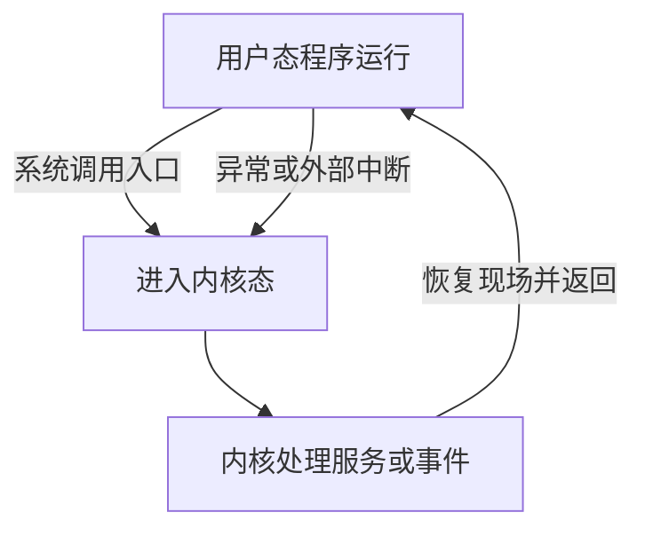

# 视频题：内核态与中断

这一页的题容易混在两个问题上：**事情在哪里发生？处理它的代码在哪里执行？** 例如用户程序执行除零指令时，异常可以在用户态运行期间发生；除零异常的处理则由内核接管。视频中的红笔是讲解标记，并非你的个人答题记录。

[直接开始做题 ↓](#start-questions){ .md-button .md-button--primary }

## 先抓住一道“门”

CPU 有用户态和内核态。用户态能做普通计算、访问自己获准的内存；设置中断屏蔽、直接控制设备、管理进程等受保护操作必须由内核完成。用户程序需要服务时，走系统调用入口；硬件事件或执行异常到来时，也会由处理器按受控机制进入内核处理。

| 题目看到的词 | 发生的来源 | 典型例子 |
| --- | --- | --- |
| 外部中断 | 当前指令执行流程以外的设备／时钟事件 | 时钟到点、设备完成 I/O |
| 内部异常 | 当前指令执行引发的问题或主动陷入 | 除零、缺页、系统调用入口 |
| 特权指令 | 只有内核态可执行的指令 | 关中断、设置中断屏蔽等 |

“中断”在教材里有广义和狭义用法。广义可把异常与陷入也放进中断体系；题目专门问**外部中断**时，就要排除由当前指令引起的异常。

## 1. 用户态进入内核态靠什么 {#start-questions}

!!! question "先做题"
    CPU 的状态分为用户态和内核态，从用户态转换到内核态的唯一途径是（）。  
    A. 修改程序状态字指令  
    B. 中断屏蔽  
    C. 中断  
    D. 中断处理程序

??? success "查看答案与解析"
    **答案：C，中断（广义）。** 用户程序不能直接改 CPU 的特权状态，也不能靠执行“中断处理程序”这个普通函数名实现切换。系统调用的陷入、异常、时钟中断等，都会使处理器按受控机制进入内核态。严格区分时，系统调用是主动陷入，除零／缺页是异常，定时器是外部中断；这道题把它们归在广义中断机制下。

## 2. 哪些指令可在用户态执行

!!! question "先做题"
    下列指令中，可以在用户态执行的是（）。  
    Ⅰ. 置时钟指令  
    Ⅱ. 停机指令  
    Ⅲ. 存数指令  
    Ⅳ. 寄存器清零指令  
    A. Ⅰ、Ⅳ  
    B. Ⅲ、Ⅳ  
    C. Ⅱ、Ⅲ、Ⅳ  
    D. Ⅱ、Ⅲ

??? success "查看答案与解析"
    **答案：B，Ⅲ存数指令、Ⅳ寄存器清零指令。** 普通数据存取和通用寄存器清零是程序日常运算；Ⅰ置时钟、Ⅱ停机牵涉系统控制，属于特权操作。不要看见“寄存器”就一律判为内核态：关键是操作**通用寄存器**，还是改动受保护的控制寄存器。

## 3. 哪些指令必须在内核态执行

!!! question "先做题"
    下列指令中，必须在内核态执行的是（）。  
    Ⅰ. 陷入指令  
    Ⅱ. 系统调用指令  
    Ⅲ. 开中断指令  
    Ⅳ. 转移指令  
    Ⅴ. 中断屏蔽字设置指令  
    A. Ⅰ、Ⅱ、Ⅲ、Ⅳ  
    B. Ⅱ、Ⅲ  
    C. Ⅱ、Ⅲ、Ⅴ  
    D. Ⅰ、Ⅳ

??? success "查看答案与解析"
    **视频给出的答案：C，Ⅱ、Ⅲ、Ⅴ。** Ⅲ开中断、Ⅴ设置中断屏蔽字会改变系统控制状态，属于特权操作；Ⅰ陷入指令需要允许用户程序执行，才能主动请求内核；Ⅳ转移指令是一般程序也要用的普通跳转。Ⅱ的名称需要特别核对，见下方说明。

    !!! warning "‘系统调用指令’的措辞"
        不同教材可能把用户态执行的 **trap/syscall 入口指令**也叫“系统调用指令”。若按这个名字理解，Ⅱ就不该被判为“只能在内核态执行”。视频给出 C，但未展示教材对Ⅱ的定义，本站把它标为**选项措辞待核对**。稳定的机制是：**用户态可以执行受控的陷入入口，真正的系统调用服务在内核态完成**。

## 4. 哪些程序在内核态执行

!!! question "先做题"
    下列程序中，必须在内核态执行的是（）。  
    Ⅰ. 磁盘调度程序  
    Ⅱ. 中断处理程序  
    Ⅲ. 设备驱动程序  
    Ⅳ. 操作系统初始化程序  
    A. Ⅰ、Ⅱ、Ⅲ、Ⅳ  
    B. Ⅰ、Ⅲ  
    C. Ⅰ、Ⅱ、Ⅳ  
    D. Ⅱ、Ⅲ

??? success "查看答案与解析"
    **答案：A，四者都在内核态。** 它们需要管理设备、处理中断或初始化系统。下面的 2011 年统考题反过来考察用户态程序。

## 5. 在用户态执行的程序（2011 年统考）

!!! question "先做题"
    下列选项中，在用户态执行的是（）。  
    A. 命令解释程序  
    B. 缺页处理程序  
    C. 进程调度程序  
    D. 时钟中断处理程序  

    *2011 年计算机联考真题*

??? success "查看答案与解析"
    **答案：A，命令解释程序。** 缺页处理、进程调度、时钟中断处理都属于内核工作。此处依照两道题的教材模型；实际系统可能把部分驱动或服务设计在用户空间，不能把题目的实现假设扩展为所有操作系统。

## 6. 哪个是外部中断

!!! question "先做题"
    下列中断事件中，能引起外部中断的事件是（）。  
    Ⅰ. 时钟中断  
    Ⅱ. 访管中断  
    Ⅲ. 缺页中断  
    A. Ⅰ  
    B. Ⅲ  
    C. Ⅰ和Ⅱ  
    D. Ⅱ和Ⅲ

??? success "查看答案与解析"
    **答案：A，仅Ⅰ时钟中断。** 时钟信号从当前程序指令之外到来；Ⅱ访管／陷入是程序主动请求，Ⅲ缺页是执行访存指令时发现所需页面未就绪，都归内部异常。判断时只问：**触发原因是不是当前指令本身？**

## 7. 哪个事件不可能在用户态发生

!!! question "先做题"
    下列选项中，不可能在用户态发生的事件是（）。  
    A. 系统调用  
    B. 外部中断  
    C. 进程切换  
    D. 缺页  

    *2012 年计算机联考真题*

??? success "查看答案与解析"
    **答案：C，进程切换。**系统调用请求、外部中断和缺页可以在用户程序运行时**触发**；但真正保存／恢复进程上下文、决定运行哪个进程，是内核态的工作。

    **具体画面：** 浏览器在用户态执行一次访存，页面不在内存，CPU 发现缺页并进入内核；内核读盘后可能切换去运行播放器。缺页的**起点**是浏览器的用户态指令，切换进程的**操作**由内核完成。这样就不会把“发生”误读成“处理程序所在的状态”。

## 8. 中断处理要多保存什么

!!! question "先做题"
    中断处理和子程序调用都需要压栈以保护现场，中断处理一定会保存而子程序调用不需要保存其内容的是（）。  
    A. 程序计数器  
    B. 程序状态字寄存器  
    C. 通用数据寄存器  
    D. 通用地址寄存器  

    *2012 年计算机联考真题*

??? success "查看答案与解析"
    **答案：B，程序状态字寄存器 PSW。** 两种流程都要有办法记住返回位置；中断还涉及保存处理器状态，以便之后恢复原来的执行状态。普通子程序调用通常不需要因权限切换而保存完整 PSW。具体保存哪些寄存器由体系结构和调用约定决定，题目抓的是**中断必须保护状态、普通调用不一定**这一区别。

## 9. 哪些操作会让用户进程转入内核态

!!! question "先做题"
    下列选项中，会导致用户进程从用户态切换到内核态的操作是（）。  
    Ⅰ. 整数除以零  
    Ⅱ. `sin()` 函数调用  
    Ⅲ. `read` 系统调用  
    A. 仅Ⅰ、Ⅱ  
    B. 仅Ⅰ、Ⅲ  
    C. 仅Ⅱ、Ⅲ  
    D. Ⅰ、Ⅱ和Ⅲ  

    *2013 年计算机联考真题*

??? success "查看答案与解析"
    **答案：B，仅Ⅰ、Ⅲ。** 除零产生异常；`read` 请求内核读数据；普通数学库函数 `sin()` 可在用户态计算。若某个函数内部主动调用内核，是那个后续系统调用导致切换，不能因为它叫“函数”就一概而论。

## 10. 哪种指令不能在用户态执行

!!! question "先做题"
    下列指令中，不能在用户态执行的是（）。  
    A. trap 指令  
    B. 跳转指令  
    C. 压栈指令  
    D. 关中断指令  

    *2014 年计算机联考真题*

??? success "查看答案与解析"
    **答案：D，关中断指令。**用户程序若能随意关闭中断，系统就难以及时收回 CPU 或响应设备。`trap` 是用户态申请服务的受控入口；普通跳转、压栈也是程序运行的基本动作。

## 三分钟口头复做

1. 为什么“缺页在用户态发生”和“缺页处理程序在内核态执行”可以同时成立？
2. `sin()`、`read()`、整数除零，哪几个会让 CPU 进入内核态？分别是主动请求还是异常？
3. 时钟中断、陷入、缺页中，哪个是外部中断？
4. 如果一个选项写“用户态能执行关中断”，用一句话说出它错在哪里。

**资料说明：** 根据你提供的王道考研视频资料整理；2011—2014 年真题年份依据原资料标注。机制对照：[OSTEP《Limited Direct Execution》](https://pages.cs.wisc.edu/~remzi/OSTEP/cpu-mechanisms.pdf)、[UW CS 537 内核入口讲义](https://pages.cs.wisc.edu/~bart/537/lecturenotes/enterexit.html)。

[返回本章题目索引](王道习题与错题.md) · [回看系统调用与接口](视频题-系统调用与接口.md)
