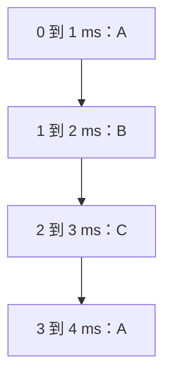

# 视频题：分时与响应时间

分时系统把 CPU 使用时间切成小段，让就绪任务轮流运行。本页用两组题，讲明白**时间片、用户数、响应时间**之间的关系，并把一题有争议的选择题单独标出来。

[直接开始做题 ↓](#start-questions){ .md-button .md-button--primary }

## 响应时间究竟从哪儿算

在这些视频题里，响应时间指“用户提出请求，到系统**首次给出响应**”之间的时间。它关注的是用户有没有及时感觉到系统理他了；一个任务全部做完所需的时间是另一项指标。不同教材或调度算法章节可能把“响应”定义为“首次得到 CPU”，做题时要先看题目口径。

设 A、B、C 都已就绪，按 A→B→C 轮转，忽略切换开销：

如果 B 在 A 开始运行时提交请求，简单模型中要等大约一个时间片才轮到它；C 要等约两个。实际系统还要考虑任务到达时间、阻塞、优先级和上下文切换开销，不能拿图里的数字直接套真实机器。

## 1. 固定时间片时，用户数怎样影响响应 {#start-questions}

!!! question "先做题"
    在分时系统中，时间片一定时，（）响应时间越长。  
    A. 内存越多  
    B. 内存越少  
    C. 用户数越多  
    D. 用户数越少

??? success "查看答案与解析"
    **答案：C，用户数越多，响应时间通常越长。** 在人人都有活干、每人轮流得到一个时间片的简化模型里，3 个用户一圈大约要 `3 × q`，4 个用户一圈大约要 `4 × q`，其中 `q` 是时间片长度。排在队尾的人要等更久。题干说“时间片一定”，所以内存多少并不是直接决定这一轮等待时间的选项。

    !!! tip "考试模型与真实系统"
        上面的关系默认用户任务都处于就绪态，且使用近似的轮转调度。现实中有人没提交任务、有人在等 I/O，响应时间不会仅由登录用户总数决定。

## 2. 哪种改进有利于响应时间

!!! question "先做题"
    分时系统的一个重要性能是系统的响应时间，对操作系统的（）因素进行改进有利于改善系统的响应时间。  
    A. 加大时间片  
    B. 采用静态页式管理  
    C. 优先级＋非抢占式调度算法  
    D. 代码可重入

??? success "查看答案与解析"
    视频先用 1 ms 与 2 ms 的轮转图说明 A 往往使等待变长，又说明 C 可能让低优先级任务迟迟得不到响应；视频最后也明确写着“**本题答案 C 正确性存疑**”。

    !!! warning "这题先记为待核对，不强背一个字母"
        在没有更完整的题目来源、指定系统条件和权威答案前，无法从这些资料推出一个对所有分时系统都成立的唯一选项。视频讲解本身对 C 提出质疑，因此本站不把 C 记为确定答案，也不凭推测改判为 D。

    逐项看条件，比背选项更有用：

    | 选项 | 能不能直接断言“改善响应时间” | 原因 |
    | --- | --- | --- |
    | A 加大时间片 | 一般不能 | 轮转时别人要等更久；但过小时间片又会增加切换开销，所以也不是越小越好。 |
    | B 静态页式管理 | 不能无条件断言 | 预先装入页面可能避免运行中的缺页等待，但占用更多内存，也可能减少并发用户数。 |
    | C 优先级＋非抢占式 | 不能无条件断言 | 高优先级任务也许先得到 CPU；低优先级任务可能长期等待，非抢占还可能让新来的交互任务等当前任务结束。 |
    | D 代码可重入 | 不能无条件断言 | 共享一份可重入代码可节省内存，但内存节省不直接等于每位用户都更快获得首次响应。 |

    这题如果以后在书上遇到，请补上**教材版次、题号、官方答案和原解析**，再确定它考查的是哪一个限定场景。现在能稳定掌握的是：**响应时间受排队人数、时间片、调度与切换成本共同影响。**

## 两道口头自测

1. 三个一直就绪的用户轮转，时间片从 1 ms 改成 2 ms。排在第三个的用户首次得到 CPU 的等待时间，在忽略开销时怎样变化？——从约 2 ms 变成约 4 ms。
2. 如果时间片缩到极小，会不会一直变好？——不会，频繁切换要花时间，可能反过来伤害响应与吞吐。

**资料说明：** 根据你提供的王道考研视频资料整理；争议判断依据是视频中的原提示及调度机制。[OSTEP《CPU Scheduling》](https://pages.cs.wisc.edu/~remzi/OSTEP/cpu-sched.pdf)列出一种“到首次运行”的响应时间定义，提示不同教材口径需要核对。

[返回本章题目索引](王道习题与错题.md)
