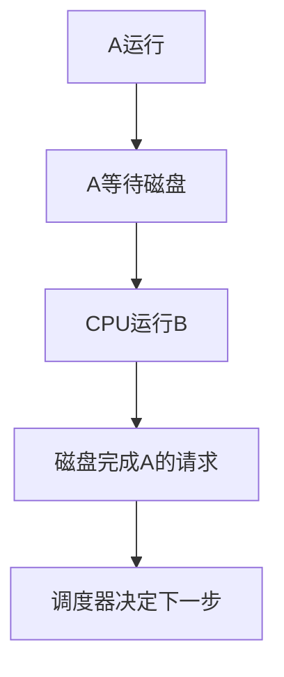

# 视频题：系统类型与多道程序

这一组题在问同一条主线：计算机怎样从“做完一件事再做下一件事”，走到“让多件事交错推进”。以下是**视频题讲解**，没有你的个人首次答案，先不标“已掌握”。

[直接开始做题 ↓](#start-questions){ .md-button .md-button--primary }

## 先用一个场景建立画面

假设 A 作业算一会儿就等磁盘，B 作业此时已经准备好。单道程序让 CPU 陪 A 一起等；**多道程序设计**把多道作业放在内存中，A 等 I/O 时让 CPU 去做 B。这样 CPU 更少空等，也可在同一段时间里让 CPU 和 I/O 设备各自忙起来。

这里说的“同时推进”是**并发**，不保证同一瞬间真的有两个进程在不同 CPU 上执行；后者叫**并行**。

| 类型或技术 | 首要关注点 | 一眼识别 |
| --- | --- | --- |
| 批处理 | 成批提交作业、减少人工干预 | 用户提交后通常不能直接交互 |
| 多道程序设计 | 让多个作业交错推进，提高资源利用率 | 一道作业等 I/O，CPU 可做另一道 |
| 分时系统 | 多个用户轮流得到短时间的 CPU 服务 | 时间片、交互、响应时间 |
| 实时系统 | 在规定时间内完成对外部事件的处理 | 截止时间约束 |
| 多处理器系统 | 多个处理单元 | 可实现真正的并行执行 |

## 1. 提高单机资源利用率 {#start-questions}

!!! question "先做题"
    提高单机资源利用率的关键技术是（）。  
    A. 脱机技术  
    B. 虚拟技术  
    C. 交换技术  
    D. 多道程序设计技术

??? success "查看答案与解析"
    **答案：D，多道程序设计。** 脱机输入输出可缓解慢设备与主机的速度差；虚拟和交换也有各自用途。但本题抓的是让 CPU 在一项作业等待时转去服务另一项作业，这正是多道程序设计的核心。不要把“资源利用率提高”误背成“任何虚拟技术都必然是答案”。

## 2. 批处理系统的主要缺点

!!! question "先做题"
    批处理系统的主要缺点是（）。  
    A. 系统吞吐量小  
    B. CPU 利用率不高  
    C. 资源利用率低  
    D. 无交互能力

??? success "查看答案与解析"
    **答案：D，缺少交互能力。** 批处理系统适合把一批作业提交后自动处理，目标通常是提高吞吐和资源利用率。用户难以像在终端前那样边输入边得到反馈，是题目要找的短板。

## 3. 多道程序设计的基本特征

!!! question "先做题"
    下列选项中，不属于多道程序设计的基本特征的是（）。  
    A. 制约性  
    B. 间断性  
    C. 顺序性  
    D. 共享性

??? success "查看答案与解析"
    **答案：C，顺序性。** 多个程序要共享 CPU、内存等资源，因此彼此会有制约；某道程序等 I/O 时会间断，资源在不同程序间共享。把 A、B、C 三道程序想成三个人轮流用一台打印机：每个人自己有先后步骤，但**不同程序之间**不要求按 A 全做完、B 才开始的顺序运行。题目中的“顺序性”指后者，不是在否认单个程序内部的逻辑顺序。

## 4. 操作系统的基本类型

!!! question "先做题"
    操作系统的基本类型主要有（）。  
    A. 批处理操作系统、分时操作系统和多任务系统  
    B. 批处理操作系统、分时操作系统和实时操作系统  
    C. 单用户系统、多用户系统和批处理操作系统  
    D. 实时操作系统、分时操作系统和多用户系统

??? success "查看答案与解析"
    **答案：B，批处理、分时、实时。** 这是一种教材里的经典分类。单用户／多用户按用户数量划分，PC 操作系统偏应用场景，“多任务”描述能力，不能与批处理、分时、实时混成同一层分类。

## 5. 实时系统的时间要求

!!! question "先做题"
    实时操作系统必须在（）内处理来自外部的事件。  
    A. 一个机器周期  
    B. 被控制对象规定时间  
    C. 周转时间  
    D. 时间片

??? success "查看答案与解析"
    **答案：B，在被控制对象规定的时间内。** 实时性不等于“绝对最快”或“一个时间片之内”。例如温控系统要求 100 毫秒内关闭过热设备，80 毫秒完成是合格；若 200 毫秒才完成，即使平均运行速度很快，这次仍可能失败。这个 100 毫秒只是帮助理解的例子，不是题目给定数值。

## 6. 分时系统的特点

!!! question "先做题"
    下列关于分时系统的叙述中，错误的是（）。  
    A. 分时系统主要用于批处理作业  
    B. 分时系统中每个任务依次轮流使用时间片  
    C. 分时系统的响应时间好  
    D. 分时系统是一种多用户操作系统

??? success "查看答案与解析"
    **答案：A，‘分时系统主要用于批处理作业’错误。** 分时系统的出发点是让多个用户轮流使用计算机并获得交互响应。时间片是它的常见实现手段；“响应时间好”也与交互目标相符。

## 7. 多个进程并行执行

!!! question "先做题"
    下列各种系统中，（）可以使多个进程并行执行。  
    A. 分时系统  
    B. 多处理器系统  
    C. 批处理系统  
    D. 实时系统

??? success "查看答案与解析"
    **答案：B，多处理器系统。** 只有一个 CPU 执行核心时，多个进程可以快速切换，看起来一起向前走，但某一瞬间通常只能有一个占用该核心。题干用的是**并行**，所以要找多个处理单元。若题目改问“多个进程并发执行”，单处理器分时系统也可以做到。

## 8. 引入多道程序设计的前提

!!! question "先做题"
    引入多道程序技术的前提条件之一是系统具有（）。  
    A. 多个 CPU  
    B. 多个终端  
    C. 中断功能  
    D. 分时功能

??? success "查看答案与解析"
    **答案：C，中断功能。** 当作业等待 I/O 或设备完成工作，系统需要收到事件并重新安排 CPU；中断为这种控制转移提供关键支撑。不要求多个 CPU、多个终端，也不要求先具备分时功能。这里是王道教材的考试模型；具体系统还会用到内存保护、调度等机制，不能理解为“只要有中断就自动有完整多道系统”。

## 9. 批处理系统的三条陈述

!!! question "先做题"
    下列关于批处理系统的叙述中，正确的是（）。  
    Ⅰ. 批处理系统允许多个用户与计算机直接交互  
    Ⅱ. 批处理系统分为单道批处理系统和多道批处理系统  
    Ⅲ. 中断技术使得多道批处理系统和 I/O 设备可与 CPU 并行工作  
    A. 仅Ⅱ、Ⅲ  
    B. 仅Ⅱ  
    C. 仅Ⅰ、Ⅱ  
    D. 仅Ⅰ、Ⅲ  

    *2016 年计算机联考真题*

??? success "查看答案与解析"
    **答案：A，仅Ⅱ、Ⅲ。** Ⅰ“多个用户与计算机直接交互”不符合批处理；Ⅱ“有单道与多道批处理”成立；Ⅲ“中断技术支持多道批处理时 I/O 设备与 CPU 重叠工作”成立。判断 III 时，脑中放回开头的 A 等磁盘、CPU 做 B 的场景。

## 10. 多道程序相对单道的优点

!!! question "先做题"
    与单道程序系统相比，多道程序系统的优点是（）。  
    Ⅰ. CPU 利用率高  
    Ⅱ. 系统开销小  
    Ⅲ. 系统吞吐量大  
    Ⅳ. I/O 设备利用率高  
    A. 仅Ⅰ、Ⅲ  
    B. 仅Ⅰ、Ⅳ  
    C. 仅Ⅱ、Ⅲ  
    D. 仅Ⅰ、Ⅲ、Ⅳ  

    *2017 年计算机联考真题*

??? success "查看答案与解析"
    **答案：D，Ⅰ、Ⅲ、Ⅳ。** 典型条件下，CPU 利用率高、系统吞吐量大、I/O 设备利用率高。Ⅱ“系统开销小”不成立：多道程序还要调度、保护、切换和管理共享资源，开销反而增加。这里说的是**典型负载下可能得到的改善**，不是无条件的数学保证。

## 11. 进程越多，CPU 利用率越高吗

!!! question "先做题"
    下列关于多道程序系统的叙述中，不正确的是（）。  
    A. 支持进程的并发执行  
    B. 不必支持虚拟存储管理  
    C. 需要实现对共享资源的管理  
    D. 进程数越多 CPU 利用率越高  

    *2022 年计算机联考真题*

??? success "查看答案与解析"
    **答案：D 是错误陈述。** 当内存里只有一道常等 I/O 的作业时，增加另一道确实可能填补 CPU 空闲；但继续无限增加会带来切换、内存竞争甚至频繁换入换出的成本。曲线不会因“进程数变多”就永远上升。其余三项——支持并发、不必一定依赖虚拟存储、需要管理共享资源——在题目语境中成立。

    !!! example "把两道题连起来"
        2017 年题问“相对单道，**通常有哪些优点**”；2022 年题把它偷换成“**进程数越多越好**”。看到“总是、必然、越多越高”这样的绝对词，先找资源竞争和系统开销的反例。

## 12. 输入输出指令与通道技术

!!! question "先做题"
    下列说法中，正确的是（）。  
    Ⅰ. 批处理的主要缺点是需要大量内存  
    Ⅱ. 当计算机提供了核心态和用户态时，输入/输出指令必须在核心态下执行  
    Ⅲ. 操作系统中采用多道程序设计技术的最主要原因是为了提高 CPU 和外部设备的可靠性  
    Ⅳ. 操作系统中，通道技术是一种硬件技术  
    A. Ⅰ、Ⅱ  
    B. Ⅰ、Ⅲ  
    C. Ⅱ、Ⅳ  
    D. Ⅱ、Ⅲ、Ⅳ

??? success "查看答案与解析"
    **答案：C，仅Ⅱ、Ⅳ。** Ⅱ在教材的特权指令模型里，直接执行 I/O 指令要有内核权限；Ⅳ“通道是硬件技术”成立，可承担专门的 I/O 控制工作。Ⅰ“需要大量内存”不是批处理系统的主要缺点；Ⅲ把“提高 CPU 和设备的**利用率**”写成了“提高**可靠性**”，概念换掉了。这里还要注意：**访管／陷入指令**可以由用户态主动执行来申请内核服务，而直接操作设备的 I/O 指令属于受保护操作。

## 一分钟复做

1. A 等磁盘时，单道与多道各让 CPU 做什么？
2. 为什么“多道程序提高利用率”与“进程越多越好”不是同一句话？
3. 分别给“并发”和“并行”画一个只有一个核心、两个核心的例子。

**资料说明：** 根据你提供的王道考研视频资料整理；2016、2017、2022 年真题年份依据原资料标注。机制对照：[OSTEP《Introduction》](https://pages.cs.wisc.edu/~remzi/OSTEP/intro.pdf)。

[返回本章题目索引](王道习题与错题.md) · [继续看分时与响应时间](视频题-分时与响应时间.md)
