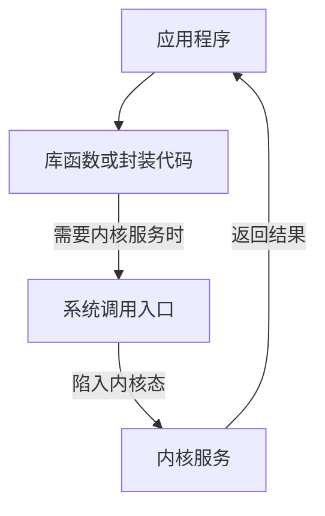

# 视频题：系统调用与接口

本页整理你给的王道考研视频资料中与**应用程序怎样请求操作系统做事**有关的题。题干与选项已整理为可复制的文字，答案按原资料和机制核对；资料里的红笔是视频讲解，不当作你的作答。书上题号、个人错因和复做结果尚未提供。

[直接开始做题 ↓](#start-questions){ .md-button .md-button--primary }

## 先把四层关系看明白

你写 `printf("hi")`，真正向屏幕输出时，通常会经过库函数的整理，再请求内核执行输出。这就像寄快递：**你**填寄件信息，**快递站柜台**帮你打包，**配送系统**才有权限安排车辆。类比只帮助理解；在计算机里，是否进入内核由处理器的特权机制决定。



| 名词 | 一句话判断 | 例子 |
| --- | --- | --- |
| 系统调用 | 操作系统给应用程序请求内核服务的**程序接口** | 读文件、创建进程 |
| 库函数 | 编程语言或运行库给程序员调用的函数；有些纯在用户态运行，有些会调用系统调用 | `abs()` 通常不必入内核；`printf()` 输出时可能调用 `write()` |
| 中断／异常 | 让 CPU 暂停当前执行、转去处理某事件的一类机制；系统调用通常借助受控的陷入机制进入内核 | 定时器中断、缺页异常、陷入指令 |
| 原语 | 必须作为不可分割整体完成的底层操作 | 信号量操作等教材中的例子 |

!!! tip "记忆钩子"
    题目问“**应用程序向操作系统要服务的接口**”，选**系统调用**。问“**用户操作计算机的界面**”，才看命令行或图形界面。接口的服务对象不同。

## 1. 程序接口：系统调用 {#start-questions}

!!! question "先做题"
    下列选项中，操作系统提供给应用程序的接口是（）。  
    A. 系统调用  
    B. 中断  
    C. 库函数  
    D. 原语  

    *2010 年计算机联考真题*

??? success "查看答案与解析"
    **答案：A，系统调用。** 应用程序要创建文件、读磁盘等，不能直接执行受保护的内核代码，只能通过系统调用提出请求。库函数是程序员常用的上层封装，**不等于**系统调用：`abs(-3)` 可以直接算出 `3`；而读文件的库函数最终要向内核请求文件数据。中断是“进入处理流程”的机制，原语是“不可分割的操作”，都不是这里要找的程序接口。

    **自测：** `printf()` 是系统调用吗？——它是 C 库函数；在需要向终端输出时，可经由底层系统调用完成输出。

---

## 2. 系统调用的三个判断

!!! question "先做题"
    下列关于系统调用的说法中，正确的是（）。  
    Ⅰ. 用户程序使用系统调用命令，该命令经过编译后形成若干参数和陷入指令  
    Ⅱ. 用户程序使用系统调用命令，该命令经过编译后形成若干参数和屏蔽中断指令  
    Ⅲ. 用户程序创建一个新进程，需使用操作系统提供的系统调用接口  
    Ⅳ. 当操作系统完成用户请求的系统调用功能后，应使 CPU 从内核态转到用户态  
    A. Ⅰ、Ⅲ  
    B. Ⅲ、Ⅳ  
    C. Ⅰ、Ⅲ、Ⅳ  
    D. Ⅱ、Ⅲ、Ⅳ

??? success "查看答案与解析"
    **答案：C，Ⅰ、Ⅲ、Ⅳ。**

    - **Ⅰ成立（按教材模型）：** 用户程序准备调用号和参数，执行系统调用入口指令；这会受控地进入内核。不同处理器的具体指令名不同，不能把“陷入指令”当成唯一机器指令拼写。
    - **Ⅱ不成立：** 用户程序不能靠“屏蔽中断”来请求服务；随意关中断会破坏系统控制。
    - **Ⅲ成立：** 创建新进程涉及受保护的系统资源，需要内核服务。
    - **Ⅳ成立：** 服务处理完，处理器恢复合适的用户态现场，再继续用户程序。

    下面这张图比死记“用户态／内核态”更实用：

    ```mermaid
    sequenceDiagram
        participant U as 用户程序
        participant H as CPU陷入机制
        participant K as 内核
        U->>H: 准备参数并执行系统调用入口
        H->>K: 切换到内核态并转交请求
        K->>K: 检查参数、执行服务
        K-->>U: 恢复用户态并返回结果
    ```

---

## 3. 操作系统必须提供什么功能

!!! question "先做题"
    （）是操作系统必须提供的功能。  
    A. 图形用户界面（GUI）  
    B. 为进程提供系统调用命令  
    C. 中断处理  
    D. 编译源程序

??? success "查看答案与解析"
    **答案：C，中断处理。** 在这道教材语境中，系统必须能处理硬件或执行异常带来的控制转移，才能继续协调 CPU、设备等。图形界面和编译器都可以由别的软件提供；B 用“为进程提供系统调用**命令**”作表述，容易把程序接口和用户命令混淆，且题目问的是各种操作系统的共同基础功能。不要据此推成“操作系统通常没有系统调用”。

---

## 4. 库函数与系统调用

!!! question "先做题"
    下列关于库函数和系统调用的说法中，不正确的是（）。  
    A. 库函数运行在用户态，系统调用运行在内核态  
    B. 使用库函数时开销较小，使用系统调用时开销较大  
    C. 库函数不方便替换，系统调用通常很方便被替换  
    D. 库函数可以很方便地调试，而系统调用很麻烦

??? success "查看答案与解析"
    **答案：C。** C 说“库函数不方便替换，系统调用通常很方便替换”，方向反了。库函数位于应用程序可用的上层代码，通常更容易修改、替换和调试；系统调用接口是操作系统提供的受保护边界，变更需要兼顾兼容性。A 所说“库函数运行在用户态、系统调用的内核服务运行在内核态”是**典型路径**，但要记得：一个库函数内部可以发起系统调用，因此执行它的整个过程未必始终停留在用户态。

    **具体例子：** `abs(-5)` 多数情况下算术运算即可；`fread()` 是库函数，却可能经过 `read()` 向内核取数据。看函数名或头文件，不能代替分析它有没有请求内核服务。

---

## 5. 系统调用和普通过程调用

!!! question "先做题"
    下列关于系统调用和一般过程调用的说法中，正确的是（）。  
    A. 两者都需要将当前 CPU 中的 PSW 和 PC 的值压栈，以保存现场信息  
    B. 系统调用的被调用过程一定运行在内核态  
    C. 一般过程调用的被调用过程一定运行在用户态  
    D. 两者的调用过程与被调用过程一定都运行在用户态

??? success "查看答案与解析"
    **答案：B，系统调用的被调用过程运行在内核态。** 普通函数调用通常只是同一特权级内跳转；系统调用需通过受控入口切换权限级，内核完成服务后再返回。题目 A 说两种调用都“一定压栈保存当前 PSW 和 PC”，把硬件陷入的现场保护照搬到普通调用；普通函数调用怎样保存返回地址和寄存器，取决于体系结构与调用约定，不能按系统调用的方式一概而论。

    !!! warning "两组词别混"
        **函数调用**是在程序结构上的调用关系；**系统调用**是跨越用户态与内核态的服务请求。一个用户态库函数，可以在内部进一步发起系统调用。

---

## 6. 读文件第 100 个逻辑块

!!! question "先做题"
    用户在程序中试图读某文件的第 100 个逻辑块，使用操作系统提供的（）接口。  
    A. 系统调用  
    B. 键盘命令  
    C. 原语  
    D. 图形用户接口

??? success "查看答案与解析"
    **答案：A，系统调用。** 第 100 个逻辑块是文件读请求的目标位置；应用程序要取得文件内容，仍需让操作系统进行文件访问。键盘命令和图形界面是人与计算机交互的方式；原语不是应用程序申请文件数据的接口。

## 这一页的复做卡

1. 不看表格，说出 `abs()`、`fread()`、内核 `read` 服务分别处于哪一层。
2. 解释“库函数可能封装系统调用”，给出一个纯计算和一个读写文件的例子。
3. 说出为什么“系统调用”与“陷入指令／中断机制”不能直接画等号。

**资料说明：** 题目根据你提供的王道考研视频资料整理；2010 年真题年份依据原资料标注。机制对照：[OSTEP《Limited Direct Execution》](https://pages.cs.wisc.edu/~remzi/OSTEP/cpu-mechanisms.pdf)、[Linux `syscall(2)` 手册](https://man7.org/linux/man-pages/man2/syscall.2.html)。

[返回本章题目索引](王道习题与错题.md)
