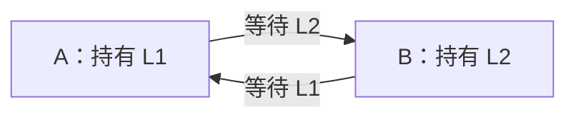

# 同步、互斥与死锁

!!! note "本页内容边界"
    先整理互斥、等待与死锁的通用机制，使用两进程、两把锁的教学模型。信号量、经典同步问题和银行家算法仍待补充；本页不对应你的王道教材题号，也不代表个人已经完成练习。

## 为什么既需要互斥，又会担心死锁？

**临界区**是访问共享资源、需要协调执行的一段代码。**互斥**要求同一时刻最多一个参与者进入相应临界区；**同步**还关注先后条件，例如“数据准备好后再读取”。两者不能只用“让程序慢一点”来替代。

锁可以保护共享数据，但一个进程持有一把锁、又等待另一把锁时，就要继续追问：另一把锁由谁持有？它是否也在等待？**死锁**指一组进程互相等待，组内任何一个都无法继续推进以解除这个等待。

## 逐步看持有者与等待图 { #locks-lab }

下面的 L1、L2 各只有一个实例。A、B 持锁期间不会被外部强行夺走锁；申请失败后阻塞，并保留已经持有的锁。

静态过程：A 获得 L1，B 获得 L2；A 再申请 L2 被阻塞，形成 A→B；B 再申请 L1 也被阻塞，形成 B→A。两条边组成等待环，此时两者都不能继续执行释放指令。

!!! info "演示规则"
    每一步是一次抽象的锁申请或释放，不是一个固定时间片。释放时将锁交给最早等待它的进程，视为原挂起申请完成；这是明确约定的教学规则，不模拟具体语言运行库的全部互斥锁语义。阻塞进程不能继续执行自己的指令；重置仅用于重放轨迹，不是死锁恢复算法。

等待图中的边 `A → B` 表示 **A 正等待 B 持有的锁**，不是“A 把锁交给 B”。默认轨迹末尾可画为：

只执行到第三步时，A 已阻塞、B 还没有阻塞，这与第四步的死锁状态不同。先判断当前状态，再判断未来某个交错执行是否可能出问题。

## 四个必要条件怎样落到这张图上？

| 条件 | 在默认轨迹中如何体现 |
| --- | --- |
| 互斥使用 | 一把锁同时只属于一个进程 |
| 占有并等待 | A 保留 L1 等 L2，B 保留 L2 等 L1 |
| 不可剥夺 | 本模型不强制夺走已授予的锁 |
| 循环等待 | A 等 B，B 又等 A |

四条件及统一加锁次序的思路参考 [OSTEP：Common Concurrency Problems](https://pages.cs.wisc.edu/~remzi/OSTEP/threads-bugs.pdf)。单实例资源情形下的环与死锁判定，可对照 [UIC：Deadlocks](https://www.cs.uic.edu/~jbell/CourseNotes/OperatingSystems/7_Deadlocks.html)。若某类资源有多个实例，不能直接把本例“看见环就判死锁”的结论照搬过去。

## 统一顺序为什么能打断循环？

切换到“统一顺序，等待后唤醒”：A、B 都先申请 L1，再申请 L2。B 可能在申请 L1 时等待，但它尚未持有 L2，A 仍能获得 L2、完成并释放，随后 B 继续。

这里破坏的是**循环等待条件**，属于死锁预防的思路。它不保证完全没有等待，也不等于证明系统永远不会饥饿。银行家算法等死锁避免方法需要另外讨论。

再切换到“相反顺序，串行运行”。虽然两者的加锁顺序相反，但 A 完全释放后 B 才执行，也可以正常结束。这说明“代码中存在危险顺序”与“当前已经死锁”需要分别判断。

### 自测：只有一条等待边，能下结论吗？

A 持有 L1、等待 B 的 L2，而 B 没有阻塞。如果 B 下一步释放 L2，A 能否继续？当前能否仅凭 `A → B` 判死锁？

??? success "展开核对"
    A 可以在 L2 释放并按本模型交接后继续；仅有这条等待边不能判定死锁。必须检查是否还存在无法解除的依赖。本例第四步的 `B → A` 才闭合等待环。对照 [就绪、运行与阻塞](进程线程与调度.md)，等待锁的进程也不能只靠分到 CPU 就跨过阻塞条件。

## 继续整理的内容

- 信号量与生产者—消费者等同步问题。
- 死锁预防、避免、检测与恢复的系统比较。
- 多实例资源的分配矩阵、安全序列与银行家算法。

## 对应习题

[查看本章王道习题与错题](王道习题与错题.md)。
