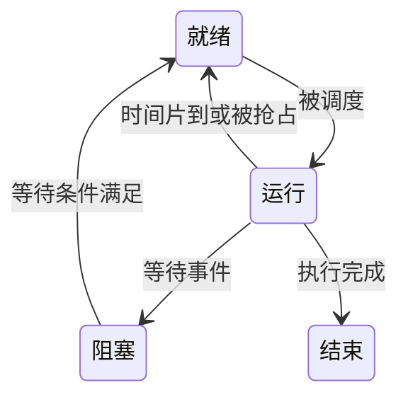

# 进程、线程与调度

!!! note "本页内容边界"
    先补上调度的通用机制和自拟算例，供理解与自测；尚未按你的王道教材版次逐项核对。进程控制、通信等内容仍待整理，本页也不代表个人已经掌握这些内容。

## 调度要解决什么问题？

当多个任务都能继续运行、CPU 却只能执行其中一个时，就需要**调度**：决定下一段 CPU 时间交给谁。下面以进程为调度对象，只研究单 CPU、没有 I/O 的小模型；真实系统还涉及线程调度、多核和优先级等条件。

先把三种状态分开：**就绪**是除了 CPU 以外的运行条件已经具备；**运行**是正在使用 CPU；**阻塞**是还在等待 I/O 完成或其他事件。阻塞任务不能仅靠“轮到它”就继续运行。

## FCFS 与时间片轮转 { #scheduling-lab }

**先来先服务（FCFS）**按进入就绪队列的先后执行，本模型中一旦获得 CPU 就运行到完成。**时间片轮转（RR）**每次最多执行一个时间片 `q`；若未完成，放回队尾，等待下一轮。时间片不是任务总服务时间，最后一次执行也可能不足 `q`。

静态算例：A、B、C 都在 t=0 到达，服务时间分别为 5、3、1。同到达时按 A、B、C 排队。FCFS：A[0,5)、B[5,8)、C[8,9)。RR 的 q=2：A[0,2)、B[2,4)、C[4,5)、A[5,7)、B[7,8)、A[8,9)。

!!! info "演示规则"
    单 CPU、无 I/O、忽略调度与切换开销，时间采用同一抽象单位。相同到达时间按表中顺序入队；RR 在片尾先接纳已经到达的新任务，再把未完成的当前任务放回队尾。每一步展示一个执行区间结束后的快照，不表示每步经过的时间相同。切换进程组或规则会重新开始。

先看时间轴，再查看就绪队列。切到“先后到达”，可以检查 **t=4 到达的 C 与此刻时间片结束的 B 谁先入队**；按本页约定，C 在 B 前面。题目若另有约定，应以题目为准。

## 从时间轴计算三个指标

令到达时刻为 `a`、第一次获得 CPU 的时刻为 `s`、完成时刻为 `c`、总服务时间为 `b`：

| 指标 | 本模型中的计算 | 在回答什么问题 |
| --- | --- | --- |
| 响应时间 | `s-a` | 等多久才第一次开始运行 |
| 周转时间 | `c-a` | 从到达到完成一共多久 |
| 等待时间 | `c-a-b` | 没在 CPU 上执行的时间一共多久 |

这里没有 I/O 阻塞，才能把“周转减服务”全部视为就绪等待；有阻塞时不能省掉对状态与题意的分析。“首次获得 CPU”的响应定义也应与题目所用定义一致。

以默认 RR、`q=2` 为例：

| 进程 | 首次 / 完成时刻 | 响应 | 周转 | 等待 |
| --- | --- | --- | --- | --- |
| A | 0 / 9 | 0 | 9 | 4 |
| B | 2 / 8 | 2 | 8 | 5 |
| C | 4 / 5 | 4 | 5 | 4 |

核对结果：所有执行区间的长度之和为 `5+3+1=9`，每个进程得到的 CPU 时间等于它的服务时间；周转和等待均非负。RR 的平均响应为 `2`，FCFS 为 `13/3`；本例两者平均周转都是 `22/3`。**一种指标改善，不能直接推出其他指标也改善。**

### 自测：空闲时间算到谁头上？

切换到“存在 CPU 空闲区间”。A 在 t=2 到达，t=2 开始、t=4 完成；它的服务时间为 2。A 的周转时间与响应时间分别是多少？

??? success "展开核对"
    周转为 `4-2=2`，响应为 `2-2=0`。t=0～2 时 A 尚未到达，这段空闲不能计入 A 的等待。继续检查 t=4～6 是否也应画为空闲区间。

机制与指标定义参考 [OSTEP：Scheduling: Introduction](https://pages.cs.wisc.edu/~remzi/OSTEP/cpu-sched.pdf)。本页数值和时间轴为独立计算的教学示例，不对应某道王道原题。

## 继续整理的内容

- 进程与线程的资源关系、控制与通信。
- 含 I/O、优先级等条件的调度计算。
- [同步、互斥与死锁](同步互斥与死锁.md)。

## 对应习题

[查看本章王道习题与错题](王道习题与错题.md)。
