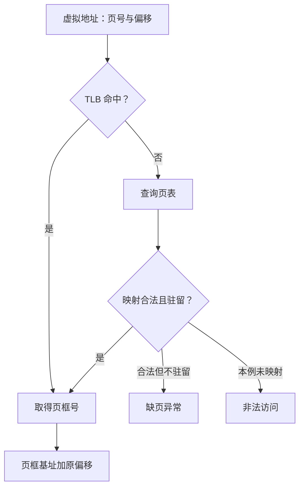

# 内存管理基础

!!! note "本页内容边界"
    先用通用的单级分页模型解释地址转换。数值与页表是自拟教学数据，尚未对应你的王道教材版次或题号；连续分配、分段等内容仍待补充。

## 为什么虚拟地址不能直接当物理地址？

程序使用的是自己的**虚拟地址**，内存硬件最终访问的是**物理地址**。分页把虚拟空间分成固定大小的**页**，把物理内存分成同样大小的**页框**。**页表**记录虚拟页与物理页框的对应关系，各页可以落在不连续的页框里。

因此，转换时要改变的是“这一页放在哪里”，页内的相对位置保持不变。页号不是页框号，页表中存的页框号也不是一个完整的字节地址。机制可对照 [OSTEP：Paging: Introduction](https://pages.cs.wisc.edu/~remzi/OSTEP/vm-paging.pdf)。

## 地址拆分与页表查询 { #paging-lab }

本模型按字节编址，虚拟空间为 `8 KiB = 8192 B`，虚拟地址共 13 位；页大小为 `1 KiB = 1024 B = 2^10 B`。因此低 **10 位**是页内偏移，高 **3 位**是虚拟页号。

静态算例：虚拟地址 1300 B ÷ 1024 B，得到页号 1、偏移 276 B。页表把第 1 页映射到第 2 页框，所以物理地址为 2×1024+276=2324 B。页号 1 不在预设 TLB 中，但这一页已经驻留内存，仍能完成转换。

每次查询都从同一个固定快照开始。第 2 页是合法但不在内存的页；第 3 页明确设为未映射，用于区分两类结果。演示省略读写权限、按需分配、多级页表和数据 Cache，不据此推断真实系统的全部异常处理。

### 把默认算例手算一遍

1. 拆地址：`1300 = 1×1024 + 276`，所以 `VPN=1`、`offset=276 B`。
2. 查映射：第 1 页驻留于第 2 页框，故 `PFN=2`。
3. 拼物理地址：`PA=2×1024+276=2324 B`。
4. 检查：`2324 % 1024 = 276`，与原偏移一致；页框 2 的地址范围为 `[2048,3071]`，结果也在其中。

`KiB` 表示 1024 B，不能在本例里改用 1000 B。余数是偏移，不是页号；边界地址 `1023` 仍在页 0，`1024` 才进入页 1。

## TLB 未命中与缺页怎样区分？

**TLB（快表）**缓存近期使用的地址映射。TLB 没有这条映射时，要继续查页表；这不表示页面一定不在内存。[OSTEP：TLBs](https://pages.cs.wisc.edu/~remzi/OSTEP/vm-tlbs.pdf) 解释了快表与页表查询的关系。

!!! warning "缺页也不一定发生页面置换"
    合法页不驻留时需要调入；若有可用空闲页框，可直接使用。需要回收页框时才涉及淘汰谁，下一页的 [FIFO / LRU 对照](虚拟内存与页面置换.md#replacement-lab) 专门展示这个选择。

### 自测：最后一个字节在哪里？

把地址改成 `8191`。请在查看结果前写出页号、偏移与物理地址；再输入 `8192`，比较它为什么不能继续按同一张页表转换。

??? success "展开核对"
    `8191 = 7×1024+1023`，页 7 映射到框 3，所以 `PA=3×1024+1023=4095 B`。`8192` 已超出本模型 13 位地址的取值范围，不能把它当成存在的第 8 页。

## 继续整理的内容

- 连续分配与非连续分配。
- 分页、分段及其比较。
- 结合具体题目计算页表大小、多级索引和访存时间。

## 对应习题

[查看本章王道习题与错题](王道习题与错题.md)。
