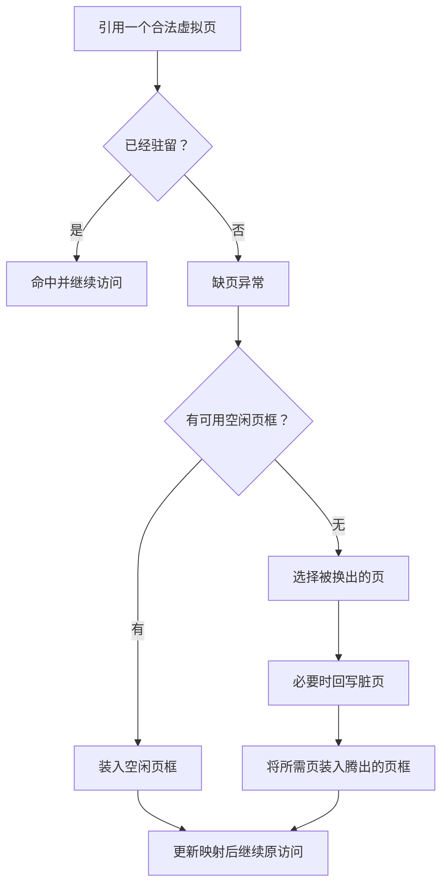

# 虚拟内存与页面置换

!!! note "本页内容边界"
    先补请求分页与 FIFO、LRU 的机制对照。示例计算不对应你的王道题号；真实系统的调页开销、脏页回写和抖动仍需结合教材继续整理。

## 缺页之后，什么时候需要换出别的页？

请求分页允许一部分合法虚拟页暂不驻留在物理内存。访问到尚未驻留的合法页会产生**缺页异常**，系统处理后再继续访问。页表和地址拆分先看 [内存管理基础](内存管理基础.md#paging-lab)。

缺页时，若有可用的空闲页框，装入即可；若需要回收页框，就要通过**页面置换算法**选择换出哪一页。因此，**缺页次数包含首次装入的情况，置换次数只数实际发生换出的情况**。

## 同一步，FIFO 与 LRU 会换出谁？ { #replacement-lab }

**FIFO（先进先出）**换出最早装入的页，命中不会改变装入次序。**LRU（最近最久未使用）**换出距上次使用最久的页，所以每次命中也要更新最近使用次序。两者中的“最早”指向不同的事件。

静态算例：序列 1,2,3,4,1,2,5,1,2,3,4,5，从空内存开始。3 个页框时，FIFO 缺页 9 次、置换 6 次；LRU 缺页 10 次、置换 7 次。切换为 4 个页框，FIFO 缺页 10 次、LRU 缺页 8 次。

!!! info "演示规则"
    输入的是**页面号**，不是字节地址。页框初始全空，缺页先使用编号最小的空框；固定分配 3 或 4 个页框，采用局部置换，忽略预取、回写和共享页等因素。命中位置用实线标记，装入位置用虚线标记，文字同步说明结果；页框位置始终固定，不按策略次序重新排图。

每次点击只处理一次引用。先判断页是否已在任一页框里，再决定是否缺页；最后看是否使用了空框。不要因为 LRU 调整了候选次序，就把它误记为一次换出。

## 页框更多，缺页一定更少吗？

默认序列是 OSTEP 介绍的 **Belady 异常**反例，计算规则参考 [Beyond Physical Memory: Policies](https://pages.cs.wisc.edu/~remzi/OSTEP/vm-beyondphys-policy.pdf)：在 FIFO 下增加页框，缺页次数可能反而增加。

| 初始均为空 | 3 个页框的缺页数 | 4 个页框的缺页数 |
| --- | --- | --- |
| FIFO | 9 | 10 |
| LRU | 10 | 8 |

这张表还说明：**LRU 并不保证对任意给定序列都比 FIFO 缺页少**。它的另一项性质是，对同一序列、都从空内存开始的标准 LRU，增加容量不会使缺页数增加；不能把这项性质偷换成“每个容量下都优于 FIFO”。

### 自测：只有一个页面反复出现

切到“反复访问同一页”。从空内存开始，四次访问 `1,1,1,1`；3 个页框下两种策略各缺页几次、置换几次？

??? success "展开核对"
    两者均缺页 1 次、置换 0 次。第一次装入空闲页框，后面三次命中；尚有空框不表示第一次访问就不缺页。核对式：`命中次数 + 缺页次数 = 4`。

## 继续整理的内容

- 最佳置换（OPT）、Clock 等策略。
- 工作集、缺页率与抖动。
- 含访问时间、脏位和回写条件的综合计算。

## 对应习题

[查看本章王道习题与错题](王道习题与错题.md)。
