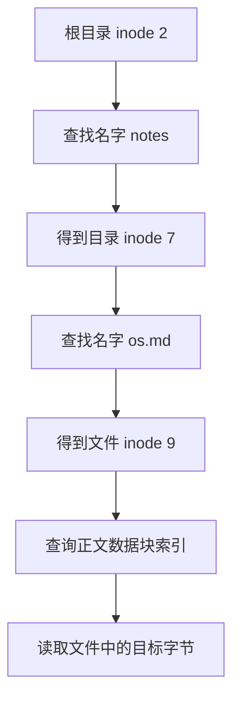

# 文件与目录

!!! note "本页内容边界"
    先用类 UNIX 文件系统的简化模型区分名字、inode 和文件内容。路径与编号均为自拟教学数据，不是本机文件状态；共享、保护等内容仍待结合教材完善。

## 文件名怎样带我们找到文件？ { #file-path }

从应用角度看，普通文件可以视为一串字节；目录则组织文件与子目录的名字。在这里采用的 inode 模型中，**目录项**把一个名字关联到一个 inode 编号；**inode**保存文件类型、长度、数据块索引等元数据。名字和正文不是同一层信息。

以读取 `/notes/os.md` 为例，假设根目录 inode 为 2、`notes` 目录 inode 为 7、`os.md` 文件 inode 为 9：

| 所在目录 | 要匹配的名字 | 指向的 inode |
| --- | --- | --- |
| `/` | `notes` | 7 |
| `/notes` | `os.md` | 9 |

这是**逐层解析路径**的过程，并不是把整条路径当作磁盘块号。不同目录可以出现同名项；判断文件位置时要带上路径上下文。基本命名与访问模型参考 [OSTEP：Files and Directories](https://pages.cs.wisc.edu/~remzi/OSTEP/file-intro.pdf)。

## 找到文件之后，怎样定位其中一个字节？

找到 inode 只解决了“是哪一个文件”。还需要把**文件偏移**拆成文件逻辑块号和块内偏移，再沿文件索引定位正文数据块，具体过程见 [直接与一级间接索引演示](文件系统.md#fileindex-lab)。

| 编号或位置 | 在本模型中的含义 | 不能直接当作 |
| --- | --- | --- |
| inode 编号 9 | 文件系统内的文件标识 | 进程的文件描述符，或正文块号 |
| 文件偏移 4333 B | 目标字节在正文中的位置 | 磁盘绝对位置 |
| 文件逻辑块号 4 | 文件内部第 5 个逻辑块 | 磁盘上的第 4 块 |

!!! tip "文件描述符又属于哪一层？"
    打开文件成功后，类 UNIX 接口会返回进程使用的整数句柄，称为文件描述符。它用于后续读写，不能和 inode 编号混用。教材中的打开文件表可能画成多层结构，需要按题意逐层追踪。

### 自测：名字相同，能断定是同一个文件吗？

`/notes/os.md` 和 `/draft/os.md` 的末尾名字相同，能否只凭这一点断定它们指向同一个 inode？

??? success "展开核对"
    不能。要分别解析所在目录中的目录项，再比较它们在同一文件系统中的 inode 标识。名字相同既不能证明内容相同，也不能证明 inode 相同。

## 继续整理的内容

- 文件逻辑结构与不同物理组织方式。
- 硬链接、符号链接及文件删除时的引用关系。
- 访问权限、共享与保护。

## 对应习题

[查看本章王道习题与错题](王道习题与错题.md)。
