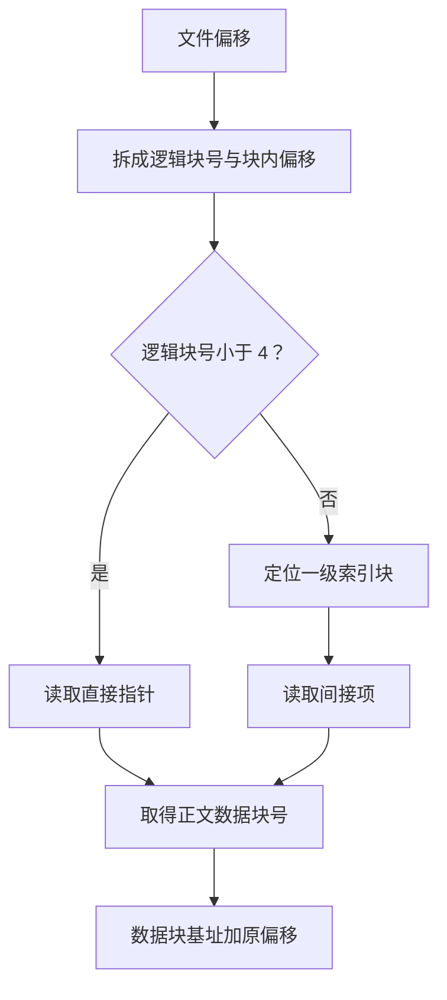

# 文件系统

!!! note "本页内容边界"
    先补充基于指针的文件块索引。布局和数值是自拟教学快照，不声称代表 ext4、APFS 等具体文件系统的真实布局；空闲空间管理、崩溃一致性等仍待整理。

## 为什么还要分直接索引与间接索引？

文件系统需要把文件中的逻辑块对应到存储设备的数据块。把少量块号直接放在 inode 中，可以快速定位小文件；文件变大后，则可以让 inode 中的一项先指向**索引块**，再由索引块保存更多数据块号。这里讨论的一级间接索引只有这一层额外的指针表。

这是基于指针的多级索引思路，机制参考 [OSTEP：File System Implementation](https://pages.cs.wisc.edu/~remzi/OSTEP/file-implementation.pdf)。实际文件系统也可能采用 extent 等其他组织方式，不能把图中的指针数量当作统一标准。

## 文件偏移怎样经过索引到达正文？ { #fileindex-lab }

本模型的块大小为 `1024 B`，inode 有 **4 个直接指针和 1 个一级间接指针**。文件长度固定为 `9500 B`，已分配 10 个数据块；一级索引块编号为 40，已用的 6 个间接项指向其余数据块。

静态算例：文件偏移 4333=4×1024+237，所以读取逻辑块 4 中偏移 237 B 的位置。直接指针只覆盖逻辑块 0～3；先到索引块 40，再读间接项 I[4-4]=I[0]，得到数据块 31。教学磁盘中的字节位置为 31×1024+237=31981 B。

!!! info "演示规则"
    所有正文块均已分配，无空洞、无压缩，偏移从 0 开始，固定查询一个字节。图中“磁盘字节位置”只采用 `数据块号×块大小+块内偏移` 的教学编址，不模拟控制器映射；索引和数据可能已被缓存，因此不能直接把图上经过几层当作实际磁盘 I/O 次数。输入框只开放 0～9500 B，真实接口的定位范围需另外讨论。

### 相邻字节，为什么可能跳到另一片磁盘位置？

| 文件偏移 | 逻辑块 / 块内偏移 | 读取哪个指针 | 数据块 / 教学字节位置 |
| --- | --- | --- | --- |
| 4095 B | 3 / 1023 B | `D[3]` | 9 / 10239 B |
| 4096 B | 4 / 0 B | `I[0]`，先经过索引块 40 | 31 / 31744 B |

逻辑顺序相邻不要求物理数据块连续。`I[0]` 的下标也不是 4：一级间接项从接替直接区后的第一个逻辑块重新编号。

## 文件长度、分配空间和索引容量

| 数量 | 本例计算 | 含义 |
| --- | --- | --- |
| 正文长度 | 9500 B | 应用看到的实际字节数 |
| 已分配的数据空间 | `10×1024=10240 B` | 最后一块有 740 B 未用于正文 |
| 已分配的一级索引块 | `1×1024=1024 B` | 存放块号，另计，不增加正文长度 |
| 这种索引结构的容量上限 | `(4+1024/4)×1024=266240 B` | 假设块号指针为 4 B，索引块可存 256 项 |

这里数据块与一级索引块合计占 `11264 B`；inode、目录和其他元数据开销尚未计入。**结构能够索引的上限，不是当前文件已经占用的长度。**

### 自测：9500 是最后一个字节吗？

文件长度为 9500 B。请比较偏移 9499 与 9500：前者对应哪一块，后者能否再读到一个正文数据字节？

??? success "展开核对"
    偏移 9499 位于逻辑块 9、块内偏移 283 B，经 `I[5]` 到数据块 16。偏移 9500 位于文件尾 EOF，已经没有可读的正文数据，不能把它当作最后一个字节。这里不模拟追加写入。

可以沿 [目录与 inode](文件与目录.md#file-path) 回看命名层，再到 [磁盘调度](../05-输入输出管理/缓冲与磁盘.md#disk-lab) 区分“找到数据块”和“按什么顺序处理设备请求”。设备块号到真实磁道的映射不在本例中。

## 继续整理的内容

- 空闲空间管理与完整文件系统布局。
- 二级、三级间接索引及 extent。
- 缓存、写入顺序与崩溃一致性。

## 对应习题

[查看本章王道习题与错题](王道习题与错题.md)。
