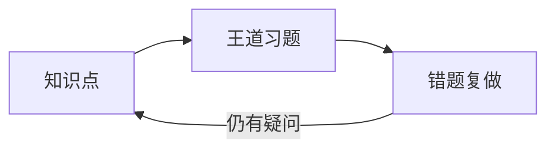

# 操作系统：知识点与王道习题

这个专栏用于整理操作系统知识点，以及做王道计算机考研操作系统习题时形成的理解、解题过程和错题复盘。内容会随着学习与复做逐步补充。

!!! info "当前内容进度"
    第 1 章已整理 4 组视频题，共 30 道。题干和选项可以搜索、复制；答案与解析需点击展开。其中 2 道题的答案仍待核对。个人首次作答、复做结果，以及对应王道教材的版次和书上题号尚未提供。知识点页及第 2～5 章目前仍是框架，不能视为学习进度。

[直接做第 1 章的题](01-操作系统概述/王道习题与错题.md){ .md-button .md-button--primary }
[查看第 1 章导览](01-操作系统概述/index.md){ .md-button }

## 按章节学习

1. [操作系统概述](01-操作系统概述/index.md)：4 组视频题已整理；知识点页待补充。
2. [进程与线程](02-进程与线程/index.md)：调度、同步与死锁；目前为框架。
3. [内存管理](03-内存管理/index.md)：地址转换、分配和虚拟内存；目前为框架。
4. [文件管理](04-文件管理/index.md)：文件、目录与文件系统；目前为框架。
5. [输入输出管理](05-输入输出管理/index.md)：设备、缓冲和磁盘；目前为框架。

## 怎么使用这个专栏

每章先看**本章导览**，再看对应知识点，最后进入**王道习题与错题**。习题会按教材版次、章节和题号定位，并链接回相关知识点；做错或暂时没有独立解决的题，会保留复做记录，不直接标记为掌握。

跨章节的问题放进[易混概念](综合复盘/易混概念.md)和[计算题与常见陷阱](综合复盘/计算题与常见陷阱.md)。
