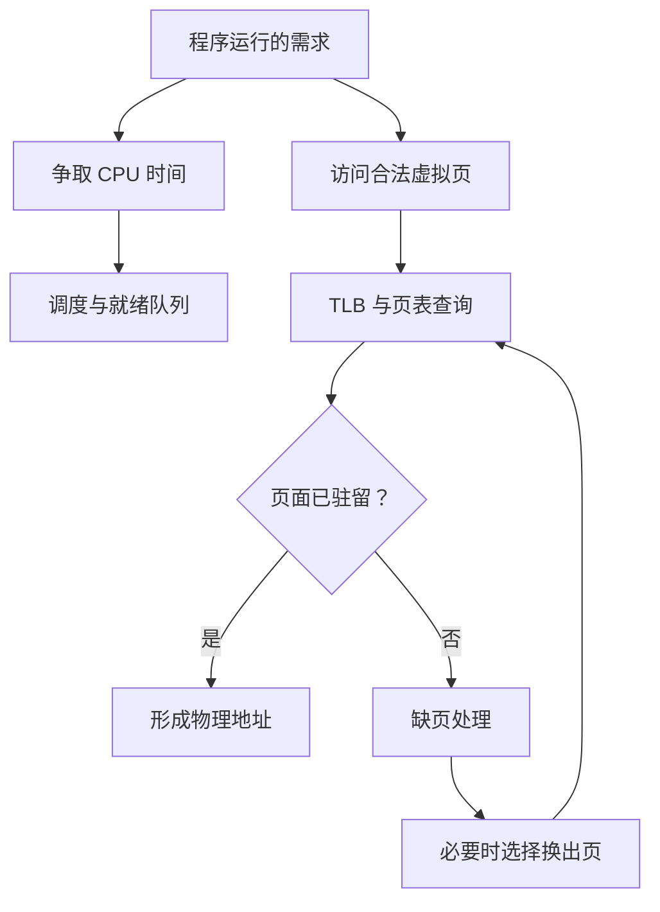
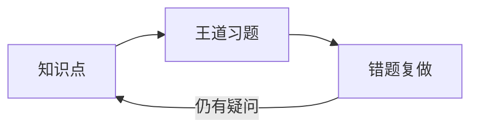

# 操作系统：知识点与王道习题

这个专栏用于整理操作系统知识点，以及做王道计算机考研操作系统习题时形成的理解、解题过程和错题复盘。内容会随着学习与复做逐步补充。

!!! info "当前内容进度"
    第 1 章已整理 4 组视频题，共 30 道，其中 2 道题的答案仍待核对。第 2 章补入调度图解，第 3 章补入地址转换与页面置换图解，均为通用机制讲解与教学算例。其余知识点仍待补充；个人首次作答、复做结果，以及王道教材版次和书上题号尚未提供。页面内容不等于个人学习进度。

[直接做第 1 章的题](01-操作系统概述/王道习题与错题.md){ .md-button .md-button--primary }
[查看第 1 章导览](01-操作系统概述/index.md){ .md-button }

## 先把运行过程连起来 { #os-map }

程序运行时，一面争取 CPU，一面使用虚拟地址访问数据。沿着下面三个问题读，能把“执行顺序”“地址映射”和“内存容量”放回同一个过程。

- 01 / CPU 时间

    **什么时候轮到我？第一次运行与最终完成差在哪里？**

    在同一组进程上切换 FCFS 与 RR，观察时间轴、就绪队列和三个时间指标。

    [打开调度时间轴 →](02-进程与线程/进程线程与调度.md#scheduling-lab)

- 02 / 地址映射

    **程序里的地址，怎样找到物理内存？**

    拆出页号与偏移，沿 TLB、页表追到页框，区分未命中、缺页和非法访问。

    [打开地址转换 →](03-内存管理/内存管理基础.md#paging-lab)

- 03 / 内存容量

    **页面不在内存，是否一定要换出别的页？**

    同步推进 FIFO 与 LRU，分别数清命中、缺页和实际换出。

    [打开页面置换 →](03-内存管理/虚拟内存与页面置换.md#replacement-lab)

先手算一步，再操作演示，最后到 [计算题与常见陷阱](综合复盘/计算题与常见陷阱.md) 核对计算条件。涉及 I/O、权限或切换开销时，需要补上演示中省略的条件。

## 按章节学习

1. [操作系统概述](01-操作系统概述/index.md)：4 组视频题已整理；知识点页待补充。
2. [进程与线程](02-进程与线程/index.md)：调度机制与交互算例已补入；其余内容待整理。
3. [内存管理](03-内存管理/index.md)：分页转换、FIFO / LRU 已补入；其余内容待整理。
4. [文件管理](04-文件管理/index.md)：文件、目录与文件系统；目前为框架。
5. [输入输出管理](05-输入输出管理/index.md)：设备、缓冲和磁盘；目前为框架。

## 怎么使用这个专栏

每章先看**本章导览**，再看对应知识点，最后进入**王道习题与错题**。习题会按教材版次、章节和题号定位，并链接回相关知识点；做错或暂时没有独立解决的题，会保留复做记录，不直接标记为掌握。

跨章节的问题放进[易混概念](综合复盘/易混概念.md)和[计算题与常见陷阱](综合复盘/计算题与常见陷阱.md)。
