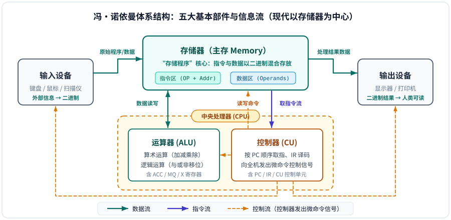
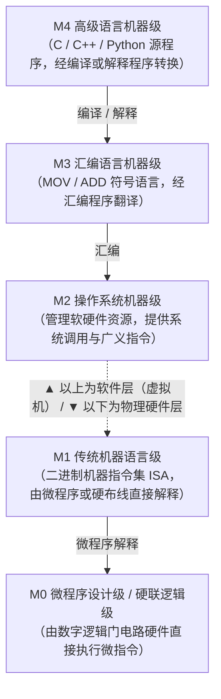

# 第1章：计算机系统概述

!!! note "参考资料"
    参考课堂讲义：[计算机系统概述 PPT](https://github.com/xurry-ace/mynotes/releases/download/pdf-assets/co-ch1-overview-20260311.pdf)

作为大二学生开始学习《计算机组成原理》是非常关键的一步。这门课的核心教学目标是帮你理解计算机的组成结构和运行机理，把计算机从“黑盒”变成“白盒”，从“玩具”变成“工具”。

第一章“计算机系统概述”是整门课程的基石，主要为你建立起计算机系统的整体宏观概念。

---

## 核心知识点

### 1. 计算机的发展简史与分类

计算机硬件随着核心物理器件的迭代经历了五代演变：

| 发展代次 | 核心逻辑器件 | 典型特征与代表应用 |
| :---: | :--- | :--- |
| **第一代** | 电子管 | 体积庞大、功耗高，主要用于科学计算与数据处理（如 **ENIAC**） |
| **第二代** | 晶体管 | 体积缩小、可靠性提升，开始引入高级语言与工业控制应用 |
| **第三代** | 中小规模集成电路（SSI/MSI） | 操作系统成熟，**小型机**出现，软件逐渐形成独立产业 |
| **第四代** | 大规模/超大规模集成电路（LSI/VLSI） | 微处理器诞生，正式进入**个人计算机（PC）**与网络时代 |
| **第五代** | 巨大规模集成电路（ULSI）/ 单片系统 | 单片微型计算机（SoC）、多核并行与智能计算广泛普及 |

-   **📈 摩尔定律（Moore's Law）**

    ---

    在价格不变的情况下，集成电路芯片上可容纳的元器件数目（集成度）约**每 18 个月翻一番**，性能也将提升一倍，极大推动了现代计算机硬件的指数级演进。

-   **🔀 模拟计算机 vs 数字计算机**

    ---

    按处理信号形式划分：**模拟计算机**直接处理连续变化的电压/电流等物理量；**数字计算机**按二进制位离散运算，精度高、存储能力与逻辑判断能力强。

---

### 2. 计算机的硬件系统（核心重点）

- **冯·诺依曼体系结构**：现代计算机的基石，核心设计思想是 ==“存储程序”和“程序控制”== ——将事先编制好的**指令**和待处理的**数据**统一以二进制形式存放在同一个存储器中，计算机在工作时按地址自动、顺序地取出指令并执行。
- **五大基本部件**：**运算器**（实现算术和逻辑运算）、**控制器**（分析指令并发出控制信号）、**存储器**、**输入设备**和**输出设备**。其中，==运算器和控制器共同组成中央处理器（CPU）==。

| 对比维度 | 冯·诺依曼体系结构（普林斯顿结构） | 哈佛体系结构（Harvard Architecture） |
| :--- | :--- | :--- |
| **存储组织** | 指令与数据**混合存放**在同一个存储器中 | **指令存储器**与**数据存储器**物理分离 |
| **总线通道** | 共享同一套数据/地址总线（易产生访存瓶颈） | 采用**独立的两套总线**，可同时取指与读写数据 |
| **优缺点** | 结构简单、存储空间利用率高；串行访存吞吐受限 | 并行度高、流水线效率高；连线与控制硬件较复杂 |
| **典型应用** | 传统通用计算机主存架构（CPU 外部主存） | DSP 芯片、ARM/单片机内部及现代 **CPU L1 指令/数据分离 Cache** |

---

### 3. 计算机的软件系统与层次结构

软件是用户与物理硬件之间的桥梁，按职能分为**系统软件**（操作系统、数据库管理系统、语言处理程序、分布式软件等，用来管理整个系统资源）和**应用软件**（如 Word、浏览器及用户按任务编写的程序）。

#### （1）多级抽象层次结构

现代计算机系统可看作由下至上层层封装的多级虚拟机（其中 **M1 与 M2 之间是传统硬件与软件的分界线**）：

> **软件与硬件的逻辑等价性**：任何由硬件实现的操作在逻辑上都可以由软件子程序模拟实现（如早期无浮点硬件时用软件算浮点），任何软件算法也可固化为专用硬件电路。两者权衡的核心在于**硬件速度快但成本高、灵活性差；软件成本低、易于修改但执行较慢**。

#### （2）三种语言处理程序对比

| 翻译程序类型 | 源语言 $\rightarrow$ 目标语言 | 工作机制与核心特点 |
| :---: | :---: | :--- |
| **汇编程序（Assembler）** | 汇编语言 $\rightarrow$ 机器语言 | 用助记符代替二进制指令码，基本呈一一对应翻译，生成目标程序 |
| **编译程序（Compiler）** | 高级语言 $\rightarrow$ 机器/汇编语言 | 执行前将源程序**整体一次性翻译**为独立目标程序，运行效率高（如 C/C++） |
| **解释程序（Interpreter）** | 高级语言 $\rightarrow$ 逐句解释执行 | **边翻译边执行**，翻译一句立即执行一句，**不生成独立的目标程序**（灵活性高但较慢） |

---

### 4. 计算机系统性能评价（必考计算点）

这是第一章最核心的量化计算板块。一个机器周期包含若干个时钟周期，而时钟周期是主频的倒数。先把核心指标与公式关系梳理成一张总表：

| 性能指标 | 符号与常用单位 | 定义与计算公式 | 核心物理含义 |
| :--- | :---: | :--- | :--- |
| **主频（时钟频率）** | $f$（$\text{MHz} / \text{GHz}$） | $f = \dfrac{1}{T_{\text{clock}}}$（$1\text{MHz}=10^6\text{Hz}$，$1\text{GHz}=10^9\text{Hz}$） | CPU 内部数字脉冲信号振荡的速度 |
| **CPU 时钟周期** | $T_{\text{clock}}$（$\text{ns} / \mu\text{s}$） | $T_{\text{clock}} = \dfrac{1}{f}$ | CPU 中最小的基本时间单位，每个动作至少占 1 周期 |
| **CPI** | 周期/条 | $\text{CPI} = \dfrac{C}{\text{IC}} = \dfrac{\sum (\text{IC}_i \times \text{CPI}_i)}{\sum \text{IC}_i}$ | 执行一条指令所需的**平均时钟周期数**（多种指令加权平均） |
| **IPC** | 条/周期 | $\text{IPC} = \dfrac{1}{\text{CPI}}$ | 每个时钟周期平均完成的指令条数（体现超标量等微架构效率） |
| **CPU 执行时间** | $T_{\text{CPU}}$（$\text{s} / \text{ms}$） | $T_{\text{CPU}} = C \times T_{\text{clock}} = \dfrac{\text{IC} \times \text{CPI}}{f}$ | 运行整个程序实际耗费的 CPU 时间（排除 I/O 等待） |
| **MIPS** | 百万条/秒 | $\text{MIPS} = \dfrac{\text{IC}}{T_{\text{CPU}} \times 10^6} = \dfrac{f}{\text{CPI} \times 10^6} = \dfrac{f\text{(MHz)}}{\text{CPI}}$ | 每秒执行的**百万条定点指令数** |
| **MFLOPS** | 百万次/秒 | $\text{MFLOPS} = \dfrac{\text{浮点操作次数}}{T_{\text{CPU}} \times 10^6}$ | 每秒执行的**百万次浮点运算数**（衡量科学计算能力） |

**重点公式单独熟记：**

$$\text{CPI} = \frac{C}{\text{IC}} = \frac{\sum (\text{IC}_i \times \text{CPI}_i)}{\sum \text{IC}_i}, \qquad T_{\text{CPU}} = \text{IC} \times \text{CPI} \times T_{\text{clock}} = \frac{\text{IC} \times \text{CPI}}{f}$$

$$\text{MIPS} = \frac{\text{IC}}{T_{\text{CPU}} \times 10^6} = \frac{f}{\text{CPI} \times 10^6}, \qquad \text{MFLOPS} = \frac{\text{浮点操作次数}}{T_{\text{CPU}} \times 10^6}$$

!!! tip "常用单位换算与 CPU 性能铁三角"
    - **时间单位换算**：$1\text{ms（毫秒）} = 10^{-3}\text{s}$，$1\mu\text{s（微秒）} = 10^{-6}\text{s}$，$1\text{ns（纳秒）} = 10^{-9}\text{s}$。注意频率与运算速率中的 $\text{M}$、$\text{G}$ 按**十进制幂**（$10^6$、$10^9$）换算！  
    - **CPU 性能三要素**：由 $T_{\text{CPU}} = \dfrac{\text{IC} \times \text{CPI}}{f}$ 可知，总指令数 $\text{IC}$（取决于指令集与编译器）越少、平均 $\text{CPI}$（取决于微架构与流水线）越小、主频 $f$（取决于制造工艺与电路设计）越高，程序执行越快。复习本章重点吃透 **“存储程序”机制** 与 **CPI / MIPS / 执行时间计算题**。

---

## 课后习题

### P21-16：CPI、MIPS 与程序执行时间计算

!!! question "题目描述"
    某台主频为 $400\text{MHz}$ 的计算机执行标准测试程序，程序中指令类型、指令执行数量和平均时钟周期数如下表所示。求该计算机的：(1) 平均 CPI；(2) MIPS；(3) 程序执行时间。

    | 指令类型 | 指令执行数量 ($\text{IC}_i$) | 平均时钟周期数 ($\text{CPI}_i$) |
    | :---: | :---: | :---: |
    | 整数 | 45000 | 1 |
    | 数据传送 | 75000 | 2 |
    | 浮点 | 8000 | 4 |
    | 分支 | 1500 | 2 |

查看答案与解析

**解析：**

**（1）求平均 CPI**

先求程序执行的总指令条数 $N$ 与耗费的总时钟周期数 $C$：

$$\begin{aligned}
N &= 45000 + 75000 + 8000 + 1500 = 129500 \\
C &= 45000 \times 1 + 75000 \times 2 + 8000 \times 4 + 1500 \times 2 \\
  &= 45000 + 150000 + 32000 + 3000 = 230000
\end{aligned}$$

因此加权平均 CPI 为：

$$\text{CPI} = \frac{C}{N} = \frac{230000}{129500} \approx 1.78$$

**（2）求 MIPS**

代入主频 $f = 400\text{MHz}$ 与 $\text{CPI} \approx 1.78$：

$$\text{MIPS} = \frac{f}{\text{CPI} \times 10^6} = \frac{400}{1.78} \approx 224.7 \approx 225$$

**（3）求程序执行时间**

由总时钟周期数 $C = 230000$ 与主频 $f = 400\text{MHz} = 4 \times 10^8\text{Hz}$ 得：

$$T = \frac{C}{f} = \frac{230000}{4 \times 10^8\text{Hz}} = 5.75 \times 10^{-4}\text{s} = 0.575\text{ms}$$

!!! success "最终答案"
    **(1)** 平均 $\text{CPI} \approx 1.78$；**(2)** $\text{MIPS} \approx 224.7$（约 $225$）；**(3)** 程序执行时间 $T = 0.575\text{ms}$。

!!! warning "考点延伸辨析：主频或 MIPS 越高，CPU 性能就一定越强吗？"
    - **主频高 $\neq$ 整体性能一定高**：同系列计算机在同等条件下主频越高越快，但跨架构对比时，**平均 CPI 和总指令数 IC 同样决定最终执行时间**，还要综合流水线、Cache 命中率、指令集与字长等因素。
    - **MIPS 也不能完全反映 CPU 性能**：因为不同指令的复杂度差异很大，且不同 CPU（如 RISC 与 CISC）的指令系统不同——一条复杂指令可能顶好几条简单指令，因此单纯比每秒执行的指令条数（MIPS）可能产生误导。

