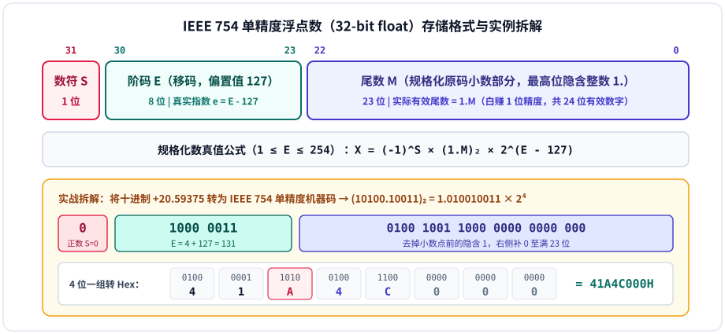
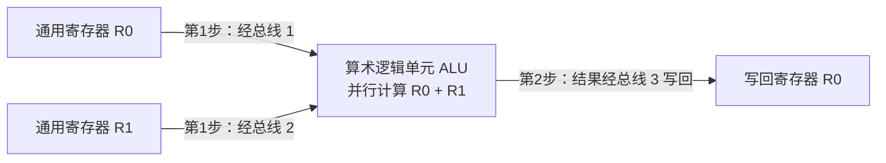
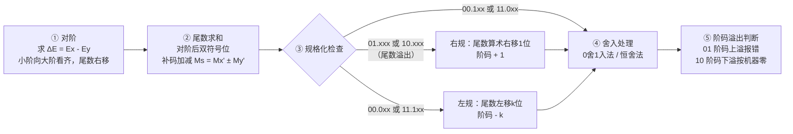

# 第2章：运算方法和运算器

!!! note "参考讲义（周老师课堂 PPT）"
    运算方法和运算器配套课件下载：  
    [PPT 1：数制与编码](https://github.com/xurry-ace/mynotes/releases/download/pdf-assets/co-ch2-arith-1.pdf) ｜ [PPT 2：定点运算与运算器](https://github.com/xurry-ace/mynotes/releases/download/pdf-assets/co-ch2-arith-2.pdf) ｜ [PPT 3：浮点运算与校验](https://github.com/xurry-ace/mynotes/releases/download/pdf-assets/co-ch2-arith-3.pdf)

---

## 核心考点

### 核心考点 1：机器数的底层逻辑与转换（必考基础）

考试中，**原码、反码、补码、移码**的相互转换以及表示范围是必考的选择/填空题，也是后面做浮点与加减大题的根基。先用一张表把四码规则彻底立住（以 **8 位带符号整数**为例）：

| 编码类型 | 正数编码规则 | 负数编码规则 | 零的表示是否唯一 | 8 位整数真值范围 | 核心定位与用途 |
| :---: | :--- | :--- | :---: | :---: | :--- |
| **原码** | 最高位 `0` + 绝对值 | 最高位 `1` + 绝对值 | 否（`+0=00H`, `-0=80H`） | $-127 \sim +127$ | 直观，用于**浮点数尾数**与原码乘除 |
| **反码** | 与原码相同 | 符号位保持 `1`，数值位**按位取反** | 否（`+0=00H`, `-0=FFH`） | $-127 \sim +127$ | 原码转补码的中间过渡桥梁 |
| **补码** | 与原码相同 | 反码**末位加 1**（符号位不变） | **唯一**（`0000 0000`） | ==$-128 \sim +127$== | 计算机有符号整数标准编码，**变减法为加法**（`1000 0000` 表示 $-128$） |
| **移码** | 补码符号位取反（`1` 正） | 补码符号位取反（`0` 负） | **唯一**（`1000 0000`） | $-128 \sim +127$ | **专用于浮点数阶码**，无符号大小直接对应真值大小 |

-   **🕰️ 补码的本质：“模”的概念与神级转换技巧**

    ---

    - **时钟类比**：机器字长有限（如 8 位），运算是“有模的”——就像时钟模为 12，时针退 3 格（$-3$）和进 9 格（$+9$）停在同一位置。对于字长 $n+1$ 位的定点整数，模为 $2^{n+1}$；当 $-2^n \le X \le 0$ 时，$[X]_{\text{补}} = 2^{n+1} + X$。
    - **原码 $\leftrightarrow$ 补码互转**：负数最快求法是**保留符号位 `1` 不变，其余数值位取反、末位加 1**；已知负数补码逆推原码也是完全同一套动作！
    - **求相反数 $[-X]_{\text{补}}$**：把 $[X]_{\text{补}}$ **连同符号位在内的全部位按位取反，末位加 1**（做补码减法 $[X-Y]_{\text{补}}$ 必用）。

-   **⚖️ 移码：为什么专给浮点数阶码使用？**

    ---

    - **快速求法**：标准移码（偏置 $2^n$）的数值位与补码完全相同，**只需把补码的符号位取反**（`1` 表示正，`0` 表示负）。（注：IEEE 754 单精度阶码偏置值为 $127 = 2^7 - 1$，比标准 8 位移码偏置 $128$ 少 $1$！）
    - **硬件优势**：把移码的所有位直接看作无符号二进制数比大小，结果与实际真值大小顺序完全一致，浮点数**对阶比大小**时硬件电路极快。

---

### 核心考点 2：IEEE 754 浮点数标准（100% 必考计算大题）

这是全书最大的重点之一，常考十进制数与 IEEE 754 十六进制机器码的双向互转。以最常考的 **32 位单精度浮点数（`float`）** 为例：

#### （1）考试实战演练：十进制 → IEEE 754 单精度

以 **将十进制数 $20.59375$ 转换为 IEEE 754 单精度格式** 为例，严格按四步走：

1. **第一步（化二进制）**：整数部分 $20 = 10100_2$，小数部分 $0.59375 = 0.5 + 0.0625 + 0.03125 = 0.10011_2$，合并得 $10100.10011_2$。
2. **第二步（规格化移位）**：写成二进制科学计数法 $1.010010011 \times 2^4$。注意小数点前的 **`1` 被隐含省去**，尾数 $M = \text{01001001100000000000000}$，真实指数 $e = 4$。
3. **第三步（加偏置求阶码 $E$）**：$E = e + 127 = 4 + 127 = 131 = 10000011_2$。
4. **第四步（按位拼接转十六进制）**：正数符号位 $S = 0$，拼成 32 位 `0 10000011 01001001100000000000000`，从左到右每 4 位一组化为十六进制即 ==`41A4C000H`==（切记第 23 位是阶码末位与尾数高 3 位拼成 `1010 = A`！）。

#### （2）常考极端值与特殊编码全表（高频陷阱点）

| 浮点数状态分类 | 阶码 $E$（8 位） | 尾数 $M$（23 位） | 真值计算公式或含义 |
| :--- | :---: | :---: | :--- |
| **机器零（$\pm 0$）** | 全 `0`（$0$） | 全 `0` | $+0.0$ 或 $-0.0$ |
| **非规格化数** | 全 `0`（$0$） | 不全为 `0` | 隐藏位变为 **`0`**，真值 $x = (-1)^S \times (0.M) \times 2^{-126}$（平滑过渡到 $0$） |
| **最小规格化正数** | `0000 0001`（$1$） | 全 `0` | $1.0 \times 2^{1-127} = \mathbf{1.0 \times 2^{-126}}$ |
| **一般规格化数** | $1 \sim 254$ | 任意 | $X = (-1)^S \times (1.M) \times 2^{E-127}$ |
| **最大规格化正数** | `1111 1110`（$254$） | 全 `1` | $+(2 - 2^{-23}) \times 2^{254-127} = \mathbf{+(2 - 2^{-23}) \times 2^{+127}}$ |
| **无穷大（$\pm\infty$）** | 全 `1`（$255$） | 全 `0` | 上溢时的正无穷 $+\infty$（$S=0$）或负无穷 $-\infty$（$S=1$） |
| **非数（NaN）** | 全 `1`（$255$） | 不全为 `0` | 非法运算结果（如 $0/0$、$\sqrt{-1}$） |

---

### 核心考点 3：定点数加减运算与“溢出检测”（必考判断/计算）

依靠补码，减法完美转化为加法：$[X+Y]_{\text{补}} = [X]_{\text{补}} + [Y]_{\text{补}}$，$[X-Y]_{\text{补}} = [X]_{\text{补}} + [-Y]_{\text{补}}$。

- **溢出的判定本质**：只有**两个正数相加得负数（正溢/上溢）**，或**两个负数相加得正数（负溢/下溢）**才会发生溢出；一正一负相加绝不可能溢出！

-   **方法一：单符号位进位异或法**

    ---

    $$V = C_{n-1} \oplus C_f$$

    - $C_{n-1}$：最高数值位向符号位产生的进位
    - $C_f$：符号位向更高位产生的进位
    - **判据**：若两个进位不一致（$V = 1$），说明发生**溢出**；若相同（$V = 0$），则无溢出。

-   **方法二：双符号位法（变形补码 · 超高频）**

    ---

    运算时采用双符号位 $S_{f1}S_{f2}$（正数设为 `00`，负数设为 `11`），逻辑表达式 $V = S_{f1} \oplus S_{f2}$：

    | 双符号位 $S_{f1}S_{f2}$ | 结果状态判定 |
    | :---: | :--- |
    | **`00`** | 结果为正，**无溢出** |
    | **`11`** | 结果为负，**无溢出** |
    | ==**`01`**== | **正溢出（上溢）**（本应为正，算出了负） |
    | ==**`10`**== | **负溢出（下溢）**（本应为负，算出了正） |

---

### 交互图解：进位不等于溢出 { #signed-lab }

先把两个问题分开：**硬件留下了哪 8 位？这 8 位能否正确表示本次有符号加法的真值？** 8 位补码范围为 `[-128, 127]`。最高位之外的进位只说明无符号位模式相加超过了 255，不能独立判断有符号溢出。

静态示例：100 + 60 = 160，超过 8 位补码上限；低 8 位为 10100000，按补码解码为 -96，因此有符号溢出。相反，-1 + -1 的位模式相加有最高位进位，低 8 位为 11111110，解码为 -2，仍是正确真值，没有有符号溢出。

!!! question "先试两个反例"
    先选择“有进位但不溢出”，再选择“正溢出”。能不能出现 `C=1, V=0` 和 `C=0, V=1`？两种都能出现，所以不能拿进位标志代替溢出标志。

这里演示的是固定 8 位加法器的位模式与补码解释，**不是让 C++ 有符号整数溢出后继续计算**。写程序时应使用足够宽的类型或在运算前检查范围。

### 核心考点 4～6：乘除法、奇偶校验码与多总线运算器

-   **✖️ 核心考点 4：乘除法硬件规律**

    ---

    - **阵列乘法器**：若被乘数和乘数是**负数补码**，硬件在相乘前会先去掉符号位，将其余数值位**求反加 1**（自动转为原码绝对值）送入乘法阵列，最后经算后求补器补上正确符号。
    - **不恢复余数除法（加减交替法）**：余数为**负** $\rightarrow$ 商 `0`，下一步余数左移（或除数右移）并**加除数**；余数为**正** $\rightarrow$ 商 `1`，下一步**减除数**。

-   **🛡️ 核心考点 5：奇偶校验码（常考选择）**

    ---

    无论奇校验还是偶校验，核心都看 ==“数据位 + 1 位校验位”整体中 `1` 的总个数==：

    | 校验方式 | 整体中 `1` 的个数要求 | 示例：数据 `1010101`（已有 4 个 `1`） |
    | :---: | :---: | :---: |
    | **偶校验** | 必须凑成**偶数**个 | 附加校验位填 **`0`** |
    | **奇校验** | 必须凑成**奇数**个 | 附加校验位填 **`1`** |

#### 核心考点 6：多总线运算器结构

现代 CPU 内部采用多总线数据通路加速寄存器间运算。例如在**三总线结构**中，执行加法指令 `ADD R0, R1` 只需两步并行操作：

> **💡 考前复习策略建议**：考试前务必拿草稿纸独立手算一遍 **IEEE 754 单精度浮点数的双向转换**（十进制 $\leftrightarrow$ 8 位十六进制机器码），并默写一遍**双符号位法（变形补码）的四种状态含义**。

!!! tip "个人学习吐槽"
    额，我觉得这种补码运算，以及二进制的乘除法都非常简单。  
    把 PPT 上的题目弄会了，理解计算机如何进行二进制运算就行了，以及 IEEE 754 浮点数，把二进制理解了，一点都不难。  
    我就不把 PPT 里的基础题目拿出来分析了，其实这部分知识密度很小，但是不知道周老师为什么要拿三个 PPT 讲。

---

## 课后习题

**大部分题目我就不单拎出来说了，PPT 和作业后面的题目都比较简单，下面对作业解析不太详细的题目做一些补充。**

### P69-9：浮点数加减法运算（双符号位补码）

#### 1. 前提约定与标准五步流程

设两个规格化浮点数分别为 $x = M_x \times 2^{E_x}$，$y = M_y \times 2^{E_y}$：

- **$M_x, M_y$（尾数 Mantissa）**：纯小数，规格化绝对值 $|M| \in [0.5, 1)$，采用双符号位补码（`00` 为正，`11` 为负）。
- **$E_x, E_y$（阶码 Exponent）**：整数，采用双符号位补码或移码（如 `11 100` 对应真值 $-4$），中间运算用双符号位直接判溢出。

1. **对阶（小阶向大阶看齐）**：通过补码减法求阶差 $[\Delta E]_{\text{补}} = [E_x]_{\text{补}} + [-E_y]_{\text{补}}$。若 $\Delta E > 0$（$E_x > E_y$），$y$ 的尾数算术右移 $\Delta E$ 位、$E_y$ 加 $\Delta E$；若 $\Delta E < 0$（$E_x < E_y$），$x$ 的尾数算术右移 $|\Delta E|$ 位、$E_x$ 加 $|\Delta E|$。
2. **尾数求和**：对阶后的尾数按双符号位补码相加得 $M_s = M_x' + M_y'$（`00.xxx` 正、`11.xxx` 负、`01.xxx` 尾数正溢、`10.xxx` 尾数负溢）。
3. **规格化处理**：将和尾数调整为最高数值位与符号位相反的形式：
   - **左规**：双符号位相同但最高数值位与符号位相同（`00.0...` 或 `11.1...`）$\rightarrow$ 尾数左移 1 位、阶码减 1，直至成为 `00.1...` 或 `11.0...`。
   - **右规**：尾数双符号位不同（`01.xxx` 或 `10.xxx`）$\rightarrow$ 尾数算术右移 1 位（高位补 $S_{f1}$）、阶码加 1。
4. **舍入处理**：右移（对阶或右规）移出的低位按 **0 舍 1 入法**（移出最高位为 `1` 则末位加 `1`）或**恒舍法**（直接截断）处理。
5. **溢出判断**：检查**最终阶码**的双符号位——`00` 或 `11` 无溢出；`01` 为**阶码上溢**（置溢出中断）；`10` 为**阶码下溢**（按机器零处理）。

| 符号 | 含义 | 本题（1）数值追踪（双符号位补码） |
| :--- | :--- | :--- |
| $E_x$ / $[E_x]_{\text{补}}$ | $x$ 的阶码真值与机器表示 | $-5$（二进制 $-101$） / `11 011` |
| $M_x$ / $[M_x]_{\text{补}}$ | $x$ 的尾数真值与机器表示 | $-0.010110$ / `11.101010` |
| $\Delta E$ | 阶差 $E_x - E_y$ | $-1$（对应补码 `11 111`） |
| $M_x'$、$M_y'$ | 对阶后的尾数 | $M_x' = 11.110101$，$M_y' = 00.010110$ |
| $M_s$、$E_s$ | 尾数之和与当前阶码 | $M_s = 00.001011$，$E_s = 11\,100$ |
| $M_s'$、$E_s'$ | 规格化后的尾数与阶码 | $M_s' = 00.101100$，$E_s' = 11\,010$ |
| 最终结果 | $x + y = M_{\text{final}} \times 2^{E_{\text{final}}}$ | $2^{-110} \times 0.101100$ |

---

#### 2. 手写解题过程整理

!!! question "题目（1）"
    已知 $x = 2^{-101} \times (-0.010110)$，$y = 2^{-100} \times 0.010110$，求 $[x+y]$（阶码指数为二进制）。

查看答案与解析

**解（我自己手写的解题过程整理）：**

- **准备：化为双符号位补码**
  - 尾数：$M_x = [-0.010110]_{\text{补}} = 11.101010$，$M_y = [0.010110]_{\text{补}} = 00.010110$
  - 阶码：$E_x = [-101]_{\text{补}} = [11\,101]_{\text{原转补}} = 11\,011$，$E_y = [-100]_{\text{补}} = 11\,100$
  - 浮点机器格式（阶码, 尾数）：$[x]_{\text{浮}} = 11\,011,\ 11.101010$；$[y]_{\text{浮}} = 11\,100,\ 00.010110$

- **第 ① 步：求阶差并对阶**

$$\Delta E = E_x - E_y \implies [\Delta E]_{\text{补}} = [E_x]_{\text{补}} + [-E_y]_{\text{补}} = 11\,011 + 00\,100 = 11\,111 \quad (\text{真值 } \Delta E = -1)$$

说明 $E_x < E_y$。按“小阶向大阶看齐”，将 $M_x$ 算术右移 1 位（高位补 `1`），$E_x$ 加 1 对齐到 `11 100`：

$$[x]_{\text{浮}}' = 11\,100,\ 11.110101$$

- **第 ② 步：尾数求和**

$$M_s = M_x' + M_y = 11.110101 + 00.010110 = 00.001011 \quad (\text{最高位进位 } 1 \text{ 自然丢弃})$$

- **第 ③ 步：规格化处理（左规）**  
  当前尾数 $M_s = 00.001011$ 非规格化，需**左移 2 位**使小数点后第一位变为 `1`（$M_s' = 00.101100$），同时阶码减 2（加上 $[-010]_{\text{补}} = 11\,110$）：

$$E_s' = 11\,100 + 11\,110 = 11\,010 \quad \Longrightarrow \quad [E_s']_{\text{原}} = 11\,110 \ (\text{真值 } -110)$$

- **第 ④～⑤ 步：舍入与溢出判断**  
  阶码双符号位为 `11`，未发生溢出。

!!! success "题目（1）最终答案"
    $$x + y = 2^{-110} \times (0.101100)$$

!!! question "题目（2）"
    已知 $x = 2^{-101} \times (-0.010110)$，$y = 2^{-100} \times 0.010110$，求 $[x-y]$。

查看答案与解析

**解：** 略，这道题 PPT 上解析很清晰，先将 $[y]_{\text{补}}$ 连同符号位取反加 1 求得 $[-y]_{\text{补}}$，其余步骤与（1）同理计算即可。

