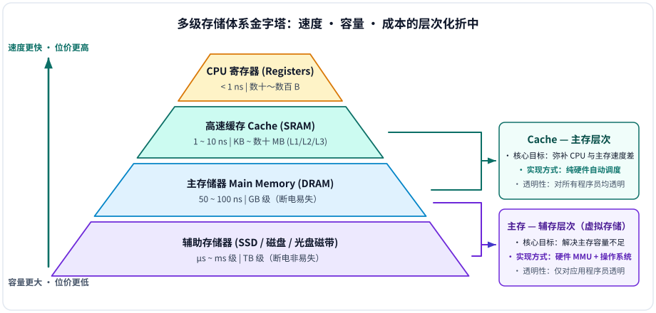
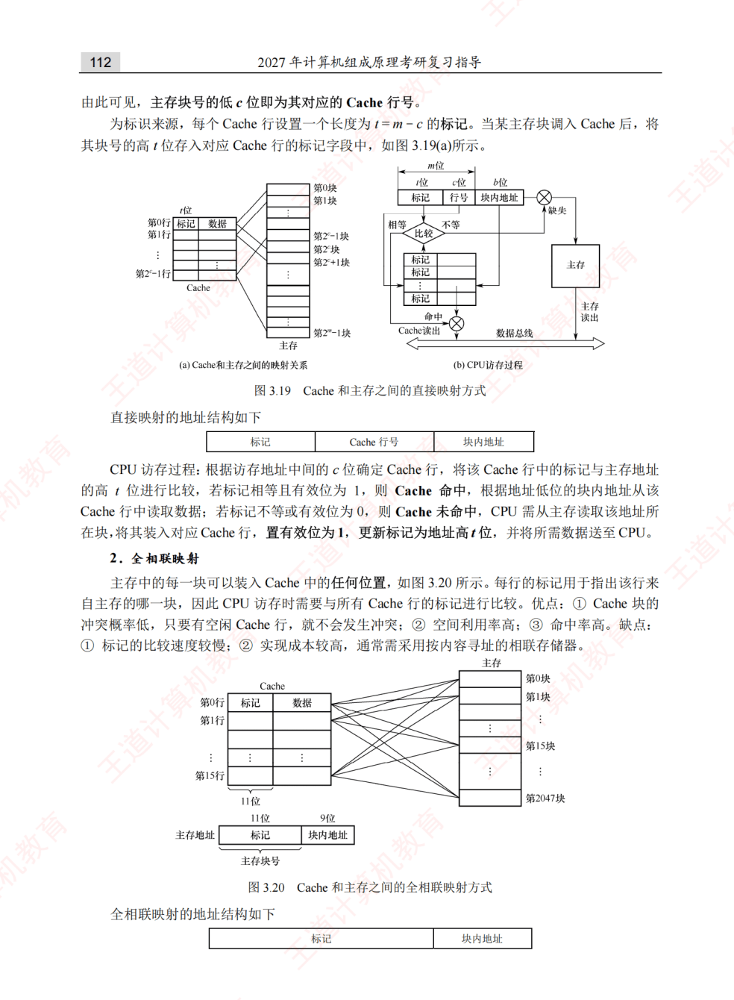
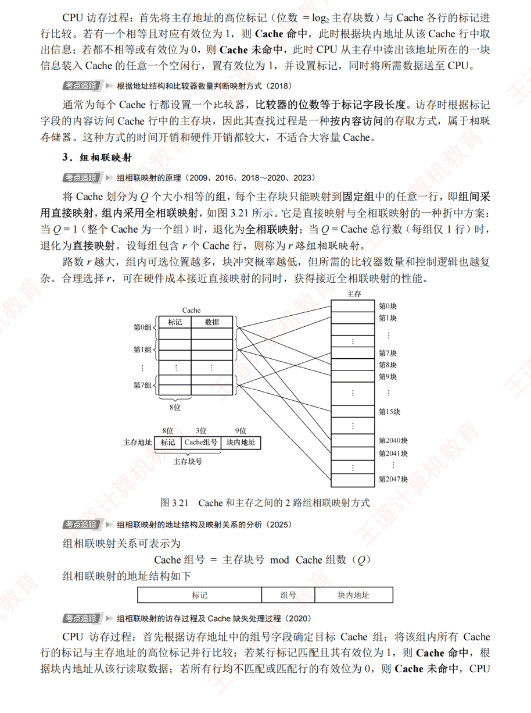
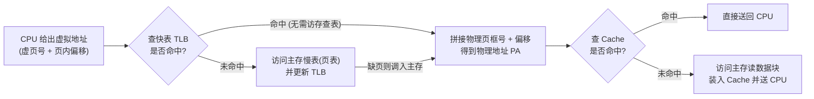
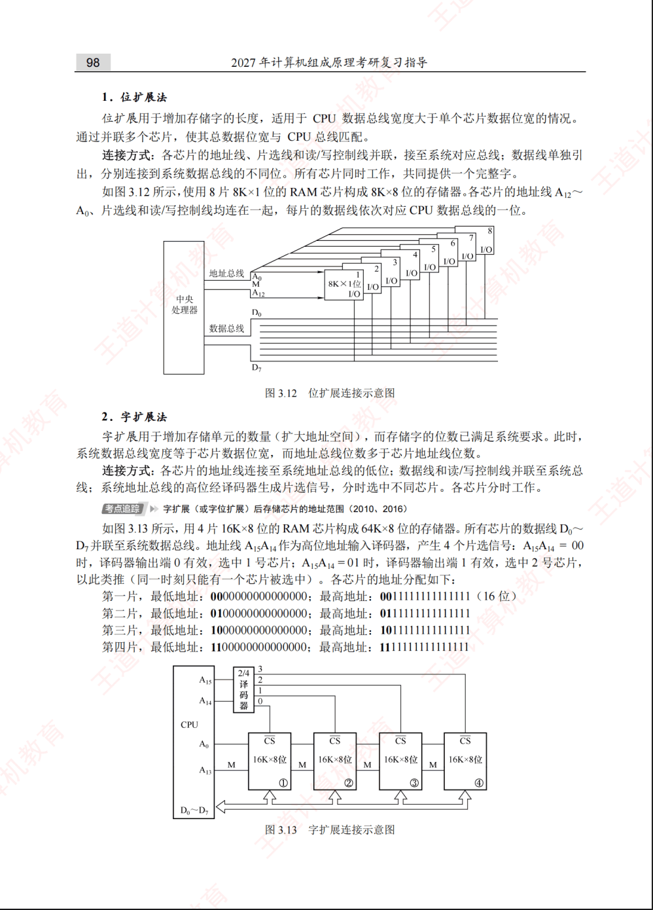
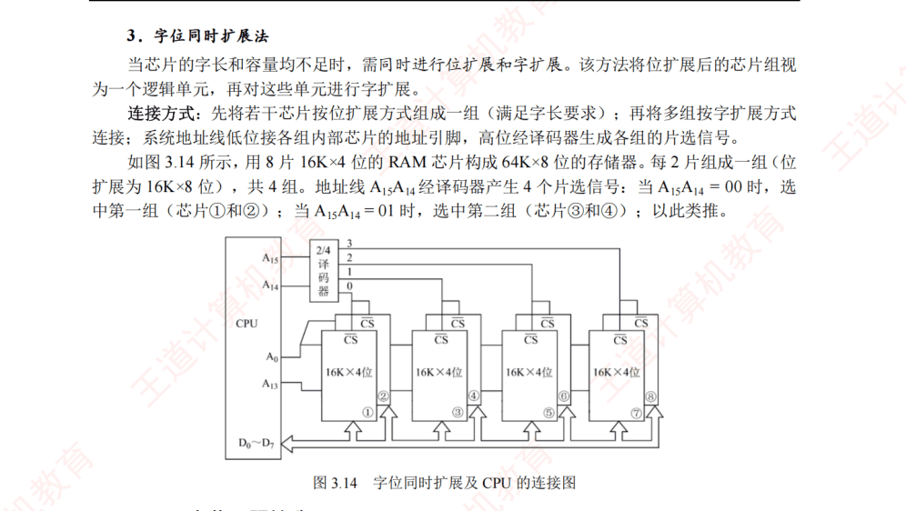

# 第3章：存储系统

第三章“存储系统”是《计算机组成原理》中**承上启下、也是期末考试必考大题的绝对核心**。如果说前两章是在研究 CPU 如何“算”，那么这一章就是研究数据如何“存”。

存储系统设计的核心矛盾是：==容量大、速度快、成本低三者不可兼得==。为了解决这个矛盾，现代计算机采用了**多级存储体系**（寄存器 $\rightarrow$ Cache $\rightarrow$ 主存 $\rightarrow$ 辅存）：



---

## 核心知识点

### 1. 核心基础：主存技术指标与数据组织

<div class="grid cards" markdown>

-   **📐 存储芯片容量与引脚数计算**

    ---

    $$\text{芯片存储容量} = 2^M \times N\text{ 位}$$

    - $M$：**地址线**根数（决定寻址单元总数 $2^M$）
    - $N$：**数据线**根数（决定每个存储单元位宽）
    - 例：$64\text{K} \times 8$ 位芯片（$64\text{K} = 2^{16}$）需 **16 根地址线 + 8 根数据线**。

-   **🧭 大端模式 vs 小端模式（高频选择）**

    ---

    按字节编址时，32 位机器数 `0x12345678`（最高字节 MSB 为 `12H`，最低字节 LSB 为 `78H`）从地址 `0x1000` 起存放如下：

    | 字节地址 | `0x1000`（低） | `0x1001` | `0x1002` | `0x1003`（高） | 记忆口诀 |
    | :---: | :---: | :---: | :---: | :---: | :--- |
    | **大端模式** | **`12H`** | `34H` | `56H` | `78H` | 高位字节放低地址（符合人类阅读顺序） |
    | **小端模式** | **`78H`** | `56H` | `34H` | `12H` | ==低对低，高对高==（常结合 C 结构体对齐考） |

</div>

---

### 2. 必考对比：SRAM 与 DRAM（高频选择/填空）

半导体随机存取存储器（RAM）均为**易失性存储器**（断电丢失信息），但底层存储元截然不同：

| 对比维度 | SRAM（静态 RAM） | DRAM（动态 RAM） |
| :--- | :--- | :--- |
| **存储元器件** | **双稳态触发器**（6 管锁存器） | **栅极电容**上的电荷 |
| **读出性质** | **非破坏性读出**（读后无需重写） | **破坏性读出**（读出后必须重写再生） |
| **是否需要刷新** | **不需要**（只要不断电即可保持） | **必须定时刷新**（电容漏电，通常 $2\text{ms}$ 内） |
| **送行列地址方式** | 行、列地址**同时送入**（地址线不复用） | 行、列地址**分两次复用同一组引脚送入**（地址线减半） |
| **存取速度** | **快** | 较慢 |
| **集成度与成本** | 集成度低、功耗大、价格**昂贵** | 集成度高、功耗低、价格**便宜** |
| **典型应用** | ==高速缓冲存储器（Cache）== | ==计算机主存（内存条）== |

#### DRAM 的“按行刷新”机制与三种刷新策略（必考计算）

DRAM 刷新由硬件独立按**行**进行（刷新一行耗时约等于 1 个存取周期 $T$）。设芯片矩阵共有 $L$ 行，最大刷新周期为 $T_{\text{ref}}$（常为 $2\text{ms}$）：

| 刷新策略 | 时间安排方式 | 刷新总开销 / 间隔 | 死时间（死区）与优缺点 |
| :---: | :--- | :--- | :--- |
| **1. 集中刷新** | 在 $T_{\text{ref}}$ 末尾集中连续刷新全部 $L$ 行 | 连续占用 $L \times T$ | **死区时间 $= L \times T$**（死时间率 $\dfrac{L \cdot T}{T_{\text{ref}}}$）；正常读写快，但死区内 CPU 无法访存 |
| **2. 分散刷新** | 把每个存储周期一分为二：前 $T$ 读写，后 $T$ 刷 1 行 | 等效周期拉长为 $2T$ | **无死区**；但每隔 $2L \cdot T$ 就刷完一遍，过度刷新使系统整体速度降低一半 |
| **3. 异步刷新** | 将 $L$ 行均匀分散到 $T_{\text{ref}}$ 内刷新 | 相邻刷新间隔 $\Delta t = \dfrac{T_{\text{ref}}}{L}$ | 单次仅暂停 1 个周期 $T$（死区缩短为 $T$），常安排在指令译码阶段刷新，**效率最高** |

<div class="co-question" markdown="1">

<p class="co-question-title">【例 4-1-49】16K×16 位存储器的芯片数与刷新计算</p>

**题目：**  
有一个 $16\text{K} \times 16$ 位的存储器，由多个 $1\text{K} \times 4$ 位的 DRAM 芯片构成（芯片内是 $64 \times 64$ 结构），回答以下问题：  
(1) 总共需要多少片 RAM？  
(2) 若采用异步刷新方式，如果单元刷新间隔不超过 $2\text{ms}$，则刷新周期（相邻两次刷新间隔）是多少？  
(3) 若采用集中刷新方式，存储器刷新一遍最少需要多少个刷新周期？设存储器的读写周期为 $0.5\mu\text{s}$，死区占多少时间？死时间率为多少？

<details class="co-answer" markdown="1">
<summary>查看答案与解析</summary>

**解析：**  
**(1)** 所需 DRAM 芯片数 $= \dfrac{16\text{K} \times 16}{1\text{K} \times 4} = 16 \times 4 = 64\text{ 片}$。  
**(2)** 采用异步刷新方式，需在 $2\text{ms}$ 内分散把芯片的 $64$ 行刷新一遍，故刷新时间间隔 $= \dfrac{2\text{ms}}{64} = 31.25\mu\text{s}$（约 $31\mu\text{s}$）。  
**(3)** 采用集中刷新方式，刷新一遍最少需要 $64$ 个刷新周期（每个周期 $T = 0.5\mu\text{s}$）：

$$\text{死区时间} = 64 \times 0.5\mu\text{s} = 32\mu\text{s}, \qquad \text{死时间率} = \frac{32\mu\text{s}}{2\text{ms}} = \frac{32\mu\text{s}}{2000\mu\text{s}} = 1.6\%$$

</details>

</div>

<div class="co-question" markdown="1">

<p class="co-question-title">【例 4-1-50】16K×1 位 DRAM 的刷新周期与刷新时间计算</p>

**题目：**  
某 $16\text{K} \times 1$ 位的 DRAM 存储芯片的读/写周期 $T_m = 0.1\mu\text{s}$，设芯片的最大刷新间隔不允许超过 $2\text{ms}$（$1\text{ms} = 10^3\mu\text{s}$），否则有可能丢失信息。回答以下问题：  
(1) 单行刷新周期是多少？将 DRAM 存储芯片刷新一遍需要多少个刷新周期？  
(2) 若将刷新平均分散在 $2\text{ms}$ 内（异步分散），则刷新信号周期是多少？  
(3) 若采用集中刷新方式，则将 DRAM 芯片刷新一遍需要多少时间？不能提供读写服务的百分比是多少？

<details class="co-answer" markdown="1">
<summary>查看答案与解析</summary>

**解析：**  
**(1)** 按该教材定义，刷新操作等于一次读操作加一次写回操作，故单行刷新周期 $= 2 \times T_m = 2 \times 0.1\mu\text{s} = 0.2\mu\text{s}$。  
$16\text{K} \times 1$ 位芯片共有 $14$ 根地址线（$2^{14} = 16\text{K}$），按行、列数相同计算，片内共有 $2^7 = 128$ 行，因此刷新一遍共需 **$128$ 个刷新周期**。  
**(2)** 在 $2\text{ms}$ 内把 $128$ 行均匀刷新一遍，刷新信号周期为：

$$\text{刷新信号周期} = \frac{2\text{ms}}{128} = 15.625\mu\text{s} \quad (\text{可取 } 16\mu\text{s})$$

**(3)** 集中刷新方式下，全部存储单元刷新一遍所需时间（即死区时间）与死时间率为：

$$\text{刷新总时间} = 128 \times 0.2\mu\text{s} = 25.6\mu\text{s}, \qquad \text{不能提供读写服务的百分比} = \frac{25.6\mu\text{s}}{2\text{ms}} = 1.28\%$$

</details>

</div>

### 3. 常考对比：ROM 的分类与特点

ROM（只读存储器）的核心特征是**非易失性**（断电不丢数据），常用于存放固件与 BIOS 引导程序：

| ROM 类型 | 写入与可改写性 | 擦除方式与粒度 | 特点与典型应用 |
| :--- | :--- | :--- | :--- |
| **掩膜 ROM（Mask ROM）** | 出厂生产时一次性固化，**不可修改** | 不可擦除 | 大批量生产成本极低、可靠性高，适合定型产品固件 |
| **PROM（可编程 ROM）** | 用户用编程器**一次性烧录** | 不可擦除（仅写一次） | 适合小批量定制，写错即报废 |
| **EPROM** | 可多次擦除重写（次数有限） | **紫外线照射整片擦除** | 必须从电路板上拆下芯片照射擦除，操作不便 |
| **EEPROM** | 可在线电信号多次擦写 | **电信号按字节擦写** | 无需拆下芯片，灵活性高，但容量较小、成本较高 |
| **Flash Memory（闪存）** | 快速在线多次电擦写 | **电信号按块（扇区）擦写** | 集成度高、擦写快，广泛用于 **U 盘、SSD、现代 BIOS** |

> **演进速记链条**：掩膜 ROM（出厂固化） $\rightarrow$ PROM（用户写一次） $\rightarrow$ EPROM（紫外线整片擦） $\rightarrow$ EEPROM（电信号按字节擦） $\rightarrow$ Flash（电信号按块擦，最快）。

---

### 4. 必考设计题：存储器容量的扩展

当单片存储芯片的字数或位宽不够时，需通过多片组合构成目标主存，连线规则总结如下表：

| 扩展方式 | 扩展目的与示例 | 地址线接法 | 数据线接法 | 片选线（$\overline{\text{CS}}$）与读写线 |
| :---: | :--- | :--- | :--- | :--- |
| **位扩展** | **增加存储字长**（如 2 片 $1\text{K}\times 4$ 位 $\rightarrow 1\text{K}\times 8$ 位） | 地址线**全部并联** | **分开连接**数据总线不同位（如 $D_7\sim D_4$ 与 $D_3\sim D_0$） | 片选线 $\overline{\text{CS}}$ **并联**，读写线并联 |
| **字扩展** | **增加存储字数**（如 2 片 $1\text{K}\times 8$ 位 $\rightarrow 2\text{K}\times 8$ 位） | 低位片内地址线并联 | 数据线**对应位全部并联** | **高位地址线经译码器**（如 74LS138）分别接各芯片 $\overline{\text{CS}}$ |
| **字位同时扩展** | **同时增加字数与位数**（排成 $M\text{ 行} \times N\text{ 列}$ 芯片阵列） | 低位地址并联入片内 | **同列**芯片数据线并联（各列接不同数据位） | **同行**芯片 $\overline{\text{CS}}$ 并联；**不同行**由高位地址译码轮流选中 |

---

### 5. 性能优化：多模块交叉存储器

为缓解“CPU 快、主存慢”的速度鸿沟，采用 $m$ 个独立主存模块并行组织（设单模块存取周期为 $T$，总线传送周期为 $\tau$）：

| 编址方式 | 地址划分结构 | 连续地址分布规律 | 并行性与核心用途 |
| :---: | :---: | :--- | :--- |
| **高位交叉编址（顺序方式）** | `高位：体号` + `低位：体内地址` | 连续地址集中在**同一个模块**内 | 访问连续数据块时仍是**串行**（耗时 $nT$），仅用于单纯扩充容量与故障隔离 |
| **低位交叉编址（轮流方式）** | `高位：体内地址` + `低位：体号` | 连续地址**轮流分散在相邻不同模块**中 | 满足交叉存取度 $T = m\tau$ 时可实现 ==流水线式不间断并行读写== |

**四体低位交叉存储器（$m=4,\ T=4\tau$）连续读取 $n$ 个字的流水线重叠示意：**

| 模块 \ 时间节拍 | $\tau_1$ | $\tau_2$ | $\tau_3$ | $\tau_4$ | $\tau_5$ | $\tau_6$ | $\tau_7$ |
| :---: | :---: | :---: | :---: | :---: | :---: | :---: | :---: |
| **体 $M_0$（地址 $0, 4\dots$）** | **启动读字 0** | 存取中 | 存取中 | **送出字 0** | **启动读字 4** | $\cdots$ | |
| **体 $M_1$（地址 $1, 5\dots$）** | | **启动读字 1** | 存取中 | 存取中 | **送出字 1** | $\cdots$ | |
| **体 $M_2$（地址 $2, 6\dots$）** | | | **启动读字 2** | 存取中 | 存取中 | **送出字 2** | |
| **体 $M_3$（地址 $3, 7\dots$）** | | | | **启动读字 3** | 存取中 | 存取中 | **送出字 3** |

由此直接看出**低位交叉连续读取 $n$ 个字的总耗时核心公式**：

$$t = T + (n - 1)\tau$$

### 6. 绝对核心压轴大题：Cache（高速缓冲存储器）

#### （1）理论基础与性能指标计算

- **局部性原理**：包含**空间局部性**（程序倾向于访问刚访问过的数据的邻近位置，如顺序执行指令、按行遍历数组）和**时间局部性**（程序倾向于在不久的将来再次访问同一数据或指令，如循环体、累加变量）。
- **命中率与平均访问时间**：增加 Cache 的目的，是在性能上使主存的平均读出时间尽可能接近 Cache 的读出时间。设程序执行期间 Cache 完成存取 $N_c$ 次，主存完成存取 $N_m$ 次，命中时 Cache 访问时间为 $t_c$，未命中时主存访问时间为 $t_m$，主存慢于 Cache 的倍率为 $r = \dfrac{t_m}{t_c}$，则：

$$\text{命中率 } h = \frac{N_c}{N_c + N_m}, \qquad \text{平均访问时间 } t_a = h \cdot t_c + (1 - h) t_m$$

$$\text{访问效率 } e = \frac{t_c}{t_a} = \frac{t_c}{h \cdot t_c + (1 - h) t_m} = \frac{1}{h + (1 - h)r}$$

> **结论**：为提高访问效率 $e$，命中率 $h$ 越接近 $1$ 越好，$r$ 值以 $5 \sim 10$ 为宜；命中率 $h$ 与程序行为、Cache 容量、组织方式及块大小密切相关。（注：若题目说明采用“先查 Cache，未命中再访问主存”的串行访存方式，则 $t_a = h \cdot t_c + (1 - h)(t_c + t_m) = t_c + (1 - h)t_m$。）

#### （2）主存与 Cache 的三种地址映射方式

由于 Cache 行数远少于主存块数，需要为每个 Cache 行设置一个**标记位（Tag）**记录其存放的主存块编号，并设置 1 位**有效位（Valid bit）**指示该行数据是否有效（写回法还需 1 位**脏位 Dirty bit**）。三种映射方式对比如下：

| 映射方式 | 映射规则 | 主存地址划分（从高到低） | 比较器数量与硬件开销 | 块冲突概率与空间利用率 |
| :--- | :--- | :--- | :--- | :--- |
| **1. 直接映射** | 主存块只能装入 Cache **唯一指定行**：<br>$\text{Cache 行号} = \text{主存块号} \bmod \text{Cache 总行数}$ | `标记 (Tag) + Cache 行号 (Index) + 块内地址 (Offset)` | 仅需 **1 个**比较器，实现最简单、判断最快 | 冲突概率**最高**，空间利用率最低，无须替换算法 |
| **2. 全相联映射** | 主存块可装入 Cache **任意空闲行** | `主存块号/标记 (Tag) + 块内地址 (Offset)` | 需与所有行并行比较，相联存储器成本**最高**、最慢 | 冲突概率**最低**，空间利用率与命中率**最高** |
| **3. 组相联映射** | **组间直接映射，组内全相联**（每组 $r$ 行称为 $r$ 路组相联）：<br>$\text{Cache 组号} = \text{主存块号} \bmod \text{Cache 总组数 } Q$ | `标记 (Tag) + 组号 (Set) + 块内地址 (Offset)` | $r$ 路组相联需 **$r$ 个**比较器，硬件与性能折中 | 随路数 $r$ 增大，冲突减少，最常用于现代 CPU |

??? info "展开查看教材原图：直接映射、全相联映射与 2 路组相联映射示意图（图 3.19 ~ 3.21）"
    

    

---

#### 交互图解：冲突、落点与 LRU { #cache-lab }

Cache 有空行，不等于当前主存块能放进去。直接映射限制“只能放哪一行”；组相联限制“只能进哪一组”，但允许在组内选一行。下面固定为 **4 行 Cache、初始全空**，输入是**主存块号**，不是字节地址。2 路组相联在组内采用 LRU（最近最少使用）替换。

<div class="study-viz concept-lab" data-concept-viz="cache">
<p>静态示例：访问 0、4、0、4、1、5、1、5。直接映射时行号 = 块号 mod 4，0 与 4 争用行 0，1 与 5 争用行 1，8 次访问全未命中。2 路组相联有 2 组，组号 = 块号 mod 2；0 与 4 可同时留在组 0，1 与 5 可同时留在组 1，因此命中 4 次。</p>
</div>

!!! tip "把规则变成计算"
    4 行直接映射：`块 4 → 组/行 0，Tag = 1`。2 路、2 组：`块 4 → 组 0，Tag = 2`。图中每行显示 **V、Tag 和块号**；V 是有效位。块号是帮助读图的标记，真实 Cache 数据区存储的是整块数据。

再切到“同组放入三个块”：虽然整个 Cache 有 4 行，块 `0、4、8` 都只能进 2 路 Cache 的组 0，组内仍然放不下。这说明**相联度能缓解某些冲突，不会消除所有未命中**。这些命中率只对应所示访问序列，不是通用性能结论。

规则核对：[CS 61C 组相联 Cache 课程笔记](https://notes.cs61c.org/content/caches-ii/set-associative/)。

#### （3）三种映射方式手写笔记与经典例题

=== "① 直接映射（2 道例题）"

    直接映射相当于把主存地址的“低位（Cache 行号 + 块内地址）”直接对应到 Cache 中，高位作为标记（Tag）。

    <div class="co-question" markdown="1">

    **【直接映射·例 1】**  
    某 32 位计算机的 Cache 容量为 $16\text{KB}$，Cache 块大小为 $16\text{B}$，若主存与 Cache 地址映射采用直接映射方式，则主存地址 `0x1234E8F8` 的单元装入 Cache 的地址是多少？

    <details class="co-answer" markdown="1">
    <summary>查看答案与解析</summary>

    **解析：** Cache 容量 $= 16\text{KB} = 2^{14}\text{B}$，按字节编址需要 **$14$ 根地址线**。将主存十六进制地址展开为二进制，只取低 14 位作为 Cache 地址：

    $$(1234\text{E}8\text{F}8)_{\text{H}} = 0001\ 0010\ 0011\ 0100\ 11\underbrace{10\ 1000\ 1111\ 1000}_{\text{低 14 位存入 Cache}}$$

    **答案：** 装入 Cache 的 14 位地址是 **`10 1000 1111 1000`**。

    </details>

    </div>

    <div class="co-question" markdown="1">

    **【直接映射·例 2】**  
    设有一个主存-Cache 层次的存储器，其主存容量为 $1\text{MB}$，Cache 容量为 $16\text{KB}$，每字块有 8 个字，每字 32 位，采用直接映射方式。若主存地址为 `35301H`，且 CPU 访问 Cache 命中，设 Cache 起始字块编号为 0，则该主存块在 Cache 的第几个字块中？

    <details class="co-answer" markdown="1">
    <summary>查看答案与解析</summary>

    **解析：**

    1. **计算各字段位数**：主存容量 $1\text{MB} = 2^{20}\text{B}$（主存地址 **20 位**）；每字块 8 个字 $= 8 \times 32\text{ bit} = 32\text{B} = 2^5\text{B}$（**低 5 位块内地址**）；Cache 容量 $16\text{KB} = 2^{14}\text{B}$（**Cache 地址 14 位**，其中高 $14-5=9$ 位为 Cache 块号）。
    2. **拆分主存地址 `(35301)H`**：

        $$(35301)_{\text{H}} = \underbrace{0011\ 01}_{\text{标记 (6位)}}\ \underbrace{01\ 0011\ 000}_{\text{Cache 块号 (9位)}}\ \underbrace{0\ 0001}_{\text{块内地址 (5位)}}$$

    3. **计算十进制块号**：$(010011000)_2 = 2^7 + 2^4 + 2^3 = 128 + 16 + 8 = 152$。

    **答案：** 在 Cache 的第 **152** 个字块中。

    </details>

    </div>

=== "② 全相联映射（综合例题）"

    在全相联映射下，主存中的任意一块可以装入 Cache 中的任意一块。设主存地址总长为 $n$ 位，块内地址占 $b$ 位，则主存字块号（即标记 Tag）占 $n - b$ 位，通过**相联存储器（按内容寻址）**与所有 Cache 行的标记同时比较。

    <div class="co-question" markdown="1">

    **【全相联映射·例题】**  
    若主存为 $1\text{MB}$，Cache 为 $2\text{KB}$，按 $256\text{B}$ 分块。回答下列问题：  
    (1) 若 Cache-主存层次采用全相联映射，则主存、Cache 各分多少块？并写出主存与 Cache 的地址格式。  
    (2) 若由相联存储器实现主存-Cache 地址变换，问该相联存储器应包含几个单元，每单元几位？  
    (3) 若 Cache 读写周期为 $25\text{ns}$，主存读写周期为 $250\text{ns}$，平均命中率为 $98\%$，求平均访问时间 $t_a$。

    <details class="co-answer" markdown="1">
    <summary>查看答案与解析</summary>

    **解析：**

    **(1)** 每块大小为 $256\text{B} = 2^8\text{B}$，故块内地址占 **8 位**：

    $$\text{主存块数} = \frac{1\text{MB}}{256\text{B}} = \frac{2^{20}}{2^8} = 2^{12}\text{ 块}\ (\text{12 位}), \qquad \text{Cache 块数} = \frac{2\text{KB}}{256\text{B}} = \frac{2^{11}}{2^8} = 8\text{ 块}\ (\text{3 位})$$

    | 地址类型 | 高位字段 | 低位字段（块内地址） |
    | :---: | :---: | :---: |
    | **主存地址格式（共 20 位）** | 主存块号 / 标记（12 位） | 块内地址（8 位） |
    | **Cache 地址格式（共 11 位）** | Cache 块号（3 位） | 块内地址（8 位） |

    **(2)** 相联存储器单元数与 Cache 块数一一对应，包含 **8 个单元**；每单元与主存块号比较，含 **12 位**（计入 1 位有效位则为 13 位）。

    **(3)** 平均访问时间 $t_a = 0.98 \times 25\text{ns} + (1 - 0.98) \times 250\text{ns} = 24.5\text{ns} + 5\text{ns} = \mathbf{29.5\text{ns}}$。

    </details>

    </div>

=== "③ 组相联映射（2 道例题）"

    设主存地址为 $n$ 位，组号占 $q$ 位（总组数 $Q = 2^q$），块内地址占 $b$ 位，高位标记占 $t = n - q - b$ 位。主存第 $j$ 块映射到 Cache 组号 $i = j \bmod Q$。

    <div class="co-question" markdown="1">

    **【组相联映射·例 1】**  
    某计算机的 Cache 共有 16 块，采用 2 路组相联映射方式（每组 2 块）。每个主存块大小为 32 字节，按字节编址。主存 129 号单元所在主存块装入到 Cache 的组号是多少？

    <details class="co-answer" markdown="1">
    <summary>查看答案与解析</summary>

    **解析：** 129 号字节单元位于主存第 $j = \lfloor 129 / 32 \rfloor = 4$ 块（从 0 编号）；Cache 共 $Q = 16 / 2 = 8$ 组；装入组号 $i = 4 \bmod 8 = \mathbf{4}$。

    </details>

    </div>

    <div class="co-question" markdown="1">

    **【组相联映射·例 2】**  
    设有一个主存-Cache 层次的存储器，Cache 的容量为 64 块，采用组相联映射方法，字块大小为 128 个字，每 4 块为 1 组。若主存容量为 4096 块，采用字编址，则主存地址和主存标记的位数分别是多少？

    <details class="co-answer" markdown="1">
    <summary>查看答案与解析</summary>

    **解析：** 按字编址，主存容量 $= 4096 \times 128 = 2^{12} \times 2^7 = 2^{19}\text{ 字}$（**19 位**）；Cache 组数 $= 64 / 4 = 16 = 2^4$（**组号 4 位**）；块内地址 $128 = 2^7$（**7 位**）；标记位数 $= 19 - 4 - 7 = \mathbf{8\text{ 位}}$。

    | 主存标记 (Tag) | 组号 (Set) | 块内地址 (Offset) |
    | :---: | :---: | :---: |
    | **8 位** | **4 位** | **7 位** |

    </details>

    </div>
---

#### （4）替换算法、写策略与 Cache 总容量计算

- **常用替换算法**：当 Cache 行（或组）已满时，常考 **LRU（近期最少使用法，命中率最高）**、**FIFO（先进先出法）**、**LFU（最不经常使用法）** 和 **随机算法（RAND）**。
- **两种写一致性策略对比**：

| 写策略 | 写命中时操作 | 是否需要脏位（Dirty bit） | 优缺点与特点 |
| :---: | :--- | :---: | :--- |
| **全写法（Write-Through，写直达）** | **同时写入** Cache 和主存 | 否（$0$ 位） | 数据强一致、实现简单；频繁写主存拖慢速度（常配写缓冲队列） |
| **写回法（Write-Back）** | **只修改 Cache**，置该行 `脏位 = 1`；仅被替换出 Cache 时才写回主存 | **是（需 $1$ 位脏位）** | 大幅减少访存次数、速度快；存在短暂不一致风险 |

!!! danger "必考审题陷阱：Cache 数据容量 vs Cache 物理总容量"
    $$\text{Cache 总容量} = \text{Cache 总行数} \times \big(\text{Tag 位数} + \text{有效位 1 位} + [\text{写回法脏位 1 位}] + \text{每块数据位数}\big)$$

    题目问 **“Cache 数据容量”** 时只算数据块部分；问 **“Cache 总容量”** 时必须加上每行的标记位与控制位！

### 7. 拓展：虚拟存储器与 TLB 快表

虚拟存储器是“主存—辅存”层次的核心技术，将程序员编写的**虚拟地址（逻辑地址）**由硬件 MMU 配合操作系统维护的页表/段表自动转换为**物理地址（实地址）**：

| 虚存组织方式 | 划分依据与块长 | 主要优点 | 主要缺点与开销 |
| :---: | :--- | :--- | :--- |
| **页式虚拟存储器** | 固定大小的**页（Page）** | 页长固定、管理简单、**无外部碎片** | 最末一页存在页内碎片；页表本身可能很大 |
| **段式虚拟存储器** | 按程序逻辑模块分**段（Segment）**，段长可变 | 逻辑独立，极便于模块化编译、**共享与保护** | 段长不一，易产生**段间外部碎片** |
| **段页式虚拟存储器** | 先按逻辑分段，段内再固定分页 | 兼具段式的逻辑共享保护与页式的紧凑物理分配 | 地址变换需**查段表 + 查页表两次**，访存开销大 |

#### TLB（快表）与 Cache 协同访存流程

由于页表存放在主存中，无快表时读写一次数据需访问 **2 次主存**（先查页表、再取数据）。CPU 内部增设 **TLB（Translation Lookaside Buffer，页表项高速缓存）** 后，完整地址变换与数据读取流程如下：



### 8. 其他补充（从其他教材整理的笔记）

#### （1）主存储器的地址寄存器（MAR）和数据寄存器（MDR）

在主存储器接口中，**地址寄存器（MAR）**用来存放当前 CPU 要访问（读或写）的主存单元地址；**数据寄存器（MDR）**用来暂存从主存中读出的信息，或准备写入主存的信息。

#### （2）字节地址空间（Byte Address Space）

**字节地址空间**就是 **CPU 能够直接寻址和访问的、以“字节（Byte）”为最小独立单位的内存地址范围**。

1. **为什么要“按字节寻址”？**  
   如果把内存比作一栋巨大的公寓楼，字节地址空间就是这栋楼的房间号系统。内存里最小的物理存储位是 bit（`0` 或 `1`），但按位寻址过于繁琐，因此计算机规定每 **8 个 bit 组成 1 个字节（Byte）**，每个字节分配一个专属门牌号（内存地址），称为**按字节寻址（Byte-addressable）**。
2. **空间大小由什么决定？**  
   地址空间的大小取决于 **CPU 的地址总线宽度 $n$**。若有 $n$ 根地址线，就能产生 $2^n$ 个不同的地址组合，每个地址对应 $1\text{ Byte}$：

    $$\text{字节地址空间大小} = 2^n \times 1\text{ Byte}$$

3. **经典实例：32 位字节地址空间 + 64 位数据线**
   - **最大寻址空间**：$2^{32} \times 1\text{B} = 4\text{GB}$，地址范围从 `0x00000000` 到 `0xFFFFFFFF`。
   - **单次访存位宽**：64 位数据线每次访存可同时并行传输 **8 个字节**（64 位）。
   - **硬件地址拆分**：高 29 位（$A_{31} \sim A_3$）用于选中哪一个 64 位的“数据行”，低 3 位（$A_2 \sim A_0$）决定这 8 个字节中的哪几个字节生效。因此 8 字节数据对象的起始地址最好是 **8 的整数倍**（低 3 位为 `000`），否则跨行存放需要访存 **2 次**——这也是 C/C++ 编译器自动做**边界对齐**的硬件原因。

---

## 课堂与课后习题

<div class="co-question" markdown="1">

### 练习 1（PPT）：C 结构体边界对齐与小端存储

**题目：**  
在按字节编址、采用**小端方式**的 32 位计算机中，按边界对齐方式，对以下 C 语言结构型变量 `a` 分配存储空间：

```c
struct record {
    short x1; // short 占 2 字节
    int x2;   // int 占 4 字节
} a;
```

若 `a` 的首地址为 `2020 FE00H`，`a` 的成员变量 `x2` 的机器数为 `1234 0000H`，则其中 `34H` 所在存储单元的地址是多少？  
A. `2020FE03H`  
B. `2020FE04H`  
C. `2020FE05H`  
D. `2020FE06H`

<details class="co-answer" markdown="1">
<summary>查看答案与解析</summary>

**答案：D**

**解析（手写解题步骤整理）：**

- **考点梳理**：
  1. **边界对齐原则**：为了让 CPU 读写效率最高，数据成员的起始地址必须是**自身类型大小的整数倍**。
  2. **小端方式（Little-endian）**：数据的**低位字节**存放在内存的**低地址端**，高位字节存放在高地址端（口诀：**低对低，高对高**）。
- **第 1 步：计算结构体的内存对齐**
  - `short x1` 占 2 字节，`int x2` 占 4 字节，结构体 `a` 的首地址为 `2020 FE00H`。
  - 故 `x1` 先占用首地址 `2020 FE00H` 与 `2020 FE01H`。
  - `x2` 为 `int` 类型（4 字节），根据边界对齐原则，其起始地址必须能被 4 整除（`2020 FE02H` 和 `2020 FE03H` 留空填充），故 `x2` 占用 **`2020 FE04H` ~ `2020 FE07H`** 这 4 个字节。
- **第 2 步：按小端方式摆放机器数**
  - `x2` 的机器数为 `12 34 00 00 H`（每 2 位十六进制数 $= 1\text{ Byte} = 8\text{ bit}$），从高位字节到低位字节依次为 `12H`、`34H`、`00H`、`00H`。
  - 按小端方式（低位字节放低地址）依次存放如下表：

| 内存地址 | `2020 FE00H` | `2020 FE01H` | `2020 FE02H` | `2020 FE03H` | `2020 FE04H` | `2020 FE05H` | **`2020 FE06H`** | `2020 FE07H` |
| :---: | :---: | :---: | :---: | :---: | :---: | :---: | :---: | :---: |
| **存放数据** | `x1` 低字节 | `x1` 高字节 | 空（对齐） | 空（对齐） | `00H` | `00H` | **`34H`** | `12H` |

</details>

</div>

### 练习 2（PPT）：存储芯片引脚数与按半字寻址

<div class="co-question" markdown="1">

**题目 1：**  
某存储器芯片，其存储容量为 $64\text{K} \times 8$ 位，该芯片的地址线和数据线的数目分别是多少？

<details class="co-answer" markdown="1">
<summary>查看答案与解析</summary>

**答案：16 根地址线、8 根数据线**

**解析：**  
因为 $64\text{K} = 2^{16}$，寻址 $2^{16}$ 个单元需要 **16 根地址线**；每个单元位宽为 8 位，故需要 **8 根数据线**。

</details>

</div>

<div class="co-question" markdown="1">

**题目 2：**  
某计算机字长 32 位，容量 $4\text{MB}$，若按半字编址，寻址范围是多少？

<details class="co-answer" markdown="1">
<summary>查看答案与解析</summary>

**答案：`2M`（即 $2 \times 2^{20}$ 个地址单元）**

**解析：**

1. **概念区分**：
   - **容量（以字节为单位）**：存储器物理上总共能装多少个 Byte（$1\text{B} = 8\text{ bit}$）。
   - **编址方式**：按字节编址每 $1\text{B}$ 分配一个地址；按半字编址每半个字分配一个地址；按字编址每个字分配一个地址。
2. **分步计算**：
   - 计算机字长 $= 32\text{ bit} = 4\text{B}$，故半字大小 $= \dfrac{4\text{B}}{2} = 2\text{B}$。
   - 总容量 $= 4\text{MB} = 4 \times 2^{20}\text{B}$。
   - 寻址范围（地址单元总数）为：

$$\text{寻址范围} = \frac{\text{总容量}}{\text{编址单位大小}} = \frac{4 \times 2^{20}\text{B}}{2\text{B}} = 2 \times 2^{20} = 2\text{M}$$

</details>

</div>

<div class="co-question" markdown="1">

### 作业 P122-1：存储器容量与芯片扩展计算

**题目：**  
设有一个具有 20 位地址和 32 位字长的存储器，问：  
(1) 该存储器能存储多少字节的信息？  
(2) 如果存储器由 $512\text{K} \times 8$ 位 SRAM 芯片组成，需要多少片？  
(3) 需要多少位地址作芯片选择？

<details class="co-answer" markdown="1">
<summary>查看答案与解析</summary>

**解析：**

- **(1) 求存储器总字节容量**：  
  地址线 20 位，说明有 $2^{20} = 1\text{M}$ 个存储单元；每个单元字长 $32\text{ bit} = 4\text{B}$，故总容量 $= 1\text{M} \times 4\text{B} = \mathbf{4\text{MB}}$。
- **(2) 求所需 $512\text{K} \times 8$ 位芯片片数**：  
  目标规格为 $1\text{M} \times 32$ 位，单片规格为 $512\text{K} \times 8$ 位：
  - **位扩展（列数）**：$32 / 8 = 4$ 列；
  - **字扩展（行数）**：$1\text{M} / 512\text{K} = 1024\text{K} / 512\text{K} = 2$ 行；
  - 构成 $2 \times 4$ 的芯片阵列，总片数 $= 2 \times 4 = \mathbf{8\text{ 片}}$。
- **(3) 求片选地址位数**：  
  单片容量 $512\text{K} = 2^{19}$，片内寻址需要 **19 位**地址线（$A_{18} \sim A_0$）。剩余高位地址线数量 $= 20 - 19 = \mathbf{1\text{ 位}}$（即最高位 $A_{19}$），可产生 2 个片选信号分别选中 2 行芯片。

**答案：** (1) $4\text{MB}$；(2) $8$ 片；(3) $1$ 位地址作片选。

</details>

</div>

<div class="co-question" markdown="1">

### 作业 P122-3：16K×8 位芯片扩展为 64K×32 位存储器

**题目：**  
用 $16\text{K} \times 8$ 位的 DRAM 芯片构成 $64\text{K} \times 32$ 位存储器，请画出该存储器的组成逻辑框图。

<details class="co-answer" markdown="1">
<summary>查看答案与解析</summary>

**解析：**

**1. 芯片总数与阵列规划**

- **目标容量**：$64\text{K} \times 32\text{ 位}$；**单片容量**：$16\text{K} \times 8\text{ 位}$。
- **字扩展（行数）**：$64\text{K} / 16\text{K} = 4\text{ 行}$（4 组芯片轮流工作）。
- **位扩展（列数）**：$32 / 8 = 4\text{ 列}$（每组 4 片芯片拼成 32 位字长）。
- **总片数**：$4 \times 4 = 16\text{ 片}$。

**2. 地址线、数据线与控制线分配**

- **地址线（共 16 位 $A_{15} \sim A_0$，因 $64\text{K} = 2^{16}$）**：
  - **片内地址线（14 位）**：单片 $16\text{K} = 2^{14}$，低 14 位 $A_{13} \sim A_0$ 并行连接到所有 16 片芯片的地址端。
  - **片选地址线（2 位）**：高 2 位 $A_{15}, A_{14}$ 接 **2-4 译码器**（以访存控制信号 $\overline{\text{MREQ}}$ 作为译码器使能端），译码器输出的 4 个片选信号 $\overline{Y_0} \sim \overline{Y_3}$ 分别横向接第 1~4 行芯片的片选端 $\overline{\text{CS}}$。
- **数据线（共 32 位 $D_{31} \sim D_0$）**：按列并联，每行的 4 片芯片分别连接 $D_7 \sim D_0$、$D_{15} \sim D_8$、$D_{23} \sim D_{16}$、$D_{31} \sim D_{24}$。
- **读写控制线（$\overline{\text{WE}}$）**：同时并联到所有 16 片芯片的读写控制端。


??? info "补充参考：王道教材存储器位扩展、字扩展与字位同时扩展连接图（图 3.12 ~ 3.14）"
    借鉴王道计算机考研资料（如需电子版可联系我）：

    

    

</details>

</div>

<div class="co-question" markdown="1">

### 作业 P122-8：顺序存储器与交叉存储器带宽计算

**题目：**  
设存储器容量为 $64\text{MB}$，字长为 64 位，模块数 $m = 8$，分别用顺序和交叉方式进行组织。存储周期 $T = 100\text{ns}$，数据总线宽度为 64 位，总线传送周期 $\tau = 50\text{ns}$。求：顺序存储器和交叉存储器的带宽各是多少？

<details class="co-answer" markdown="1">
<summary>查看答案与解析</summary>

**解析：**

**1. 基本单位统一**

- 字长 $= 64\text{ bit} = 8\text{B}$；存储周期 $T = 100\text{ns} = 10^{-7}\text{s}$；总线传送周期 $\tau = 50\text{ns} = 0.5 \times 10^{-7}\text{s}$；模块数 $m = 8$。

**2. 顺序存储器（高位交叉）带宽**

各模块串行工作，每隔一个完整的存储周期 $T = 100\text{ns}$ 只能读写一个字（$8\text{B}$）：

$$W_{\text{顺序}} = \frac{\text{字长}}{T} = \frac{8\text{B}}{100 \times 10^{-9}\text{s}} = 8 \times 10^7\text{B/s} = 80\text{MB/s} \quad (\text{或 } 640\text{Mbps})$$

**3. 交叉存储器（低位交叉）最大极限带宽**

各模块流水线并行工作，满足 $T \le m\tau$。在流水线完全充满的极限状态下，每隔一个总线传送周期 $\tau = 50\text{ns}$ 即可输出一个字（$8\text{B}$）：

$$W_{\text{交叉（极限）}} = \frac{\text{字长}}{\tau} = \frac{8\text{B}}{50 \times 10^{-9}\text{s}} = 1.6 \times 10^8\text{B/s} = 160\text{MB/s} \quad (\text{或 } 1280\text{Mbps})$$

!!! warning "重点辨析：极限最大带宽 vs 连续读出 $n=8$ 个字的实际数据传输率"
    老师给的标准答案以 $\text{bit}$ 为单位（顺序 **$640\text{Mbps}$**、交叉 **$1280\text{Mbps}$**），与上面的 **$80\text{MB/s}$**、**$160\text{MB/s}$** 物理意义完全一致（$1\text{B} = 8\text{bit}$）。

    但要注意 **408 考研常考的变体问法**——如果题目明确限定 **“若连续读出 8 个字，求顺序存储器和交叉存储器的数据传输率各是多少？”**，就必须计入流水线第一个字的建立时间 $T$：

    - **顺序存储器（读 8 个字）**：耗时 $t_{\text{顺序}} = 8T = 800\text{ns}$，实际传输率 $= \dfrac{64\text{B}}{800\text{ns}} = \mathbf{80\text{MB/s}}$（与极限带宽相同）。
    - **交叉存储器（读 8 个字）**：耗时 $t_{\text{交叉}} = T + (8 - 1)\tau = 100\text{ns} + 7 \times 50\text{ns} = 450\text{ns}$，实际传输率为：

    $$\text{实际数据传输率}_{\text{交叉}} = \frac{8 \times 8\text{B}}{450\text{ns}} = \frac{64\text{B}}{450 \times 10^{-9}\text{s}} \approx \mathbf{142.22\text{MB/s}}$$

    **避坑总结**：只要题目出现 **“连续读出 $n$ 个字”**，交叉存储器分母必须用 $T + (n-1)\tau$；只有未限定字数、单纯问“交叉存储器的最大带宽”时，才直接用极限公式 $\dfrac{\text{字长}}{\tau}$。

</details>

</div>

<div class="co-question" markdown="1">

### 作业 P122-9：Cache 平均访问时间与系统效率

**题目：**  
CPU 执行一段程序时，Cache 完成存取的次数为 $2420$ 次，主存完成存取的次数为 $80$ 次，已知 Cache 存储周期为 $40\text{ns}$，主存存储周期为 $240\text{ns}$，求 Cache/主存系统的效率和平均访问时间。

<details class="co-answer" markdown="1">
<summary>查看答案与解析</summary>

**解析：**

1. **计算 Cache 命中率 $H$**：

    $$N = N_c + N_m = 2420 + 80 = 2500\text{ 次}, \qquad H = \frac{N_c}{N} = \frac{2420}{2500} = 0.968$$

2. **计算平均访问时间 $T_a$**（已知 $T_c = 40\text{ns}$，$T_m = 240\text{ns}$）：

    $$T_a = H \times T_c + (1 - H) \times T_m = 0.968 \times 40\text{ns} + 0.032 \times 240\text{ns} = 38.72\text{ns} + 7.68\text{ns} = \mathbf{46.4\text{ns}}$$

3. **计算 Cache/主存系统的访问效率 $e$**：

    $$e = \frac{T_c}{T_a} \times 100\% = \frac{40\text{ns}}{46.4\text{ns}} \times 100\% \approx \mathbf{86.2\%}$$

**答案：** 平均访问时间为 **$46.4\text{ns}$**，系统效率约为 **$86.2\%$**。

</details>

</div>

<div class="co-question" markdown="1">

### 作业 P123-10：由平均访问时间反推 Cache 命中率

**题目：**  
已知 Cache 存储周期 $40\text{ns}$，主存存储周期 $200\text{ns}$，Cache/主存系统平均访问时间为 $50\text{ns}$，求 Cache 的命中率是多少？

<details class="co-answer" markdown="1">
<summary>查看答案与解析</summary>

**解析：**  
将已知条件 $T_c = 40\text{ns}$、$T_m = 200\text{ns}$、$T_a = 50\text{ns}$ 代入平均访问时间公式 $T_a = H \times T_c + (1 - H) \times T_m$：

$$\begin{aligned}
50 &= 40H + 200(1 - H) \\
160H &= 150 \implies H = \frac{150}{160} = \frac{15}{16} = 0.9375 = 93.75\%
\end{aligned}$$

**答案：** Cache 的命中率是 **$93.75\%$**（或 $\dfrac{15}{16}$）。

</details>

</div>

<div class="co-question" markdown="1">

### 作业 P123-13：组相联 Cache 内存地址格式划分

**题目：**  
一个组相联 Cache 由 64 个行组成，每组 4 行。主存储器包含 $4\text{K}$ 个块，每块 128 字。请表示内存地址的格式。

<details class="co-answer" markdown="1">
<summary>查看答案与解析</summary>

**解析：**  
按字编址下，组相联映射地址从高到低分为 `主存字块标记 (Tag) + 组索引 (Index) + 块内字地址 (Offset)` 三部分：

1. **块内地址（Offset）**：每块有 $128 = 2^7$ 字 $\implies$ **块内地址占 7 位**。
2. **组索引（Index）**：Cache 共 64 行，每组 4 行，总组数 $= \dfrac{64}{4} = 16 = 2^4$ 组 $\implies$ **组索引占 4 位**。
3. **主存字块标记（Tag）**：主存共 $4\text{K} = 2^{12}$ 块（主存块号共 12 位），故 $\text{Tag 位数} = 12 - 4 = \mathbf{8\text{ 位}}$；系统总地址长度为 $8 + 4 + 7 = 19$ 位。

| 主存字块标记 (Tag) | 组索引 (Index) | 块内地址 (Offset) |
| :---: | :---: | :---: |
| **8 位**（$A_{18} \sim A_{11}$） | **4 位**（$A_{10} \sim A_7$） | **7 位**（$A_6 \sim A_0$） |

**答案：** 内存地址总长 **19 位**，其中 **Tag 占 8 位，组索引占 4 位，块内字地址占 7 位**。

</details>

</div>

<div class="co-question" markdown="1">

### 作业 P123-14：直接映射冲突地址构造

**题目：**  
有一个处理机，主存容量 $1\text{MB}$，字长 $1\text{B}$，块大小 $16\text{B}$，Cache 容量 $64\text{KB}$。若 Cache 采用直接映射方式，请给出两个不同标记的内存地址，它们映射到同一个 Cache 行。

<details class="co-answer" markdown="1">
<summary>查看答案与解析</summary>

**解析：**

1. **划分 20 位物理地址结构**：
   - 物理地址总位数：$1\text{MB} = 2^{20}\text{B} \implies 20\text{ 位}$；
   - 块内地址（Offset）：$16\text{B} = 2^4\text{B} \implies 4\text{ 位}$（$A_3 \sim A_0$）；
   - Cache 行号（Index）：$\dfrac{64\text{KB}}{16\text{B}} = 4096 = 2^{12} \implies 12\text{ 位}$（$A_{15} \sim A_4$）；
   - 主存标记（Tag）：$20 - 12 - 4 = 4\text{ 位}$（$A_{19} \sim A_{16}$）。
2. **构造冲突地址对**：要使两个地址映射到同一个 Cache 行且标记不同，只需**保持中间 12 位 Index 相同，改变高 4 位 Tag**（例如均取第 0 行、第 0 字节）：

| 示例地址 | 4 位 Tag ($A_{19}\sim A_{16}$) | 12 位 Index ($A_{15}\sim A_4$) | 4 位 Offset ($A_3\sim A_0$) | 十六进制表示 |
| :---: | :---: | :---: | :---: | :---: |
| **地址 1** | `0000` | `0000 0000 0000` | `0000` | **`00000H`** |
| **地址 2** | `0001` | `0000 0000 0000` | `0000` | **`10000H`** |

**答案：** 例如 **`00000H`** 和 **`10000H`**（均映射到 Cache 第 0 行，但 Tag 分别为 `0H` 和 `1H`）。

</details>

</div>

<div class="co-question" markdown="1">

### 作业 P123-15：按字编址下的直接映射参数与地址格式

**题目：**  
假设主存容量 $16\text{M} \times 32$ 位，Cache 容量 $64\text{K} \times 32$ 位，主存与 Cache 之间以每块 $4 \times 32$ 位大小传送数据，请确定直接映射方式的有关参数，并画出主存地址格式。

<details class="co-answer" markdown="1">
<summary>查看答案与解析</summary>

**解析：**  
注意本题所有容量均以 **`×32位`（即 32 位字）** 为单位，说明系统**按字编址**：

1. **主存总地址位数**：主存共 $16\text{M} = 2^{24}$ 个字单元 $\implies$ **总地址 24 位**。
2. **块内字地址（Offset）**：每块含 $4 = 2^2$ 个字 $\implies$ **块内地址占 2 位**。
3. **Cache 行号（Index）**：Cache 共 $\dfrac{64\text{K}}{4} = 16\text{K} = 2^{14}$ 行 $\implies$ **Cache 行号占 14 位**。
4. **主存标记（Tag）**：$24 - 14 - 2 = \mathbf{8\text{ 位}}$。

| 主存字块标记 (Tag) | Cache 行号 (Index) | 块内地址 (Offset) |
| :---: | :---: | :---: |
| **8 位**（$A_{23} \sim A_{16}$） | **14 位**（$A_{15} \sim A_2$） | **2 位**（$A_1 \sim A_0$） |

**答案：** 主存总地址 **24 位**，其中 **Tag 占 8 位、Cache 行号占 14 位、块内字地址占 2 位**。

</details>

</div>

<div class="co-question" markdown="1">

### 作业 P123-21：页式虚拟存储与 TLB 有效访问时间（EAT）

**题目：**  
设某系统采用页式虚拟存储管理，页表存放在主存中。  
(1) 如果一次内存访问使用 $50\text{ns}$，访问一次主存数据需用多少时间？  
(2) 如果增加 TLB，忽略查找 TLB 表项占用的时间，并且 $75\%$ 的页表访问命中 TLB，内存的有效访问时间（EAT）是多少？

<details class="co-answer" markdown="1">
<summary>查看答案与解析</summary>

**解析：**

- **(1) 无 TLB 时的访存时间**：  
  页表存放在主存中，CPU 每次按虚拟地址读写数据都必须访问 **2 次主存**（第 1 次查主存页表得到物理页号，第 2 次访问主存读写实际数据）：

    $$T_{\text{无 TLB}} = 50\text{ns} + 50\text{ns} = \mathbf{100\text{ns}}$$

- **(2) 引入 TLB 后的有效访问时间（EAT）**：
  - **TLB 命中（概率 $75\%$）**：忽略查 TLB 时间（$0\text{ns}$），直接访问 1 次主存读数据，耗时 $50\text{ns}$；
  - **TLB 未命中（概率 $25\%$）**：需先查主存页表（$50\text{ns}$）再访问主存数据（$50\text{ns}$），耗时 $100\text{ns}$；
  - 加权平均得有效访问时间：

    $$\text{EAT} = 0.75 \times 50\text{ns} + 0.25 \times 100\text{ns} = 37.5\text{ns} + 25\text{ns} = \mathbf{62.5\text{ns}}$$

**答案：** (1) 无 TLB 时需 **$100\text{ns}$**；(2) 引入 TLB 后有效访问时间为 **$62.5\text{ns}$**。

</details>

</div>

## 补充典型例题

<div class="co-question" markdown="1">

### 补充题 1：Cache 地址划分与总容量计算（含有效位/脏位）

**题目：**  
某计算机的主存容量为 $256\text{KB}$，Cache 容量为 $2\text{KB}$，每块大小为 $64\text{B}$。分别求直接映射和 2 路组相联映射下主存地址各字段的位数，并计算 Cache 总容量。

<details class="co-answer" markdown="1">
<summary>查看答案与解析</summary>

**解析：**

- **基本参数**：主存容量 $256\text{KB} = 2^{18}\text{B}$（总地址 **18 位**）；块大小 $64\text{B} = 2^6\text{B}$（块内地址 **6 位**，每块数据 $64 \times 8 = 512$ 位）；Cache 总行数 $= \dfrac{2\text{KB}}{64\text{B}} = 32 = 2^5$ 行。

| 映射方式 | 主存地址划分（共 18 位） | Cache 总容量（全写法，含 1 位有效位） | Cache 总容量（写回法，再加 1 位脏位） |
| :--- | :--- | :--- | :--- |
| **直接映射** | `Tag (7位) + Line (5位) + Word (6位)` | $32 \times (7 + 1 + 512) = \mathbf{16640\text{ 位}}$ | $32 \times (7 + 1 + 1 + 512) = \mathbf{16672\text{ 位}}$ |
| **2 路组相联** | `Tag (8位) + Set (4位) + Word (6位)` | $32 \times (8 + 1 + 512) = \mathbf{16672\text{ 位}}$ | $32 \times (8 + 1 + 1 + 512) = \mathbf{16704\text{ 位}}$ |

</details>

</div>

<div class="co-question" markdown="1">

### 补充题 2：同时访问 vs 先查 Cache 再访存的平均访问时间

**题目：**  
某 Cache-主存系统中，Cache 存取周期为 $20\text{ns}$，主存存取周期为 $200\text{ns}$。设 Cache 命中率为 $90\%$，求平均访问时间和访问效率。

<details class="co-answer" markdown="1">
<summary>查看答案与解析</summary>

**解析：**

- **同时访问方式（默认公式）**：

    $$t_a = h \cdot t_c + (1 - h) t_m = 0.9 \times 20\text{ns} + 0.1 \times 200\text{ns} = 38\text{ns}, \qquad e = \frac{20}{38} \approx 52.6\%$$

- **先查 Cache、未命中再访问主存方式**：未命中时需耗时 $t_c + t_m = 220\text{ns}$，此时：

    $$t_a = 0.9 \times 20\text{ns} + 0.1 \times (20 + 200)\text{ns} = 40\text{ns}, \qquad e = \frac{20}{40} = 50\%$$

</details>

</div>

<div class="co-question" markdown="1">

### 补充题 3：LRU 替换算法命中率计算

**题目：**  
某 Cache 采用 4 路组相联映射，某组中已有块号为 `2, 8, 6, 4` 的数据（按从最远到最近访问排序为：`4, 6, 8, 2`）。现在依次访问块号为 `8, 2, 6, 8, 4` 的数据，采用 LRU 替换算法，求命中率。

<details class="co-answer" markdown="1">
<summary>查看答案与解析</summary>

**解析：**  
LRU 规则将最近访问的块移至队首（最近使用端），淘汰时移出队尾（最久未用端）：

| 访问步序 | 访问块号 | 是否命中 | 调整后队列（最近使用 $\rightarrow$ 最久未用） |
| :---: | :---: | :---: | :---: |
| 初始 | — | — | `4, 6, 8, 2` |
| 1 | `8` | 命中 | `8, 4, 6, 2` |
| 2 | `2` | 命中 | `2, 8, 4, 6` |
| 3 | `6` | 命中 | `6, 2, 8, 4` |
| 4 | `8` | 命中 | `8, 6, 2, 4` |
| 5 | `4` | 命中 | `4, 8, 6, 2` |

**答案：** 5 次访问全部命中，命中率 $= 5 / 5 = \mathbf{100\%}$。

</details>

</div>

<div class="co-question" markdown="1">

### 补充题 4：4 体低位交叉存储器连续读耗时与带宽

**题目：**  
一个 4 体低位交叉存储器，每个模块的存取周期为 $200\text{ns}$，总线传送周期为 $50\text{ns}$。求连续读取 8 个字的时间和带宽。

<details class="co-answer" markdown="1">
<summary>查看答案与解析</summary>

**解析：**

1. **验证流水线条件**：$m \times \tau = 4 \times 50\text{ns} = 200\text{ns} = T$，满足 $T = m\tau$。
2. **连续读取 8 个字的总时间**：

    $$t = T + (8 - 1)\tau = 200\text{ns} + 7 \times 50\text{ns} = \mathbf{550\text{ns}}$$

3. **实际带宽对比**：
   - 低位交叉带宽 $= \dfrac{8\text{ 字}}{550\text{ns}} \approx \mathbf{1.45 \times 10^7\text{ 字/秒}}$；
   - 顺序方式需 $8 \times 200\text{ns} = 1600\text{ns}$，带宽仅 $\dfrac{8\text{ 字}}{1600\text{ns}} = 5 \times 10^6\text{ 字/秒}$（低位交叉约为顺序方式的 $2.9$ 倍）。

</details>

</div>

<div class="co-question" markdown="1">

### 补充题 5：DRAM 三种刷新方式的死时间对比

**题目：**  
某 DRAM 芯片有 128 行，存取周期为 $50\text{ns}$，刷新周期为 $2\text{ms}$。分别计算集中刷新、分散刷新和异步刷新下的死时间与特点。

<details class="co-answer" markdown="1">
<summary>查看答案与解析</summary>

**解析：**

| 刷新方式 | 刷新安排方式 | 死时间（死区）计算 | 特点对比 |
| :--- | :--- | :--- | :--- |
| **集中刷新** | 在 $2\text{ms}$ 末尾集中刷新 128 行 | $128 \times 50\text{ns} = \mathbf{6400\text{ns}} = 6.4\mu\text{s}$ | 读写操作不受刷新干扰，但存在连续 $6.4\mu\text{s}$ 死区 |
| **分散刷新** | 每个存储周期前半 $50\text{ns}$ 读写，后半 $50\text{ns}$ 刷新 | **无死区（$0\text{ns}$）** | 系统等效存取周期翻倍为 $100\text{ns}$，过度刷新降低速度 |
| **异步刷新** | 每隔 $2\text{ms} / 128 = 15.625\mu\text{s}$ 刷新 1 行 | 单次刷新耗时 **$\mathbf{50\text{ns}}$** | 兼顾两者优点，将死区分散为每次仅 $50\text{ns}$ |

</details>

</div>
