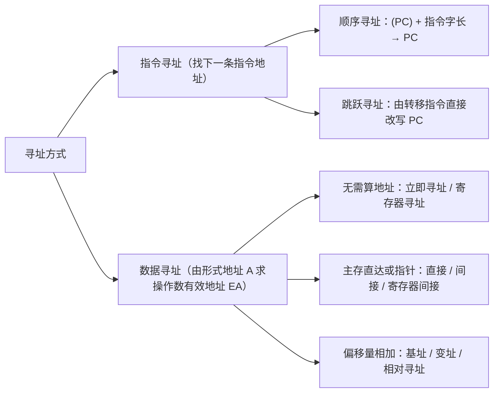
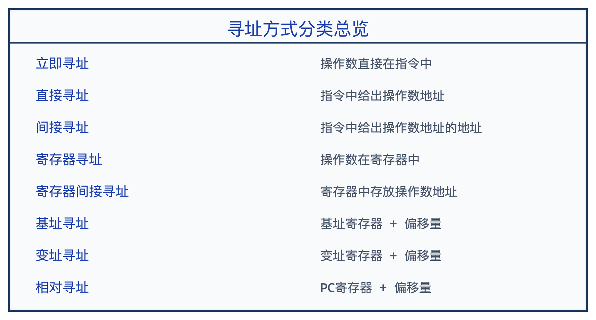

# 第四章：指令系统

指令系统（Instruction Set Architecture，**ISA**）是连接**软件程序**与**底层硬件微架构**的契约——向上规定了编译器与汇编程序员能调用的全部机器操作，向下决定了第 5 章 CPU 数据通路与控制器的设计目标。

---

## 4.1 指令系统基本概念

### 4.1.1 机器指令的构成

**机器指令**是计算机 CPU 能直接识别和执行的二进制代码，由**操作码**和**地址码**两部分组成：

<div class="grid cards" markdown>

-   **⚙️ 操作码（Opcode，OP）**

    ---

    指明本条指令“**干什么**”——规定执行的操作类型与性质（如加法 `ADD`、减法 `SUB`、数据传送 `MOV`、条件跳转 `JZ` 等）。

-   **📍 地址码（Address，A）**

    ---

    指明操作数“**在哪里**”——给出源操作数的存放位置、运算结果的保存地址，或下一条指令的转向地址。

</div>

### 4.1.2 指令的一般格式与地址码数目

根据指令中显式给出的地址码字段数量，机器指令可分为零地址～三地址指令：


| 指令类型 | 地址码数量 | 典型格式与数学含义 | 常见代表与执行特点 |
| :---: | :---: | :--- | :--- |
| **零地址指令** | $0$ | `OP`（无显式地址，或隐含用栈顶操作数） | 停机 `HLT`、空操作 `NOP`、子程序返回 `RET`；取指译码最快 |
| **一地址指令** | $1$ | `OP \| A1`：$(\text{A}_1) \leftarrow \text{OP}(\text{A}_1)$ 或 $(\text{ACC})\,\text{OP}\,(\text{A}_1) \rightarrow \text{ACC}$ | 加 1 `INC`、取反 `NOT`、求补 `NEG` |
| **二地址指令** | $2$ | `OP \| A1 \| A2`：$(\text{A}_1)\,\text{OP}\,(\text{A}_2) \rightarrow \text{A}_1$ | **最常用格式**，如 `ADD`、`MOV`、`SUB` |
| **三地址指令** | $3$ | `OP \| A1 \| A2 \| A3`：$(\text{A}_1)\,\text{OP}\,(\text{A}_2) \rightarrow \text{A}_3$ | 不破坏源操作数（RISC R 型指令常用），指令字较长 |

**最常见的二地址指令字段结构与操作数物理位置分类：**


| 操作数位置分类 | 源 / 目的操作数存放处 | 执行阶段访存次数（不含取指） | 速度与架构偏好 |
| :---: | :--- | :---: | :--- |
| **寄存器-寄存器型（RR）** | 两个操作数都在 CPU 寄存器中 | **$0$ 次** | **最快**，RISC Load/Store 架构算术指令标配 |
| **寄存器-存储器型（RS）** | 一个在寄存器，一个在主存单元 | **$1$ 次**（或读改写 2 次） | 较快，CISC（如 x86）极为常见 |
| **存储器-存储器型（SS）** | 两个操作数都在主存单元中 | **$2 \sim 3$ 次** | 最慢，现代处理器已很少采用 |

---

## 4.2 指令的五大操作类型

按功能划分，所有指令集基本涵盖以下五大类操作（点击下方标签页切换浏览）：

=== "📦 1. 数据传送指令"

    用于实现数据在寄存器、主存储器和堆栈之间的移动与拷贝（不改变数据内容本身）：

    | 指令子类型 | 功能说明 | 常见助记符 |
    | :--- | :--- | :--- |
    | **通用传送** | 将数据从源位置复制到目的位置 | `MOV`, `LDA`（取数入累加器）, `STA`（存数入主存） |
    | **堆栈操作** | 栈顶指针移动并完成压栈 / 弹栈 | `PUSH`（入栈）, `POP`（出栈） |
    | **数据交换** | 原子交换两个寄存器或单元的数据 | `XCHG` |

=== "➕ 2. 算术运算指令"

    调用 ALU 完成定点数或浮点数的加、减、乘、除运算，并自动更新状态标志位（CF、OF、ZF、SF）：

    | 指令子类型 | 功能说明 | 常见助记符 |
    | :--- | :--- | :--- |
    | **加法类** | 两数相加 / 带进位加 / 自增 1 | `ADD`, `ADC`（带进位加）, `INC`（加 1） |
    | **减法类** | 两数相减 / 带借位减 / 自减 1 / 求补 | `SUB`, `SBB`（带借位减）, `DEC`（减 1）, `NEG`（求相反数补码） |
    | **乘法类** | 无符号乘法 / 带符号乘法 | `MUL`, `IMUL` |
    | **除法类** | 无符号除法 / 带符号除法 | `DIV`, `IDIV` |

=== "🔣 3. 逻辑运算指令"

    对二进制机器字执行按位布尔逻辑操作（常用于位掩码清零、置位、翻转与测试）：

    | 指令子类型 | 功能说明与位操作技巧 | 常见助记符 |
    | :--- | :--- | :--- |
    | **按位与** | 对应位同为 `1` 才得 `1`（常用于特定位清 `0` 屏蔽） | `AND`, `TEST` |
    | **按位或** | 对应位有 `1` 即得 `1`（常用于特定位置 `1`） | `OR` |
    | **按位异或** | 相异为 `1`、相同为 `0`（`XOR AX, AX` 可快速清零） | `XOR` |
    | **按位取反** | `0` 变 `1`、`1` 变 `0` | `NOT` |

    !!! info "易考细节：`TEST` 与 `AND` 的区别"
        `TEST` 指令同样执行按位与操作，但**不保存运算结果到目的操作数**，仅仅根据结果修改标志位（常接条件跳转指令 `JZ`/`JNZ`）。

=== "↔️ 4. 移位操作指令"

    实现操作数的左移、右移与循环移位：

    | 移位类别 | 左移填充规则 | 右移填充规则 | 核心算术意义 |
    | :--- | :--- | :--- | :--- |
    | **逻辑移位** | 低位补 `0`，高位移出丢弃 | **高位补 `0`**，低位移出丢弃 | 处理**无符号数**（左移 $\times 2$，右移 $\div 2$） |
    | **算术移位** | 同逻辑左移（低位补 `0`） | **最高位保持原符号位不变** | 处理**有符号补码**（无溢出时左移 $\times 2$，右移整除 $2$） |
    | **循环移位** | 移出的最高位绕回填入最低位（小循环）或连同进位位 `CF` 一起闭环（带进位大循环） | 同左，方向相反 | 密码学哈希、高低字节交换、多字节移位拼接 |

=== "🔀 5. 控制转移指令"

    改变程序计数器 `PC` 的顺序递增轨迹，实现分支、循环、函数调用与中断：

    | 指令子类型 | 功能说明 | 常见助记符 |
    | :--- | :--- | :--- |
    | **无条件转移** | 强制无条件改写 `PC` 跳转到目标地址 | `JMP` |
    | **条件转移** | 检测状态标志位（ZF/CF/OF/SF）决定是否跳转 | `JZ`, `JNZ`, `JC`, `JNC`, `JB`, `JA`, `BEQ` |
    | **循环控制** | 计数器递减并判断循环终止条件 | `LOOP`, `LOOPE` |
    | **子程序调用与返回** | 压栈保存返回地址并跳转 / 弹栈恢复 `PC` | `CALL`, `RET` |
    | **软中断与返回** | 触发异常/系统调用陷入内核 / 中断返回 | `INT`, `IRET` |

---

## 4.3 指令的寻址方式（本章绝对重点）

指令地址码字段直接写出的数字并不一定就是操作数的真实物理地址，称为**形式地址（记为 $A$）**；结合寻址方式计算出的操作数真实地址才称为**有效地址（Effective Address，记为 $\text{EA}$）**。





### 4.3.1 立即寻址（Immediate Addressing）

**机制**：地址码字段给出的不是地址，而是**操作数本身（立即数）**，紧跟在操作码后面。


```nasm
MOV AX, 1234H    ; 将立即数 1234H 直接送入寄存器 AX
ADD BX, 05H      ; 将 BX 的内容加常数 5
```

- **优点**：取指令的同时就拿到了操作数，执行阶段 **0 次访存，速度最快**。
- **缺点**：数值大小受指令字长字段位数限制，且编译后固定在指令中不可修改；常用于**赋初值、提供常量**。

### 4.3.2 直接寻址（Direct Addressing）

**机制**：形式地址 $A$ 直接就是操作数在主存中的真实有效地址，即 $\text{EA} = A$，操作数 $= (A)$。


```nasm
; 假设主存地址 2000H 单元存放的数据是 1234H
MOV AX, [2000H]  ; 访问主存 2000H 单元，将 1234H 送入 AX
```

- **优点**：简单直观，无需硬件额外计算地址，仅需 **1 次访存**。
- **缺点**：寻址范围受形式地址 $A$ 位数制约，且地址写死在指令中不便动态重定位。

### 4.3.3 间接寻址（Indirect Addressing）

**机制**：形式地址 $A$ 指向的主存单元里存放的不是操作数，而是**操作数的有效地址（即“地址的地址”）**，一次间接满足 $\text{EA} = (A)$。


```nasm
; 设主存 (2000H) = 1234H，且主存 (1234H) = 5678H
MOV AX, [[2000H]]   ; 第1次访存读 2000H 得地址 1234H，第2次访存读 1234H 得操作数 5678H
```

- **优点**：可用短形式地址访问整个大主存空间；只需改写 `2000H` 单元里的指针即可动态改变目标操作数（适合指针、链表与子程序返回）。
- **缺点**：执行阶段至少需要 **2 次访问主存**，速度最慢。

### 4.3.4 寄存器寻址（Register Addressing）

**机制**：操作数直接存放在 CPU 内部的通用寄存器 $R_i$ 中，指令仅给出寄存器编号（操作数 $= (R_i)$）。


```nasm
MOV AX, BX      ; 将寄存器 BX 的内容送入 AX
ADD AX, CX      ; AX ← (AX) + (CX)
```

- **优点**：**执行阶段 0 次访存，运算速度极快**；且寄存器编号只需很少几位（如 32 个寄存器仅占 5 位），显著缩短指令字长。
- **缺点**：CPU 片内寄存器个数有限。

### 4.3.5 寄存器间接寻址（Register Indirect Addressing）

**机制**：通用寄存器 $R_i$ 中存放的是操作数在主存中的有效地址，即 $\text{EA} = (R_i)$，操作数 $= ((R_i))$。


```nasm
; 假设寄存器 BX = 2000H
MOV AX, [BX]    ; 以 BX 的值 2000H 作为主存地址，取出 M[2000H] 送入 AX
```

- **优点**：比主存间接寻址**少访问 1 次主存**（执行阶段仅访存 1 次），又能通过递增寄存器灵活遍历连续数组或表格。

### 4.3.6 基址寻址（Base Addressing）

**机制**：将 CPU 内的**基址寄存器（BR）**内容加上指令形式地址给出的位移量 $\text{Disp}$，合成有效地址：

$$\text{EA} = (\text{BR}) + \text{Disp}$$


```nasm
; 假设基址寄存器 BX = 1000H，指令中位移量 Disp = 200H
MOV AX, [BX + 200H]   ; 有效地址 EA = 1000H + 200H = 1200H
```

- **特点**：基址寄存器内容通常由**操作系统或管理程序**设定，程序执行期间 `BR` 保持不变，而形式偏移量 `Disp` 可变；专门解决**多道程序动态重定位**与扩大寻址空间问题。（若再套一层访存则构成**基址间接寻址**。）

### 4.3.7 变址寻址（Indexed Addressing）

**机制**：将**变址寄存器（IX）**的内容与指令中给出的形式首地址 $\text{Disp}$（或 $A$）相加得到有效地址：

$$\text{EA} = (\text{IX}) + \text{Disp}$$


```nasm
; 假设数组起始首地址 = 1000H（固定在指令中），变址寄存器 SI = 0100H（循环递增）
MOV AX, [SI + 1000H]   ; 顺序访问数组元素
```

!!! important "408 高频辨析：基址寻址 vs 变址寻址（公式一模一样，到底怎么分？）"
    | 对比维度 | 基址寻址（Base Addressing） | 变址寻址（Indexed Addressing） |
    | :---: | :--- | :--- |
    | **面向角色** | **面向操作系统**（用户程序无权随意改 `BR`） | **面向用户应用程序**（程序员可在循环里加减 `IX`） |
    | **执行期间谁变谁不变** | **基址 `BR` 不变**，指令中的偏移量 `Disp` 变化 | 指令中的数组首地址 **`A` 不变**，**变址寄存器 `IX` 不断变化** |
    | **核心应用场景** | **多道程序装入与动态重定位** | **数组遍历、字符串处理与循环查表** |

### 4.3.8 相对寻址（Relative Addressing）

**机制**：将**程序计数器（PC）**的当前值与指令给出的带符号补码位移量 $\text{Disp}$ 相加：

$$\text{EA} = (\text{PC}) + \text{Disp}$$


```nasm
; 假设取指后当前 PC = 2000H，位移量 Disp = +10H
JMP +10H      ; 跳转到有效目标地址 2000H + 10H = 2010H
```

- **关键陷阱**：计算相对寻址时，**$(\text{PC})$ 已经是取出本条指令后自动加过指令字长、指向“下一条指令”的地址**！
- **优势**：转移目标与代码在内存中的绝对装入位置无关，支持**浮动程序设计（位置无关代码 PIC）**，广泛用于条件分支与循环跳转。

### 4.3.9 八大寻址方式全景速查表

| 寻址方式 | 有效地址 $\text{EA}$ | 操作数获取表示 | 执行期访存次数 | 核心特点与典型用途 |
| :--- | :---: | :---: | :---: | :--- |
| **立即寻址** | —（无有效地址） | $A$（即立即数本身） | **$0$** | 最快，操作数固定不可改；赋初值/常数 |
| **寄存器寻址** | $R_i$ | $(R_i)$ | **$0$** | 极快，指令短；算术逻辑寄存器运算 |
| **直接寻址** | $A$ | $(A)$ | $1$ | 直观简单，地址写死且范围受限；全局变量 |
| **间接寻址** | $(A)$ | $((A))$ | **$2$**（一次间接） | 寻址范围大、指针灵活，但多次访存最慢 |
| **寄存器间接寻址** | $(R_i)$ | $((R_i))$ | $1$ | 兼顾指针灵活性与少访存；指针/表格扫描 |
| **基址寻址** | $(\text{BR}) + A$ | $((\text{BR}) + A)$ | $1$ | 系统控制 `BR` 不变；多道程序重定位 |
| **变址寻址** | $(\text{IX}) + A$ | $((\text{IX}) + A)$ | $1$ | 用户递增 `IX`、`A` 为首地址；数组循环遍历 |
| **相对寻址** | $(\text{PC}) + A$ | $((\text{PC}) + A)$ | $1$（取数据）/$0$（算跳转） | 位置无关浮动代码；分支与循环跳转 |

---

## 4.4 RISC 与 CISC 架构对比

<div class="grid cards" markdown>

-   **🏛️ CISC（复杂指令集计算机）**

    ---

    - **设计哲学**：试图用一条功能复杂的机器指令直接对应高级语言的一句复杂操作，缩短目标代码行数。
    - **代表架构**：**x86（Intel / AMD）**、VAX
    - **优势**：指令功能强、历史向后兼容性极佳、早期汇编与编译器负担轻。
    - **痛点**：80% 的时间只用到 20% 的简单指令；变长指令译码困难、执行周期参差不齐，不利于硬件流水线并行。

-   **⚡ RISC（精简指令集计算机）**

    ---

    - **设计哲学**：只保留使用频率最高的 20% 简单规整指令，复杂功能交由编译器组合多条简单指令完成。
    - **代表架构**：**ARM、MIPS、RISC-V**、PowerPC
    - **优势**：定长规整、硬布线单周期执行、通用寄存器多，天生契合**超深流水线与超标量**设计，高能效比。
    - **代价**：目标代码体积略大，高度依赖现代编译器的指令调度优化。

</div>

| 对比维度 | CISC（复杂指令集） | RISC（精简指令集） |
| :--- | :--- | :--- |
| **指令数量** | 庞大（通常 $>200$ 条） | 精简（通常 $<100$ 条） |
| **指令字长与格式** | **可变字长**，字段格式繁多 | **固定字长**（如统一 32 位），格式规整 |
| **单条指令耗时** | 大多需**多个时钟周期**，长短悬殊 | 绝大多数在 **1 个时钟周期**内完成 |
| **访存指令限制** | 算术/逻辑等多种指令均可直接访存 | ==仅 `Load` / `Store` 指令可访问主存==，运算全在寄存器间进行 |
| **通用寄存器数量** | 较少 | **很多**（如 MIPS 32 个寄存器） |
| **控制器实现方式** | 以**微程序控制**为主 | 以**硬布线（组合逻辑）控制**为主 |
| **指令流水线实现** | 较难直接硬件流水化 | **极易高效实现流水线** |
| **典型代表** | x86 | ARM, MIPS, RISC-V |

> **现代处理器的融合趋势**：如今 x86 与 ARM 早已互相借鉴——现代 Intel/AMD x86 处理器在前端译码器内部会将变长复杂的 CISC 宏指令拆解为定长规整的类 RISC **微操作（$\mu\text{Ops}$）** 送入后端超标量乱序流水线执行；而现代 RISC（如 ARMv9、Apple M 系列）也引入了丰富的 SIMD 向量扩展与融合指令。

---

## 4.5 指令格式与操作码设计

### 4.5.1 指令字长选择：定长 vs 变长

| 字长策略 | 核心优点 | 核心缺点 | 常见位宽 |
| :---: | :--- | :--- | :--- |
| **固定字长** | 取指边界清晰、硬件并行译码极快（`PC + 4` 即可） | 简单无参指令会浪费多余二进制位 | 32 位（现代主流 RISC） |
| **可变字长** | 按需分配字节（1～15 字节），目标代码密度高、省内存 | 必须串行扫描边界，硬件译码电路极其复杂 | 8 位整数倍（如 x86） |

### 4.5.2 定长操作码 vs 扩展操作码

<div class="grid cards" markdown>

-   **📏 定长操作码**

    ---

    

    所有指令的操作码固定占最高 $k$ 位（最多支持 $2^k$ 条指令，如 8 位最多 256 条）。**译码电路最简单、速度最快**，用于字长充裕的 RISC 指令集。

-   **🧩 扩展操作码（可变长操作码）**

    ---

    

    在固定指令字长下，利用哈夫曼前缀码思想：**地址码多的指令用短操作码，地址码少的指令借用多余地址位扩展长操作码**（注意：短操作码绝不能成为长操作码的前缀，必须留出扩展窗口！）。

</div>

---

## 4.6 常见指令格式实例：MIPS（32 位定长 RISC）

MIPS 采用完全统一的 **32 位固定指令字长**，仅用 **R 型、I 型、J 型**三种极其规整的格式覆盖全部指令：

| 格式类型 | 32 位字段切分（从高位到低位） | 适用指令与字段含义 |
| :---: | :--- | :--- |
| **R 型（寄存器型）** | `op (6)` \| `rs (5)` \| `rt (5)` \| `rd (5)` \| `shamt (5)` \| `funct (6)` | 算术逻辑寄存器运算（`op` 全 `0`，由末 6 位 `funct` 决定加/减/与/或；`rd ← rs op rt`） |
| **I 型（立即数/访存分支型）** | `op (6)` \| `rs (5)` \| `rt (5)` \| `immediate (16)` | 立即数运算 `addi`、访存 `lw`/`sw`（基址 `rs` + 16 位偏移）、条件分支 `beq` |
| **J 型（无条件跳转型）** | `op (6)` \| `target address (26)` | 远距离无条件跳转 `j`、`jal`（26 位左移 2 位拼 `PC` 高 4 位构成 32 位跳转目标） |

=== "R 型指令示意图"
    

=== "I 型指令示意图"
    

=== "J 型指令示意图"
    

---

## 4.7 课后习题与典型例题

<div class="co-question" markdown="1">

### 作业 P147-6：由有效地址公式判断寻址方式

!!! question "题目描述"
    一种单地址指令格式为 `| OP | I | X | D |`，其中 $I$ 为间接特征（$I=0$ 直接，$I=1$ 间接），$X$ 为寻址模式，$D$ 为形式地址。$I$、$X$、$D$ 组成该指令的操作数有效地址 $E$。设 $R$ 为变址寄存器，$R_1$ 为基址寄存器，$PC$ 为程序计数器，请在下表中第一列位置填入适当的寻址方式名称（①～⑥ 为待填项）。

| 序号 | 寻址方式名称（填空答案） | $I$ | $X$ | 有效地址 $E$ | 核心物理意义与判定依据 |
| :---: | :---: | :---: | :---: | :--- | :--- |
| **①** | **直接寻址** | `0` | `00` | $E = D$ | 有效地址直接等于形式地址 $D$，无需经过寄存器或间接查表。 |
| **②** | **相对寻址** | `0` | `01` | $E = (PC) + D$ | 以程序计数器 $PC$ 当前值为基准加上偏移量 $D$，常用于相对跳转。 |
| **③** | **变址寻址** | `0` | `10` | $E = (R) + D$ | $R$ 为变址寄存器（内容由用户程序改变，常用于数组/循环遍历），$D$ 为形式首地址。 |
| **④** | **基址寻址** | `0` | `11` | $E = (R_1) + D$ | $R_1$ 为基址寄存器（内容由操作系统设定，用于多道程序重定位），$D$ 为偏移量。 |
| **⑤** | **间接寻址** | `1` | `00` | $E = (D)$ | $I=1$，形式地址 $D$ 指向的内存单元中存放的才是真正的有效地址。 |
| **⑥** | **基址间接寻址**（或间接基址寻址） | `1` | `11` | $E = ((R_1) + D),\ D = 0$ | 先算基址 $(R_1)+D$，最外层再套一层括号 `( )` 去该内存单元间接取有效地址。 |

!!! tip "考研答题避坑口诀"
    1. 看到 **$(PC)$** $\rightarrow$ 直接判定为 **相对寻址**。  
    2. 看到 **变址 / 基址寄存器** $\rightarrow$ 对应 **变址 / 基址寻址**。  
    3. 最外层多套了一个 **`( )`** $\rightarrow$ 代表多了一次 **间接寻址** 的访存动作。

</div>

<div class="co-question" markdown="1">

### 作业 P148-12：根据操作数位置指出寻址方式

1\. 操作数在寄存器中，为 **<u>寄存器</u>** 寻址方式；  
2\. 操作数地址在寄存器中，为 **<u>寄存器间接</u>** 寻址方式；  
3\. 操作数在指令中，为 **<u>立即</u>** 寻址方式；  
4\. 操作数地址（主存）在指令中，为 **<u>直接</u>** 寻址方式；  
5\. 操作数的地址为某一寄存器内容与位移量之和，可以是 **<u>相对、基址、变址</u>** 寻址方式。

</div>

<div class="co-question" markdown="1">

### 例题 1：汇编指令寻址方式识别

!!! question "题目"
    指出下列各 x86 汇编指令源操作数的寻址方式：  
    1\. `MOV AX, 2000H`  
    2\. `MOV AX, [2000H]`  
    3\. `MOV AX, BX`  
    4\. `MOV AX, [BX]`  
    5\. `MOV AX, [BX + 200H]`

<details class="co-answer" markdown="1">
<summary>查看答案与解析</summary>

**解析：**

1. **立即寻址**：操作数 `2000H` 直接包含在指令字中。
2. **直接寻址**：指令中直接给出主存有效地址 `2000H`。
3. **寄存器寻址**：操作数存放在寄存器 `BX` 中。
4. **寄存器间接寻址**：寄存器 `BX` 中存放的是操作数的主存地址。
5. **基址寻址**：有效地址 $\text{EA} = (\text{BX}) + 200\text{H}$。

</details>

</div>

<div class="co-question" markdown="1">

### 例题 2：有效地址与操作数计算

!!! question "题目"
    假设有寄存器与主存内容：$\text{BX} = 1000\text{H}$，$\text{SI} = 0200\text{H}$，$\text{BP} = 0300\text{H}$，内存单元 `[1200H] = 5678H`。求下列指令源操作数的有效地址 $\text{EA}$ 和操作数：  
    1\. `MOV AX, [BX + 200H]`  
    2\. `MOV AX, [SI + 1000H]`  
    3\. `MOV AX, [BP]`

<details class="co-answer" markdown="1">
<summary>查看答案与解析</summary>

**解析：**

1. $\text{EA} = \text{BX} + 200\text{H} = 1000\text{H} + 200\text{H} = \mathbf{1200\text{H}}$，操作数 $= [1200\text{H}] = \mathbf{5678\text{H}}$。
2. $\text{EA} = \text{SI} + 1000\text{H} = 0200\text{H} + 1000\text{H} = \mathbf{1200\text{H}}$，操作数 $= [1200\text{H}] = \mathbf{5678\text{H}}$。
3. $\text{EA} = \text{BP} = \mathbf{0300\text{H}}$，操作数 $= [0300\text{H}]$（访问堆栈段内存 `0300H` 单元）。

</details>

</div>

<div class="co-question" markdown="1">

### 例题 3：RISC 与 CISC 寻址方式特点分析

!!! question "题目"
    分析 RISC 指令系统应采用什么寻址方式？为什么？

<details class="co-answer" markdown="1">
<summary>查看答案与解析</summary>

**解析：** RISC 指令系统应**主要采用简单规整的寻址方式**（寄存器寻址、立即寻址、简单的基址/寄存器间接寻址，避免多层主存间接寻址），原因如下：

1. **简化硬件设计**：简单寻址方式易于用硬布线组合逻辑控制器高速实现。
2. **保障单周期执行**：复杂多层间接寻址需要多次访存，会严重拉长指令周期。
3. **便于流水线推进**：规整寻址使各流水段耗时均衡，减少数据相关与访存结构冲突。
4. **配合 Load/Store 架构**：RISC 通用寄存器充裕，算术逻辑运算均在寄存器间完成，仅 `Load`/`Store` 指令访问主存。

</details>

</div>

<div class="co-question" markdown="1">

### 例题 4：相对寻址跳转目标地址计算

!!! question "题目"
    某计算机采用相对寻址方式，假设当前指令地址为 `2000H`，指令长度为 2 字节，指令中的位移量为 `+10H`（用补码表示），求该指令执行后的跳转目标地址。

<details class="co-answer" markdown="1">
<summary>查看答案与解析</summary>

**解析：** 取指后程序计数器 $\text{PC}$ 自动递增指向下一条指令首地址：

$$\text{PC} = 2000\text{H} + 2 = 2002\text{H}, \qquad \text{目标地址 } E = (\text{PC}) + D = 2002\text{H} + 10\text{H} = \mathbf{2012\text{H}}$$

</details>

</div>

<div class="co-question" markdown="1">

### 例题 5：定长指令格式条数计算

!!! question "题目"
    某计算机指令字长 16 位，每个地址码占 6 位。若分别设计为纯零地址、纯一地址或纯二地址指令格式，最多各能安排多少条指令？

<details class="co-answer" markdown="1">
<summary>查看答案与解析</summary>

**解析：**

- **零地址指令**：16 位全部用作操作码，最多可安排 $2^{16} = \mathbf{65536\text{ 条}}$。
- **一地址指令**：地址码占 6 位，操作码占 $16 - 6 = 10$ 位，最多可安排 $2^{10} = \mathbf{1024\text{ 条}}$。
- **二地址指令**：两个地址码占 $6 \times 2 = 12$ 位，操作码占 $16 - 12 = 4$ 位，最多可安排 $2^4 = \mathbf{16\text{ 条}}$。

</details>

</div>

## 本章小结

!!! summary "核心考点复盘清单"
    1. **指令结构**：机器指令 $=$ 操作码（做什么）$+$ 地址码（操作数在哪）；按地址码数目分为零、一、二、三地址指令，按编码策略分为**定长操作码**与**扩展操作码**。
    2. **五大指令类型**：数据传送、算术运算、逻辑运算（注意 `TEST` 只改标志位）、移位操作（算术右移补符号位、逻辑右移补 `0`）、控制转移。
    3. **八大寻址方式**：紧盯 **有效地址 $\text{EA}$ 表达式** 与 **执行期访存次数**；重点区分基址寻址（系统重定位，`BR` 不变）与变址寻址（用户遍历数组，首地址不变、`IX` 变），以及相对寻址中 `PC` 先加指令字长的规则。
    4. **RISC vs CISC**：熟记定长/变长、Load-Store 访存限制、硬布线/微程序控制及流水线友好度差异。
