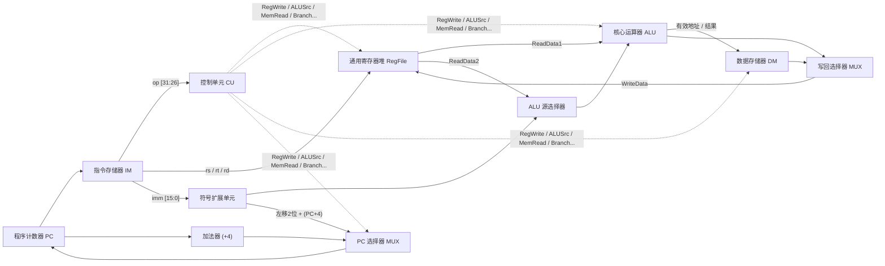
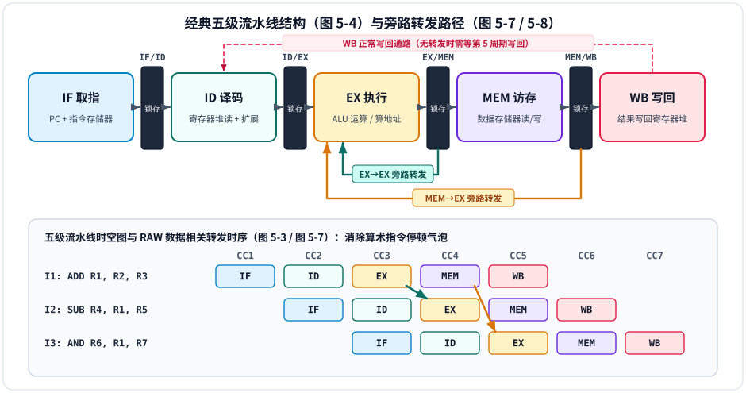
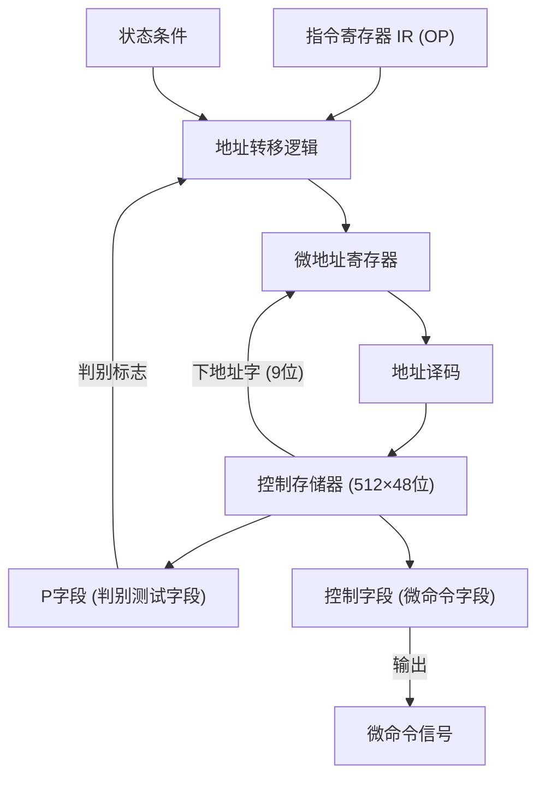

# 第5章：中央处理器

!!! note "参考讲义"
    课堂配套课件下载：[第5章 中央处理器 PPT](https://github.com/xurry-ace/mynotes/releases/download/pdf-assets/co-ch5-cpu-20260415.pdf)

中央处理器（Central Processing Unit，**CPU**）是计算机系统的运算与指挥核心，负责自动取指、译码并协调全机硬件执行指令。本章围绕以下四大核心板块展开：

<div class="grid cards" markdown>

-   **🛤️ 1. 数据通路与五阶段执行**

    ---

    理解数据在寄存器、ALU 与存储器间流动的路径，对比**单周期、多周期与流水线**三种数据通路设计。

-   **🚄 2. 经典五级指令流水线**

    ---

    掌握 `IF → ID → EX → MEM → WB` 五段重叠执行机制、流水线寄存器作用，以及**吞吐率、加速比、效率**计算。

-   **🚧 3. 流水线三大冒险与化解**

    ---

    重点攻克**结构冒险、数据冒险（RAW）与控制冒险**，吃透**旁路转发（Forwarding）**、加载互锁与 2 位分支预测。

-   **🎛️ 4. 硬布线与微程序控制器**

    ---

    对比 RISC 偏好的**硬布线组合逻辑控制**与 CISC 偏好的**微程序存储逻辑控制**，掌握控存容量与微指令相斥编码设计。

</div>

---

## 5.1 处理器数据通路与时钟

### 5.1.1 处理器的四大功能组成

根据冯·诺依曼存储程序原理，CPU 从主存取出指令、翻译指令并完成算术逻辑运算与数据传输，内部主要由四部分构成：

<div class="grid cards" markdown>

-   **🧮 1. 运算单元（执行核心）**

    ---

    - **算术逻辑单元（ALU）**：执行加减乘除算术运算与与、或、非、异或逻辑运算。
    - **移位器**：完成算术移位、逻辑移位和循环移位。
    - **乘除法器**：专用硬件乘除阵列（简单 CPU 中可由 ALU 循环移位累加实现）。

-   **🗂️ 2. 寄存器组（片内高速暂存）**

    ---

    - **通用寄存器堆（GPRs）**：存放运算临时操作数与中间结果。
    - **专用寄存器**：程序计数器 `PC`、指令寄存器 `IR`、状态标志寄存器 `FLAGS`（PSW）。
    - **堆栈指针（`SP`）**：指向调用栈顶，支撑子程序调用与中断现场保护。

-   **🧭 3. 控制单元（指挥中心 CU）**

    ---

    根据 `IR` 中的指令操作码与标志位生成控制信号序列，指挥多路选择器（MUX）选通、寄存器读写使能以及 ALU 运算功能选择。

-   **⏱️ 4. 时钟与定时电路**

    ---

    提供统一的脉冲节拍信号，决定各组合逻辑路径采样与状态锁存的时刻，直接关系 CPU 工作主频。

</div>

---

### 5.1.2 三种数据通路（Datapath）设计对比

**数据通路**是指令执行过程中数据流经的部件与连线集合，其演进经历了从单周期到多周期再到流水线三代方案：

| 对比维度 | 单周期数据通路（Single-cycle） | 多周期数据通路（Multi-cycle） | 流水线数据通路（Pipelined） |
| :--- | :--- | :--- | :--- |
| **执行方式** | 每条指令固定在 **1 个超长时钟周期**内全部执行完 | 将指令拆成多步，不同复杂度的指令占**不同个短周期** | 多条指令在五个阶段**时间重叠并行推进** |
| **时钟周期上限** | 受**最慢指令**（如访存 `lw` 或乘除）拖累，周期极长 | 只需满足单个基本阶段（如一次 ALU 或一次访存）耗时 | 由**最慢的单个流水段**耗时决定，时钟频率高 |
| **CPI（周期/条）** | 恒为 $1$（但 $T_{\text{clock}}$ 极大） | 大于 $1$（如 R 型 4 周期、`lw` 5 周期、`beq` 3 周期） | 理想充满状态下 **趋近于 $1$**（且 $T_{\text{clock}}$ 短） |
| **硬件开销与复用** | 单周期内部件不可冲突复用（需独立指令/数据存储器与多个加法器），利用率低 | 跨周期可**分时复用**同一个存储器与同一个 ALU，省硬件 | 需插入 **4 组流水线寄存器**、独立 I/D Cache 及转发/冒险检测硬件 |
| **控制复杂度** | 纯组合逻辑译码，最简单 | 需有限状态机（FSM）或微程序按步切换控制 | 信号随流水线寄存器逐级传递，需额外处理三类冒险 |

**简化的单周期 MIPS 处理器数据通路示意（对应教材图 5-1）：**



---

### 5.1.3 时钟周期约束与同步控制

处理器普遍采用**同步时序设计**（所有寄存器在统一时钟上升沿或下降沿采样更新，仅在与外设握手或跨时钟域一致性协议时辅以异步时序）。设计时钟周期长度 $T_{\text{clock}}$ 时必须同时满足四项物理约束：

1. **最长组合逻辑关键路径延迟**：信号必须在一个周期内跑完最慢的一段门电路。
2. **触发器建立时间（Setup Time）与保持时间（Hold Time）**：采样沿前后输入数据必须稳定，否则进入亚稳态。
3. **时钟偏斜（Clock Skew）**：同一时钟沿到达芯片不同触发器的微小时间差。
4. **动态功耗与散热墙**：主频越高，开关翻转功耗（$\propto C V^2 f$）呈非线性激增。

在流水线处理器中，相邻阶段之间必须插入**流水线寄存器（`IF/ID`、`ID/EX`、`EX/MEM`、`MEM/WB`）**，在每个时钟沿锁存上一段的计算结果与控制信号，保证多条指令互不串扰。

---

### 5.1.4 MIPS 指令执行的五个标准阶段（对应教材图 5-2）

| 阶段序号 | 阶段名称与缩写 | 核心操作内容 | 本阶段调用的主要硬件部件 |
| :---: | :--- | :--- | :--- |
| **第 1 段** | **取指（IF）**<br>Instruction Fetch | 以 `PC` 访问指令存储器取出 32 位指令；同时计算 `PC ← PC + 4` 指向下条顺序指令 | `PC` 寄存器、指令存储器（IM）、`+4` 加法器 |
| **第 2 段** | **译码/读数（ID）**<br>Instruction Decode | 解析操作码 `Opcode` 与功能码产生控制信号；按 `rs`、`rt` 并行读寄存器堆；对 16 位立即数做符号/零扩展 | 指令译码器、控制单元（CU）、寄存器堆读端口、立即数扩展单元 |
| **第 3 段** | **执行（EX）**<br>Execute | ALU 执行算术/逻辑运算，或计算 `lw`/`sw` 访存有效地址，或计算分支目标地址并检测零标志判跳转 | `ALU`、零标志检测器、分支目标加法器、操作数 MUX |
| **第 4 段** | **访存（MEM）**<br>Memory Access | `lw`/`sw` 指令读写数据存储器（R 型算术指令直接旁路穿过）；分支指令若条件成立则改写 `PC` | 数据存储器（DM）、`PC` 多路选择器 |
| **第 5 段** | **写回（WB）**<br>Write Back | 将 ALU 运算结果（R 型/`addi`）或从数据存储器读出的数据（`lw`）写回目标通用寄存器 | 寄存器堆**写端口**、写回数据 MUX |

---

## 5.2 指令流水线与性能分析

### 5.2.1 流水线基本原理与经典五级结构

!!! tip "直观类比：洗衣店四步流水线（仅帮助理解时间重叠思想）"
    - **串行单周期方式**：等第一批衣服完整做完“洗涤 $\rightarrow$ 甩干 $\rightarrow$ 熨烫 $\rightarrow$ 叠放”全部 4 步后，才允许放入第二批衣服，洗衣机与熨斗四分之三的时间都在闲置。
    - **流水线重叠方式**：第一批衣服进入“甩干”时，第二批立即进入“洗涤”……一旦流水线**充满**，每个节拍都有一批衣服完工，整体吞吐率提升至接近阶段数 $k$ 倍！（注：单批衣服本身的耗时并未缩短，提升的是**单位时间完成的任务总吞吐量**。）

下图完整展示了 **经典五级流水线硬件结构（图 5-4）**、**连续指令时空重叠图（图 5-3）** 以及化解 RAW 数据相关的 **EX/MEM 与 MEM/WB 旁路转发通路（图 5-7 / 图 5-8）**：



---

### 逐周期观察：延迟与吞吐率 { #pipeline-lab }

“流水线更快”需要先说清比较对象：在下面的等长五段模型中，**一条指令仍经过 5 个阶段**；加快的是一批指令的完成速度。第一条要等 5 个周期，后续指令可以每周期完成一条。

<div class="study-viz concept-lab" data-concept-viz="pipeline">
<p>静态示例：3 条指令、每条依次经过 IF、ID、EX、MEM、WB，每段 1 周期。I1 在 T1～T5 执行，I2 在 T2～T6 执行，I3 在 T3～T7 执行。流水总计 7 周期；相同阶段时长的串行模型需 15 周期，加速比 15/7 ≈ 2.14。</p>
</div>

图中**行表示不同指令，列表示同一个时钟周期**。同一列出现多个有色格，表示不同阶段正并行处理不同指令；不是一条指令同时执行多个依赖阶段。窄屏下可以横向滚动时空表。

!!! warning "这个模型成立的条件"
    每段等长、每周期最多进入一条指令，忽略流水线寄存器开销，并假定没有结构、数据和控制冒险。加速比以“相同阶段时长的串行执行”为基准，不能直接拿它预测某台真实 CPU 的加速效果。实际停顿会让总周期继续增加。

### 5.2.2 流水线三大性能指标（必考公式）

设流水线共有 $k$ 个阶段（如五级流水线 $k=5$），时钟周期为 $\Delta t$，连续输入 $n$ 条无停顿指令：

- 第 1 条指令经过 $k$ 个周期流出（**装入填充时间** $k\Delta t$）；其余 $n-1$ 条指令每隔 $1$ 个周期完成一条，故**总执行时间**为：

$$T_k = (k + n - 1)\,\Delta t$$

| 性能指标 | 计算公式（理想无停顿，$n$ 条指令） | 当 $n \to \infty$ 时的极限值 | 物理意义说明 |
| :---: | :--- | :---: | :--- |
| **吞吐率 $TP$** | $TP = \dfrac{n}{T_k} = \dfrac{n}{(k + n - 1)\Delta t}$ | $TP_{\max} = \dfrac{1}{\Delta t}$ | 单位时间内完成的指令条数 |
| **加速比 $S_p$** | $S_p = \dfrac{\text{非流水总耗时 } T_0}{\text{流水总耗时 } T_k} = \dfrac{k \cdot n}{k + n - 1}$ | $S_{p,\max} = k$ | 相比串行执行的速度提升倍数 |
| **效率 $E$** | $E = \dfrac{S_p}{k} = \dfrac{n}{k + n - 1}$ | $E_{\max} = 100\%$ | 时空图中硬件部件有效工作的时空面积占比（扣除首尾装入排空三角区） |

---

### 5.2.3 高级流水线优化技术（多发射与乱序）

单条按序五级流水线的理想极限是 $\text{CPI} = 1$。为了突破 $\text{CPI} < 1$（即 $\text{IPC} > 1$，每周期完成多条指令），现代处理器引入了三种高级流水架构：

| 架构技术 | 调度主体 | 核心工作机制 | 优点与挑战 |
| :---: | :---: | :--- | :--- |
| **超标量（Superscalar）** | **硬件动态调度** | 配置多套取指译码与执行单元，每周期同时发射 $2 \sim 8$ 条独立指令入流水线 | 二进制兼容性好；硬件依赖检测与多单元协同极复杂 |
| **超长指令字（VLIW）** | **编译器静态打包** | 编译器在编译期分析并行性，把多条无冲突指令打包成一条超长指令字并行执行 | 省去复杂硬件动态调度电路；代码密度低、跨代兼容差 |
| **动态乱序流水线（OoO）** | **硬件乱序执行 + 按序提交** | 借助**寄存器重命名（RAT）**消除假相关，就绪指令先算，最后由**重排序缓冲（ROB）**按程序顺序提交 | 最大限度隐藏访存与长指令延迟（如现代酷睿/Zen/M 系列标配） |

---

## 5.3 流水线三大冒险与硬件化解机制

由于资源争用、数据依赖或分支跳转，后续指令无法在预定时钟周期正常推进的情况称为**流水线冒险（Hazard）**：

| 冒险类型 | 产生根源 | 典型冲突场景 | 核心硬件/软件解决方案 |
| :---: | :--- | :--- | :--- |
| **1. 结构冒险**<br>（资源冲突） | 同一周期两条指令争抢**同一个物理硬件部件** | ① `IF` 取指与 `MEM` 访存同时争抢单一主存；<br>② `WB` 写寄存器与 `ID` 读寄存器冲突 | ① **哈佛分离 Cache**（独立指令 L1I 与数据 L1D）；<br>② **前半周期写寄存器、后半周期读寄存器**（先写后读） |
| **2. 数据冒险**<br>（数据相关） | 后面的指令需要用到**前面指令尚未写回的数据** | 相邻算术指令写后读（RAW），或 `LW` 取数后紧跟运算指令 | ① 插入停顿气泡（Stall / `NOP`）；<br>② **旁路/定向转发（Forwarding）**；<br>③ **加载互锁（Load-Use 停顿 1 周期）** + 编译器指令重排 |
| **3. 控制冒险**<br>（分支冲突） | `BEQ`/`JMP` 跳转方向与目标未算出前，后续指令已进流水线 | 分支在 `EX`（或 `ID`）才决出结果，若跳走则已取指令全作废 | ① 冲刷（Flush）错取指令；<br>② **动态分支预测（BTB + 2 位饱和计数器）**；<br>③ **延迟分支（Delay Slot 填充有用指令）** |

---

### 5.3.1 数据冒险深度拆解：RAW、转发与 Load-Use 互锁

指令间的数据相关按读写先后顺序分为三类：

- **RAW（Read After Write，写后读 / 真相关）**：后指令读前指令写的同一寄存器。**按序流水线中唯一会发生、且必须保证顺序的真实数据冒险**。
- **WAR（Write After Read，读后写 / 反相关）** 与 **WAW（Write After Write，写后写 / 输出相关）**：在标准按序五级流水线中（统一在 `ID` 读、统一在 `WB` 写）**绝不会发生**；仅在乱序执行处理器中出现，可通过**寄存器重命名**彻底消除。

点击下方标签对比四种典型流水线冲突时序（对应教材 **图 5-5 ～ 图 5-8**）：

=== "① 无转发硬件：插入气泡停顿（图 5-6）"

    考虑相邻写后读序列：
    ```mips
    I1: ADD R1, R2, R3    # 在 CC5 (WB) 才把结果写入 R1
    I2: SUB R4, R1, R5    # 在 ID 阶段就需要读 R1!
    ```
    若无转发且寄存器堆不支持同周期先写后读，$I_2$ 必须插入停顿气泡（`Bubble/NOP`）等待 $I_1$ 写回（若支持同周期**前半写、后半读**则停顿 2 周期，否则停顿 3 周期）：

    | 指令 \ 周期 | CC1 | CC2 | CC3 | CC4 | CC5 | CC6 | CC7 | CC8 |
    | :---: | :---: | :---: | :---: | :---: | :---: | :---: | :---: | :---: |
    | **`ADD R1, R2, R3`** | IF | ID | EX | MEM | **WB（写 R1）** | | | |
    | **`SUB R4, R1, R5`** | | IF | **Bubble** | **Bubble** | **ID（读 R1）** | EX | MEM | WB |

=== "② 硬件旁路转发（Forwarding，图 5-7/5-8）"

    实际上 `ADD` 的新结果在 **CC3 末尾（`EX/MEM` 锁存器）** 就已经算出来了！直接用数据旁路拉线送回 ALU 输入端，即可实现 **0 停顿无缝衔接**：

    - **ALU 结果转发（`EX/MEM → ALU`）**：解决紧邻下一条指令（如 `I1 → I2`）的 RAW 依赖。
    - **访存段转发（`MEM/WB → ALU`）**：解决相隔一条指令（如 `I1 → I3`）或访存读出数据的跨级依赖。

=== "③ Load-Use 加载互锁（转发也救不了的 1 周期停顿！）"

    **必考特例**：加载指令 `LW` 的数据要到 **CC4 末尾（`MEM` 访存结束）** 才从数据存储器读出，而紧跟其后的 `ADD` 在 **CC4 开头（`EX` 段）** 就急需送入 ALU（总不能让电信号穿越时空倒流！）：

    ```mips
    LW  R1, 0(R2)     # CC4 末尾 (MEM/WB) 才拿到内存数据 R1
    ADD R3, R1, R4    # 即使有 MEM→EX 转发，也必须硬件互锁停顿 1 个周期!
    ```

    | 指令 \ 周期 | CC1 | CC2 | CC3 | CC4 | CC5 | CC6 | CC7 |
    | :---: | :---: | :---: | :---: | :---: | :---: | :---: | :---: |
    | **`LW R1, 0(R2)`** | IF | ID | EX | **MEM（读出数据）** $\searrow$ | WB | | |
    | **`ADD R3, R1, R4`** | | IF | ID | ==**Bubble（互锁停 1 拍）**== | **EX（拿转发）** | MEM | WB |

    > **编译器辅助优化**：若编译器把后面一条与 `R1` 无关的独立指令移过来插在 `LW` 和 `ADD` 之间，就能完美填掉这 1 个停顿周期！

=== "④ 分支指令引发的控制冒险（图 5-5）"

    若分支跳转目标和条件在 `EX` 阶段末尾才判定完成，一旦分支成功跳转，此前在 `CC2`、`CC3` 顺着 `PC+4` 盲目预取进流水线的两条指令就是错误指令，必须冲刷清零（变成 `NOP` 气泡），造成分支惩罚（Branch Penalty）：

    | 指令 \ 周期 | CC1 | CC2 | CC3 | CC4 | CC5 |
    | :---: | :---: | :---: | :---: | :---: | :---: |
    | **`BEQ R1, R2, Target`** | IF | ID | **EX（判定跳走!）** | MEM | WB |
    | **顺序下条 `PC+4`** | | IF | ID $\rightarrow$ **冲刷作废** | — | — |
    | **顺序下下条 `PC+8`** | | | IF $\rightarrow$ **冲刷作废** | — | — |
    | **`Target` 目标指令** | | | | **IF（正确取指）** | ID |

---

### 5.3.2 控制冒险进阶：动态分支预测与延迟槽

1. **2 位饱和计数器动态分支预测（高频考点）**：  
   1 位预测器在循环末尾跳出再重入时会连续猜错 2 次；改用 **2 位饱和计数器**后，只有**连续猜错两次**才会翻转预测方向，大幅提升循环分支准确率：


2. **现代组合预测硬件**：
   - **BTB（分支目标缓冲器）**：在 `IF` 取指阶段直接按 `PC` 查表缓存分支目标地址，实现零气泡跳转。
   - **全局历史（GHR）+ 局部历史混合预测器**：结合其他分支近期走向与自身历史模式，并用选择器择优。
3. **延迟分支（分支延迟槽 Delay Slot）**：早期 MIPS 等 RISC 规定紧跟分支指令之后的 1 条槽位指令**无论跳不跳都照常执行**，由编译器从分支前或循环体调度一条安全有用的指令填入槽内（填不出时才塞 `NOP`）。

---

## 5.4 处理器控制单元（CU）：硬布线 vs 微程序

控制单元负责把指令操作码与标志状态转化为精准的**微操作控制信号（微命令）**，主要有两种截然不同的工程哲学：

<div class="grid cards" markdown>

-   **⚡ 硬布线控制器（组合逻辑控制）**

    ---

    - **原理**：将控制部件看作专门定制的纯门电路网络（配有限状态机节拍），由 `操作码 + 时钟节拍 + 状态标志` 经布尔逻辑表达式直接生成全部微命令信号。
    - **设计 5 步**：定指令集 $\rightarrow$ 拆执行微操作步 $\rightarrow$ 列控制信号表 $\rightarrow$ 化简布尔逻辑式 $\rightarrow$ 门电路搭网。
    - **定位**：**速度极快**，但电路杂乱庞大、一旦流片几乎无法增改指令，**专为 RISC 与高速流水线而生**。

-   **📼 微程序控制器（存储逻辑控制）**

    ---

    - **原理**：借鉴“存储程序”思想，把每条机器指令拆成一段**微程序**（由若干条**微指令**组成），预先固化在 CPU 内部的只读**控制存储器（CM）**中，执行机器指令就是逐条读出微指令译码发信号！
    - **核心字段**：`操作控制字段`（发微命令）$+$ `顺序控制/下址字段`（指明下条微指令地址：顺序 `+1` / 条件判别测试转移 / 微子程序调用）。
    - **定位**：**规整极易扩展维护**，但每次需访控存导致速度偏慢，**适合指令繁杂的 CISC（如 x86 微码）**。

</div>

#### （1）R 型指令五阶段微操作与控制信号实例

| 阶段 | 核心微操作（RTL 表示） | 关键控制信号配置示例 |
| :---: | :--- | :--- |
| **IF** | $\text{IR} \leftarrow \text{Mem}[\text{PC}],\ \text{PC} \leftarrow \text{PC} + 4$ | `PCSrc=0, MemRead=1, IRWrite=1, PCWrite=1, ALUSrcA=0, ALUSrcB=01, ALUOp=00` |
| **ID** | $A \leftarrow \text{Reg}[rs],\ B \leftarrow \text{Reg}[rt]$ | `ALUSrcA=0, ALUSrcB=10, ALUOp=00`（预计算分支地址） |
| **EX** | $\text{ALUOut} \leftarrow A \ \text{op}\ B$ | `ALUSrcA=1, ALUSrcB=00, ALUOp=10` |
| **MEM** | —（R 型指令不访存） | — |
| **WB** | $\text{Reg}[rd] \leftarrow \text{ALUOut}$ | `RegDst=1, RegWrite=1, MemtoReg=0` |

#### （2）水平型微指令 vs 垂直型微指令对比

| 微指令类型 | 编码特点 | 微指令字长 | 并行能力与执行速度 | 风格类比 |
| :---: | :--- | :---: | :--- | :--- |
| **水平型微指令** | 直接控制或**字段相斥分段译码**，一条微指令可同时发出多个并行微命令 | **较长** | **并行度高、执行快**（微程序短） | 贴近底层硬件控制线（主流采用） |
| **垂直型微指令** | 仿照机器指令设置微操作码，一条微指令仅完成 $1\sim 2$ 种基本操作 | 较短 | 并行度低、需译码、较慢（微程序长） | 贴近传统汇编指令 |

#### （3）硬布线控制 vs 微程序控制总表

| 对比特性 | 硬布线控制（组合逻辑） | 微程序控制（存储逻辑） |
| :--- | :--- | :--- |
| **控制信号产生源** | 组合逻辑门电路矩阵 | 控制存储器（CM）中读出的微指令 |
| **执行速度** | **极快**（仅门级传输延迟） | **较慢**（受控存读出周期限制） |
| **规整性与设计难度** | 电路零散不规整，设计调试极难 | 高度规整，结构清晰易设计 |
| **指令集扩充/修改难度** | 极困难（需重新布线改硬件） | **极容易**（更新控存微码 ROM/补丁即可） |
| **典型适用架构** | **RISC 处理器**、超高速流水线核心 | **CISC 处理器**（或混合架构中的复杂指令） |

---

## 5.5 典型 MIPS 处理器控制表与现代多核趋势

### 5.5.1 简化 MIPS 数据通路控制信号速查（点击切换）

=== "1. 主控制单元 9 大信号定义"

    支持 `R 型 (add/sub/and/or/slt)`、`lw`、`sw`、`beq`、`j` 的核心控制线：

    | 控制信号 | 取 `0` 时动作 | 取 `1` 时动作 |
    | :---: | :--- | :--- |
    | **`RegDst`** | 写回目标寄存器号选 `rt [20:16]`（如 `lw`） | 写回目标寄存器号选 `rd [15:11]`（如 R 型） |
    | **`ALUSrc`** | ALU 第二操作数来自寄存器堆 `ReadData2` | ALU 第二操作数来自 16 位符号扩展立即数 |
    | **`MemtoReg`** | 写回寄存器的数据来自 `ALU` 运算结果 | 写回寄存器的数据来自数据存储器读出值（`lw`） |
    | **`RegWrite`** | 不写寄存器堆 | 时钟沿将 `WriteData` 写入目标通用寄存器 |
    | **`MemRead`** | 不读数据存储器 | 按地址读数据存储器（`lw`） |
    | **`MemWrite`** | 不写数据存储器 | 按地址将寄存器值写入数据存储器（`sw`） |
    | **`Branch`** | 非条件分支指令 | 条件分支指令（配合 ALU `Zero` 标志决定是否跳） |
    | **`Jump`** | 非无条件跳转 | 无条件跳转 `j`（改写 `PC`） |
    | **`ALUOp` (2位)** | `00`：强制加法算地址（`lw`/`sw`）；`01`：减法判相等（`beq`） | `10`：交由 R 型末 6 位 `funct` 字段决定具体运算 |

=== "2. ALU 二级译码编码表"

    | 指令类型 | 主控制 `ALUOp` | 指令 `funct` 字段 | 生成 3 位 `ALUCtrl` | ALU 实际执行操作 |
    | :---: | :---: | :---: | :---: | :--- |
    | `lw` / `sw` | `00` | `xxxxxx`（无关） | `010` | **加法**（基址 $+$ 偏移算有效地址） |
    | `beq` | `01` | `xxxxxx`（无关） | `110` | **减法**（两寄存器相减测 `Zero` 标志） |
    | `add` | `10` | `100000` | `010` | **加法** |
    | `sub` | `10` | `100010` | `110` | **减法** |
    | `and` | `10` | `100100` | `000` | **按位与** |
    | `or` | `10` | `100101` | `001` | **按位或** |
    | `slt` | `10` | `101010` | `111` | **小于则置 1**（Set on Less Than） |

=== "3. 五级流水线控制信号逐级传递"

    在流水线处理器中，所有控制信号均在 **`ID` 译码阶段**一次性译出，随后像接力棒一样随指令沿流水线寄存器向后传递，用完即卸下：

    - **`EX` 阶段消费并卸下**：`ALUOp`、`ALUSrc`、`RegDst`
    - **`MEM` 阶段消费并卸下**：`Branch`、`MemRead`、`MemWrite`
    - **`WB` 阶段最终消费**：`RegWrite`、`MemtoReg`

---

### 5.5.2 现代高性能处理器架构演进方向

当单核主频触碰“功耗墙”且指令级并行收益递减后，现代处理器在四个维度全面拓展并行算力：

<div class="grid cards" markdown>

-   **🔬 1. 指令级并行（ILP）深挖**

    ---

    多路超标量发射 $+$ 寄存器重命名（RAT） $+$ 重排序缓冲（ROB）乱序执行 $+$ 多级 BTB/返回栈（RAS）分支预测，配合动态调频调压（DVFS）与时钟/功率门控控温。

-   **🧵 2. 线程级并行（TLP · 多核化）**

    ---

    单芯片集成多核（Multicore），配备**私有 L1/L2 Cache + 共享大容量 L3 Cache**、片上互连网络（Ring / Mesh）以及 **MESI 缓存一致性协议**与原子同步原语。

-   **📊 3. 数据级并行（DLP · 向量化）**

    ---

    单指令流多数据流（**SIMD**，如 x86 AVX-512、ARM NEON），一条指令同时对一组向量数组元素并行运算；以及拥有数千并行流处理器的 **GPU**。

-   **🧠 4. 专用领域架构（DSA）**

    ---

    针对矩阵乘加等特定负载定制硬件数据流，如神经网络处理器（**NPU / TPU**）、光线追踪核心与加解密引擎，获得数量级的每瓦性能提升。

</div>

---

## 课后习题

<div class="co-question" markdown="1">

### 作业 P201-6：控制存储器（CM）容量估算

!!! question "题目"
    假设某机器有 80 条指令，平均每条指令由 4 条微指令组成，其中有一条取指微指令是所有指令共用的。已知微指令长度为 32 位，请估算控制存储器容量。

<details class="co-answer" markdown="1">
<summary>查看答案与解析</summary>

**解析：**

1. **核心公式**：控制存储器容量 $= \text{互不相同的微指令总条数} \times \text{微指令字长}$。
2. **扣除公共取指微指令**：
   - 平均每条机器指令含 4 条微指令，扣除 1 条所有指令共用的“取指微指令”后，每条机器指令独占的执行微指令数为 $4 - 1 = 3$ 条。
   - 80 条机器指令独占的微指令总数 $= 80 \times 3 = 240$ 条。
   - 加上 1 条公共取指微指令，控制存储器实际存放的微指令总条数 $= 240 + 1 = \mathbf{241\text{ 条}}$。
3. **计算控制存储器容量**：

$$\text{CM 容量} = 241 \times 32\text{ 位} = \mathbf{7712\text{ 位 (bit)}} = \mathbf{964\text{B}}$$

!!! success "答案"
    控制存储器规格为 **$241 \times 32$ 位**，总容量为 **$7712$ 位**（或 **$964\text{B}$**）。

</details>

</div>

<div class="co-question" markdown="1">

### 作业 P201-8：微指令控制字段分组编码设计

!!! question "题目"
    某机有 8 条微指令 $I_1 \sim I_8$，每条微指令所包含的微命令控制信号如下表所示。$a \sim j$ 分别对应 10 种不同性质的微命令信号。假设一条微指令的控制字段仅限为 8 位，请安排微指令的控制字段格式。

    | 微指令 | $a$ | $b$ | $c$ | $d$ | $e$ | $f$ | $g$ | $h$ | $i$ | $j$ |
    | :---: | :---: | :---: | :---: | :---: | :---: | :---: | :---: | :---: | :---: | :---: |
    | $I_1$ | $\surd$ | $\surd$ | $\surd$ | $\surd$ | $\surd$ | | | | | |
    | $I_2$ | $\surd$ | | | $\surd$ | | $\surd$ | $\surd$ | | | |
    | $I_3$ | | $\surd$ | | | | | | $\surd$ | | |
    | $I_4$ | | | $\surd$ | | | | | | | |
    | $I_5$ | | | $\surd$ | | $\surd$ | | $\surd$ | | $\surd$ | |
    | $I_6$ | $\surd$ | | | | | | | $\surd$ | | $\surd$ |
    | $I_7$ | | | $\surd$ | $\surd$ | | | | $\surd$ | | |
    | $I_8$ | $\surd$ | $\surd$ | | | | | | $\surd$ | | |

<details class="co-answer" markdown="1">
<summary>查看答案与解析</summary>

**解析（个人总结）：**  
这道题的本质是：当微命令信号总数（10 个）大于控制字段位数（8 位）时，需要把**从不在同一条微指令中同时出现的（相斥的）微命令**分在同一组，共享一个译码字段（**切记留出 1 个全 `0` 状态表示本组不发任何微命令**，因此 $n$ 位译码字段最多放 $2^n - 1$ 个互斥信号！）；其余频繁同时出现的微命令各自占 1 位采用直接控制。

因为相斥分组方式不唯一，以下三种 8 位控制字段格式均正确：

| 方案 | 第 1 ～ 4 位（直接控制，各占 1 位） | 第 5 ～ 6 位（2 位译码，最多容 $2^2-1=3$ 个互斥信号） | 第 7 ～ 8 位（2 位译码，最多容 $2^2-1=3$ 个互斥信号） |
| :---: | :---: | :---: | :---: |
| **方案一** | $a,\ c,\ d,\ g$ | 译码产生 $\{e,\ f,\ h\}$ | 译码产生 $\{b,\ i,\ j\}$ |
| **方案二** | $a,\ b,\ c,\ g$ | 译码产生 $\{e,\ f,\ h\}$ | 译码产生 $\{d,\ i,\ j\}$ |
| **方案三** | $a,\ c,\ d,\ e$ | 译码产生 $\{f,\ h,\ i\}$ | 译码产生 $\{b,\ g,\ j\}$ |

</details>

</div>

<div class="co-question" markdown="1">

### 作业 P202-11：水平型微指令字段位数与微程序控制器框图

!!! question "题目"
    已知某机采用微程序控制方式，控存容量为 $512 \times 48$ 位。微程序可在整个控存中实现转移，控制微程序转移的条件共 4 个，微指令采用水平型格式，后继微指令地址采用断定方式。请问：  
    (1) 微指令的三个字段分别应为多少位？  
    (2) 画出对应这种微指令格式的微程序控制器逻辑框图。

<details class="co-answer" markdown="1">
<summary>查看答案与解析</summary>

**解析（手写解题过程整理）：**

采用断定方式（下地址法）的水平型微指令标准结构如下：

| 操作控制字段（微操作码字段） | 转移控制字段（判别测试字段 $P$） | 下地址字段 |
| :---: | :---: | :---: |
| 用于发出微命令控制信号（**36 位** 或 35 位） | 用于指定转移测试条件（**3 位** 或 4 位） | 用于指出后继微指令地址（**9 位**） |

**(1) 计算三个字段的位数**：

- **下地址字段**：控存容量为 $512 \times 48$ 位（共 $512 = 2^9$ 个存储单元），微程序可在整个控存中转移，故**下地址字段需 9 位**。
- **转移控制字段（$P$ 字段）**：共有 4 个转移条件，加上“**不转移（无条件按顺序下址执行）**”共 $4 + 1 = 5$ 种状态，按二进制编码需 $\lceil \log_2 5 \rceil = \mathbf{3\text{ 位}}$（若采用每位直接对应 1 个测试条件，也可取 **4 位**）。
- **操作控制字段**：微指令总字长为 48 位，故操作控制字段位数 $= 48 - 3 - 9 = \mathbf{36\text{ 位}}$（若转移字段取 4 位，则操作控制字段为 **35 位**）。

**(2) 微程序控制器逻辑框图（图 7.37）**：

其中**微地址寄存器**接收微指令的下地址字，**$P$ 字段**（判别测试字段）与**控制字段**组成微指令寄存器输出。**地址转移逻辑**根据指令寄存器 $\text{IR}$ 的 $\text{OP}$ 码、状态条件以及 $P$ 字段的判别标志修改微地址寄存器的适当位数，实现微程序的分支转移：



</details>

</div>

<div class="co-question" markdown="1">

### 作业 P202-12：四级流水线时钟周期与数据冒险（RAW）推迟分析

!!! question "题目"
    今有 4 级流水线，分别完成取指（$\text{IF}$）、指令译码并取数（$\text{ID}$）、运算（$\text{EX}$）、送结果（$\text{WR}$）四步操作。假设完成各步操作的时间依次为 $100\text{ns}$、$100\text{ns}$、$80\text{ns}$、$50\text{ns}$。请问：  
    (1) 流水线的操作周期应设计为多少？  
    (2) 若相邻两条指令发生数据相关，硬件上不采取措施，那么第 2 条指令要推迟多少时间进行？  
    (3) 如果在硬件设计上加以改进，至少需推迟多少时间？

<details class="co-answer" markdown="1">
<summary>查看答案与解析</summary>

**解析（手写解题过程整理）：**

**(1) 流水线的操作周期 $T$**：  
为保证每一级流水段都能在统一的时钟脉冲下完成工作，流水线操作周期由各段中**最慢**的那一段决定：

$$T = \max(100\text{ns},\ 100\text{ns},\ 80\text{ns},\ 50\text{ns}) = \mathbf{100\text{ns}}$$

**(2) 硬件上不采取措施时的推迟时间**：  
相邻指令发生写后读（RAW）数据相关时，指令 $I_2$ 的译码并取数（$\text{ID}$）阶段需要用到 $I_1$ 写回寄存器（$\text{WR}$）的结果。若硬件不采取任何措施，必须等 $I_1$ 在第 4 周期完成 $\text{WR}$ 后，$I_2$ 才能在第 5 周期进入 $\text{ID}$（中间插入 **2 个气泡**）：

| 指令 \ 时钟周期 | 1 | 2 | 3 | 4 | 5 |
| :---: | :---: | :---: | :---: | :---: | :---: |
| **指令 $I_1$** | IF | ID | EX | **WR（写回完成）** | |
| **指令 $I_2$（未加硬件措施）** | | IF | **气泡（停顿）** | **气泡（停顿）** | **ID（取数）** |

$$\text{推迟时间} = 2 \times T = 2 \times 100\text{ns} = \mathbf{200\text{ns}}$$

**(3) 硬件改进（采用旁路/定向转发技术 Forwarding）后的最少推迟时间**：  
$I_1$ 的新数据其实在第 3 周期的 $\text{EX}$（运算）阶段结束时就已经由 ALU 算出了。若增加**内部旁路（转发）通路**，将 $\text{EX}$ 的输出直接拉线送给后续阶段，在本题将“译码与取数”合并为同一 $\text{ID}$ 段的前提下，$I_2$ 只需推迟 **1 个周期**即可在第 4 周期拿到 $I_1$ 刚算出的结果：

| 指令 \ 时钟周期 | 1 | 2 | 3 | 4 | 5 |
| :---: | :---: | :---: | :---: | :---: | :---: |
| **指令 $I_1$** | IF | ID | **EX（算出结果）** $\searrow$ | WR | |
| **指令 $I_2$（旁路转发）** | | IF | **气泡（停顿）** | **ID（旁路取数）** | EX |

$$\text{最少推迟时间} = 1 \times T = \mathbf{100\text{ns}}$$

</details>

</div>

<div class="co-question" markdown="1">

### 作业 P202-13：五级流水线时空图、实际吞吐率与加速比

!!! question "题目"
    指令流水线有取指（$\text{IF}$）、译码（$\text{ID}$）、执行（$\text{EX}$）、访存（$\text{MEM}$）、写回寄存器堆（$\text{WB}$）五个过程段，共有 20 条指令连续输入此流水线。  
    (1) 画出流水处理的时空图，假设时钟周期为 $100\text{ns}$。  
    (2) 求流水线的实际吞吐率（单位时间里执行完毕的指令数）。  
    (3) 求流水线的加速比。

<details class="co-answer" markdown="1">
<summary>查看答案与解析</summary>

**解析（手写解题过程整理）：**

**(1) 流水处理的时空图**：  
设流水段数 $k = 5$，指令条数 $n = 20$，时钟周期 $\Delta t = 100\text{ns}$。第 1 条指令在 $t_5$ 完成，此后每周期完成 1 条指令，第 20 条指令在 $t_{24}$（共 $k + n - 1 = 24$ 个周期）完成：

| 空间 $S$ \ 时间 $T$ | $t_1$ | $t_2$ | $t_3$ | $t_4$ | $t_5$ | $t_6$ | $t_7$ | $t_8$ | $t_9$ | $\cdots$ | $t_{19}$ | $t_{20}$ | $t_{21}$ | $t_{22}$ | $t_{23}$ | $t_{24}$ |
| :---: | :---: | :---: | :---: | :---: | :---: | :---: | :---: | :---: | :---: | :---: | :---: | :---: | :---: | :---: | :---: | :---: |
| **WB** | | | | | **1** | **2** | **3** | **4** | **5** | $\cdots$ | **15** | **16** | **17** | **18** | **19** | **20** |
| **MEM** | | | | 1 | 2 | 3 | 4 | 5 | 6 | $\cdots$ | 16 | 17 | 18 | 19 | 20 | |
| **EX** | | | 1 | 2 | 3 | 4 | 5 | 6 | 7 | $\cdots$ | 17 | 18 | 19 | 20 | | |
| **ID** | | 1 | 2 | 3 | 4 | 5 | 6 | 7 | 8 | $\cdots$ | 18 | 19 | 20 | | | |
| **IF** | 1 | 2 | 3 | 4 | 5 | 6 | 7 | 8 | 9 | $\cdots$ | 19 | 20 | | | | |

**(2) 实际吞吐率（Throughput, $TP$）**：  
完成 $n = 20$ 条指令的总时间 $T_k$ 与实际吞吐率 $TP$ 为：

$$\begin{aligned}
T_k &= (k + n - 1) \times \Delta t = (5 + 20 - 1) \times 100\text{ns} = 2400\text{ns} \\
TP &= \frac{n}{T_k} = \frac{20}{2400\text{ns}} = \frac{1}{120}\text{ 条/ns} \approx \mathbf{8.33 \times 10^6\text{ 条/s}}
\end{aligned}$$

**(3) 流水线加速比（Speedup, $S_p$）**：  
不使用流水线（串行执行）所需总时间 $T_0 = n \times k \times \Delta t = 20 \times 5 \times 100\text{ns} = 10000\text{ns}$（写这步主要是为了考试过程分），故加速比为：

$$S_p = \frac{T_0}{T_k} = \frac{k \times n}{k + n - 1} = \frac{5 \times 20}{5 + 20 - 1} = \frac{100}{24} = \frac{25}{6} \approx \mathbf{4.17}$$

</details>

</div>
