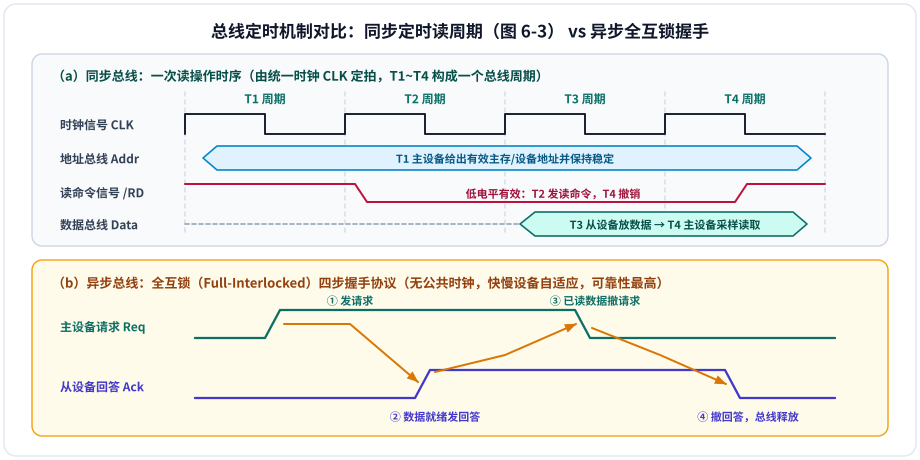
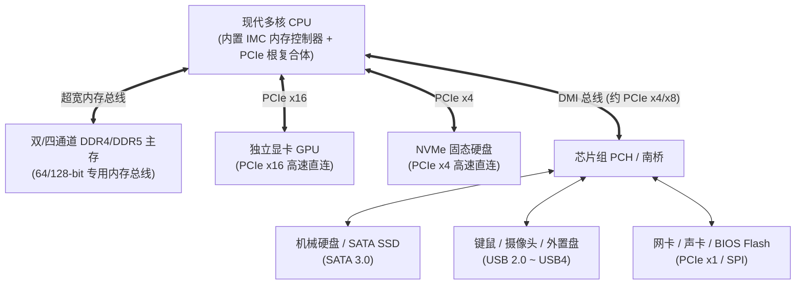
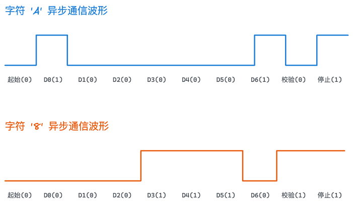

# 第6章：总线系统

!!! note "参考讲义"
    课堂配套课件下载：[第6章 总线系统 PPT](https://github.com/xurry-ace/mynotes/releases/download/pdf-assets/co-ch6-bus.pdf)

总线（**Bus**）是计算机系统各功能部件之间传输数据、地址和控制信息的**共享公共通道**。本章围绕**总线结构与带宽指标、总线仲裁、同步/异步定时机制、主流总线标准（PCIe / USB）**四大核心展开。

---

## 6.1 总线概述与系统结构

### 6.1.1 基本概念：为什么要共享总线？

如果为计算机内每两个部件都拉一组点对点专线（全互连），$N$ 个部件需要 $\frac{N(N-1)}{2}$ 套连线，不仅主板布线极其复杂，新增外设也无处插脚。

> **城市公交路线类比（仅帮助理解）**：总线就像一条贯穿全城的公共汽车干线，CPU、主存、各 I/O 接口则是沿途站点，数据是上下车的乘客——**分时共享同一组物理传输线**（同一时刻只允许一个发送源驱动总线，可多个设备接收）。

<div class="grid cards" markdown>

-   **📡 系统总线的三类信息线**

    ---

    - **数据总线（DB）**：**双向**传输指令与数据，位数等于总线宽度。
    - **地址总线（AB）**：**单向**（由主设备发出）指明主存单元或 I/O 端口地址。
    - **控制总线（CB）**：传递读/写命令、中断请求、总线请求与授权及定时信号（单根单向，整体双向）。

-   **👑 主设备（Master） vs 从设备（Slave）**

    ---

    - **主设备**：能主动申请并获得总线控制权、发起读写事务的部件（如 **CPU、DMA 控制器**）。
    - **从设备**：不能主动争总线，只能响应主设备地址寻址被动配合读写的部件（如**主存、显存、普通外设接口**）。

</div>

---

### 6.1.2 三种典型总线系统结构（对应教材图 6-1）

点击标签查看计算机总线拓扑的三代演进：

=== "1. 单总线结构"

    CPU、主存和所有高速/低速 I/O 接口全部挂接在同一条系统总线上：

    ```mermaid
    flowchart TB
        CPU["CPU"] <--> BUS["====== 单一共享系统总线 ======"]
        MEM["主存 Memory"] <--> BUS
        IO1["I/O 接口 1 (磁盘)"] <--> BUS
        IO2["I/O 接口 2 (键盘/显示)"] <--> BUS
    ```

    - **优点**：结构最简单、成本低，增减外设极方便。
    - **缺点**：所有访存与外设传输全挤在一条路上，设备增多时**总线争用严重，成为全机性能瓶颈**。

=== "2. 面向 CPU 的双总线结构"

    在 CPU 与主存之间设专用**存储总线（M 总线）**，在 CPU 与外设间设 **I/O 总线**：

    ```mermaid
    flowchart LR
        MEM["主存 Memory"] <-->|"专用存储总线"| CPU["中央处理器 CPU"]
        CPU <-->|"I/O 总线"| IO["各类 I/O 接口与外设"]
    ```

    - **优点**：CPU 访存效率大幅提升。
    - **致命痛点**：外设与主存没有直接通路，**I/O 数据进出内存必须全程借道 CPU 转发**，拖累 CPU 效率。

=== "3. 面向存储器的双总线结构（现代基础）"

    在单系统总线基础上再专门开辟一条 CPU $\leftrightarrow$ 主存高速专线：

    ```mermaid
    flowchart LR
        CPU["CPU"] <-->|"高速存储总线"| MEM["主存 Memory"]
        CPU <--> SYS["系统 / I/O 总线"]
        MEM <-->|"支持 DMA 直接访存"| SYS
        SYS <--> IO1["高速 I/O 接口"] & IO2["低速 I/O 接口"]
    ```

    - **核心优势**：兼顾了 **CPU 高速访存** 与 **DMA 外设直接读写主存（绕开 CPU）**，是现代分层互连架构的雏形。

---

### 6.1.3 总线的分类与“串行逆袭并行”之谜

- **按连接层级位置**：**片内（芯片级）总线**（CPU 内部寄存器与 ALU 互连）$\rightarrow$ **系统（板级）总线**（CPU、主存、I/O 通道互连）$\rightarrow$ **通信（外部）总线**（主机与外部设备或计算机间互连）。
- **按数据传输方式（高频简答考点：为什么现代高速 PCIe、USB、SATA 全淘汰了并行总线改用串行？）**：

| 对比维度 | 并行总线（如早期 ISA、PCI、IDE） | 串行总线（如现代 PCIe、USB、SATA） |
| :--- | :--- | :--- |
| **传输形式** | 多根数据线同时并排传送 8/16/32/64 位 | 一对（或多对通道 Lane）差分线**逐位高速串行**传送 |
| **引脚与布线** | 信号线极多、接插件庞大、成本高 | 引脚极少、体积小巧、支持长距离线缆 |
| **高频瓶颈** | 频率拉高后，多根并排导线间产生严重**电磁串扰**与**时钟偏斜（Skew，各路信号不能同时到达）**，频率很难突破几百 MHz | 无多线同步偏斜困扰，采用**低压差分信号（LVDS）抗干扰**与嵌入式时钟编码，轻松冲上 **数 GHz ～ 数十 GHz**！ |

---

### 6.1.4 总线性能指标与带宽计算（必考计算）

- **总线宽度（$W$）**：数据总线的根数（一次并行传输的二进制位数，如 32 位、64 位）。
- **总线工作频率（$f_{\text{bus}}$）**：每秒完成的总线传输周期数（若 $n$ 个时钟周期完成 1 次总线传输，则 $f_{\text{bus}} = \dfrac{f_{\text{clk}}}{n}$）。
- **总线带宽（最大理论传输速率 $B$）**：

$$B = \text{每次传输字节数} \times \text{总线工作频率} = \frac{W}{8} \times f_{\text{bus}} = \frac{W}{8} \times \frac{f_{\text{clk}}}{n} \quad (\text{单位：MB/s 或 GB/s})$$

> **速算示例**：32 位总线（$W = 32\text{ bit} = 4\text{B}$），工作频率为 $66\text{MHz}$，理论带宽 $= 4\text{B} \times 66\text{MHz} = \mathbf{264\text{ MB/s}}$（注：实际有效带宽受地址/握手协议开销影响，约为理论值的 $60\% \sim 80\%$；注意频率与带宽里的 $\text{M} = 10^6$！）。

---

## 6.2 总线仲裁（Bus Arbitration）

同一时刻若有多个主设备同时想占用总线，必须由**总线仲裁机制**按优先级裁决谁先上车，防止电信号冲突烧毁电路。

### 6.2.1 三种集中式仲裁方式对比（408 高频必考 · 对应图 6-2）

集中式仲裁由中央**总线仲裁器**统一受理请求并发放授权，三种经典接法对比如下：

=== "① 链式查询（菊花链）"

    所有设备共用 1 根请求线 `BR` 和 1 根忙线 `BS`，**授权线 `BG` 像串糖葫芦一样从仲裁器依次串行穿过各设备**，第一个确实发了请求的设备截留 `BG` 获得总线：

    ```mermaid
    flowchart LR
        ARB["中央总线仲裁器"] -->|"BG 授权信号依次顺传"| D0["设备 0<br/>(优先级最高)"] -->|"BG"| D1["设备 1"] -->|"BG"| Dn["设备 n<br/>(优先级最低)"]
        D0 & D1 & Dn -.->|"共享 1 根请求线 BR / 忙线 BS"| ARB
    ```

=== "② 计数器定时查询"

    去掉串行 `BG` 线，改为仲裁器内部用计数器递增，通过 **$\lceil \log_2 N \rceil$ 根设备地址线**向全线广播轮询“当前编号设备需要总线吗？”：

    ```mermaid
    flowchart LR
        ARB["中央仲裁器<br/>(内置计数器)"] ==>|"log₂N 根设备地址线广播查询"| D0["设备 0"] & D1["设备 1"] & Dn["设备 n"]
        D0 & D1 & Dn -.->|"共享 1 根 BR / 1 根 BS"| ARB
    ```

=== "③ 独立请求方式"

    豪横地给**每一个设备单独拉一对专属请求线 $\text{BR}_i$ 和专属授权线 $\text{BG}_i$** 直通中央仲裁器内部排队电路：

    ```mermaid
    flowchart LR
        ARB["中央仲裁器<br/>(并行优先级排队器)"] <-->|"独立 BR₀ / BG₀"| D0["设备 0"]
        ARB <-->|"独立 BR₁ / BG₁"| D1["设备 1"]
        ARB <-->|"独立 BRₙ / BGₙ"| Dn["设备 n"]
    ```

| 集中仲裁方式 | 控制线总根数（$N$ 个设备） | 优先级灵活性 | 裁决响应速度 | 故障敏感性与突出优缺点 |
| :---: | :---: | :--- | :---: | :--- |
| **链式查询** | **$3$ 根**（最少，与 $N$ 无关） | **固定死板**（离仲裁器越近越高，远端易“饿死”） | 最慢（逐级传播） | **对断路故障极敏感**——前面某台坏了，下游全部瘫痪；胜在连线极简 |
| **计数器定时查询** | **$\lceil \log_2 N \rceil + 2$ 根** | **灵活可变**（初值从 0 起为固定优先；从上次中止点起为公平循环优先） | 中等 | 对单点故障不敏感，兼顾连线数与公平性 |
| **独立请求方式** | ==**$2N + 1$ 根**==（含 1 根 `BS`） | **极度灵活**（可编程动态调整、屏蔽故障设备） | **最快**（并行一步裁决） | 控制线数量随设备数线性暴增，硬件接口成本最高 |

### 6.2.2 分布式仲裁与优先级策略

- **分布式仲裁**（无中央仲裁器，各主设备自带仲裁号与竞争逻辑）：
  1. **自举式分布式仲裁**：高优先级设备发请求时直接压制低优先级设备的授权信号。
  2. **碰撞检测式（CSMA/CD）**：先听后发、边发边听，撞车后随机退避重发（经典以太网采用，实时性不确定）。
  3. **仲裁号竞争（如 PCI/CAN）**：各主设备将自身优先级号驱动上仲裁总线，硬件逐位比大小决出唯一胜者。
- **常用优先级算法**：**固定优先级**（简单但低优先级易饥饿）、**轮询（Round-Robin）**、**动态老化优先级**（等待越久优先级越高，彻底防饿死）及分组混合策略。

---

## 6.3 总线定时（Bus Timing）

总线定时规定了收发双方如何确认“地址/数据什么时候放稳了、什么时候可以取走”。



### 四种总线定时方式全景对比

| 定时方式 | 同步基准 | 工作机制核心 | 优点 | 缺点与典型代表 |
| :---: | :---: | :--- | :--- | :--- |
| **1. 同步定时** | 统一公共时钟 | 一个总线周期含固定时钟拍数（如 **T1 发地址 $\rightarrow$ T2 发读命令 $\rightarrow$ T3 给数据 $\rightarrow$ T4 采样结束**） | 控制逻辑最简单、传输速率高 | **全线被迫迁就最慢设备**；长距离高频时钟偏斜严重 |
| **2. 异步定时** | 无公共时钟（靠**请求 Req / 回答 Ack** 握手） | 分为三种互锁等级：<br>• **不互锁**：发完定宽脉冲就不管（最快但最不可靠）<br>• **半互锁**：Req 等 Ack 才撤，但 Ack 自动定时撤<br>• **全互锁**：四步边沿严格因果咬合（上图 b，**最可靠**） | 快慢设备同网混搭，总线周期长度完全按需伸缩 | 往返握手控制线多、协议延迟开销大，极限速率不如同步 |
| **3. 半同步定时** | 公共时钟 $+$ **`WAIT` 等待信号线** | 默认按同步时钟走；慢速从设备来不及准备数据时拉低 $\overline{\text{WAIT}}$，让主设备在 T2/T3 间自动插入若干个 $T_w$ 等待周期 | 兼顾同步的高速简单与异步的快慢兼容 | 控制略增复杂；**经典 PCI 总线**采用 |
| **4. 分离式定时** | 事务拆成两个独立子周期 | **子周期 1**：主设备发完地址和读命令后**立即释放总线**；从设备内部慢慢准备数据期间总线让给别人用；<br>**子周期 2**：从设备备好数据后**反过来充当主设备**申请总线把数据送回 | ==消除空闲等待，挖掘极限总线利用率== | 双方都必须具备主设备能力，状态管理最复杂；现代 **PCIe 数据包事务**即源于此思想 |

---

## 6.4 总线标准演进与现代 PC 互连实例

### 6.4.1 PC 内部扩展总线三代跨越：ISA → PCI → PCIe

| 总线标准 | 推出年代 | 传输方式与拓扑 | 位宽 / 通道与工作频率 | 峰值带宽量级 | 核心历史定位 |
| :---: | :---: | :--- | :--- | :--- | :--- |
| **ISA** | 1981 | 并行共享总线 | $8/16$ 位，$8\text{MHz}$ | $5 \sim 10\text{ MB/s}$ | 早期 IBM PC 标准，需手动跳线配端口，早已淘汰 |
| **PCI** | 1991 | 并行共享总线（地址/数据复用） | $32/64$ 位，$33/66\text{MHz}$ | $132 \sim 528\text{ MB/s}$ | 首创与 CPU 解耦的桥接架构与**即插即用（PnP）** |
| **PCIe** | 2004 至今 | **高速串行点对点全双工交换** | `x1 / x4 / x8 / x16` 差分通道（`128b/130b` 编码，分物理/数据链路/事务层） | 见下表（高达数十 $\text{GB/s}$） | **当代绝对霸主**，直连显卡、NVMe SSD 与高速网卡 |

<div class="grid cards" markdown>

-   **🚀 各代 PCIe 单向带宽速查**

    ---

    | PCIe 版本 | 单通道 (`x1`) 带宽 | 显卡槽 (`x16`) 带宽 |
    | :---: | :---: | :---: |
    | PCIe 1.0 / 2.0 | $250\text{ MB/s}$ / $500\text{ MB/s}$ | $4\text{ GB/s}$ / $8\text{ GB/s}$ |
    | **PCIe 3.0** | $1\text{ GB/s}$ | $16\text{ GB/s}$ |
    | **PCIe 4.0** | $2\text{ GB/s}$ | $32\text{ GB/s}$ |
    | **PCIe 5.0** | $4\text{ GB/s}$ | $64\text{ GB/s}$ |

-   **🔌 USB 外设串行总线演进与四类传输**

    ---

    - **特点**：星形集线器（Hub）拓扑（最多 5 级级联、127 个设备）、支持**热插拔**与总线供电。
    - **带宽演进**：USB 1.0（$1.5/12\text{Mbps}$）$\to$ USB 2.0（$480\text{Mbps}$）$\to$ USB 3.0/3.1/3.2（$5/10/20\text{Gbps}$）$\to$ USB4（$40\text{Gbps}$）。
    - **四种传输模式**：**控制传输**（枚举配置）、**中断传输**（键鼠小数据低延迟）、**批量传输**（U 盘/打印机高可靠大块）、**等时传输**（音视频实时流）。

</div>

### 6.4.2 其他常用存储与嵌入式片上总线

| 标准名称 | 应用领域 | 信号线与核心特征 |
| :---: | :--- | :--- |
| **SATA / SCSI** | 外存硬盘接口 | **SATA 3.0** 串行点对点（$6\text{Gbps}$，主流机械盘/入门 SSD）；**SCSI/SAS** 高可靠服务器存储接口 |
| **$\text{I}^2\text{C}$** | 板级低速传感器/EEPROM | 仅 **2 根线**（数据 `SDA` + 时钟 `SCL`），半双工多主从寻址，极省引脚 |
| **SPI** | 单片机连 Flash/屏幕/传感器 | **4 根线**（`MOSI`、`MISO`、`SCK`、片选 `SS`），全双工同步串行，速度显著快于 $\text{I}^2\text{C}$ |
| **AMBA / Wishbone** | SoC 芯片内部片上互连 | ARM **AMBA** 家族含 **AXI**（超高带宽乱序）、**AHB**（高速骨干）、**APB**（低功耗外设）；Wishbone 为开源 FPGA 总线 |

---

### 6.4.3 现代 PC 层次化总线系统全貌（对应教材图 6-4）

现代 PC 早已将原“北桥”的内存控制器与高速 PCIe 控制器直接集成进 **CPU 内部**（多路 CPU 或 Chiplet 间用 Intel **QPI/UPI** 或 AMD **Infinity Fabric** 互连），通过 **DMI 总线**连接南桥芯片组（PCH）扩展中低速外设：



---

## 作业题

<div class="co-question" markdown="1">

### 作业 P229-3：异步串行通信字符“A”与“8”波形图

!!! question "题目"
    用异步通信方式传送字符“A”和“8”，数据有 7 位，偶校验 1 位，起始位 1 位，停止位 1 位，请分别画出波形图。

<details class="co-answer" markdown="1">
<summary>查看答案与解析</summary>

**解析：**

**异步串行通信**通过在每个字符帧前后加装**起始位**与**停止位**实现逐帧自同步，绘图前必须牢记五条铁律：

1. **空闲状态（Idle）**：恒保持**高电平（`1`）**。
2. **起始位（Start Bit）**：跳变为 **1 位低电平（`0`）**，唤醒接收端采样时钟。
3. **数据位（Data Bits，7 位）**：==严格按低位在前（LSB First，$D_0 \rightarrow D_6$）、高位在后发送==！
4. **校验位（Parity Bit，1 位）**：题目指定**偶校验**——**仅统计 7 位数据位**加上该校验位中 `1` 的总个数必须为**偶数**（切勿把起始位和停止位算进去！）。
5. **停止位（Stop Bit）**：恒为 **1 位高电平（`1`）**，标志本帧结束。

- **字符 `'A'`**：ASCII 码 $= 65 = (1000001)_2$，倒序 LSB 在前依次发 `1, 0, 0, 0, 0, 0, 1`（已有 2 个 `1`，偶校验位填 **`0`**）：

| 起始位 | D0 (LSB) | D1 | D2 | D3 | D4 | D5 | D6 (MSB) | 偶校验位 | 停止位 |
| :---: | :---: | :---: | :---: | :---: | :---: | :---: | :---: | :---: | :---: |
| **`0`** | **`1`** | **`0`** | **`0`** | **`0`** | **`0`** | **`0`** | **`1`** | **`0`** | **`1`** |

- **字符 `'8'`**：ASCII 码 $= 56 = (0111000)_2$，倒序 LSB 在前依次发 `0, 0, 0, 1, 1, 1, 0`（已有 3 个 `1`，偶校验位补 **`1`**）：

| 起始位 | D0 (LSB) | D1 | D2 | D3 | D4 | D5 | D6 (MSB) | 偶校验位 | 停止位 |
| :---: | :---: | :---: | :---: | :---: | :---: | :---: | :---: | :---: | :---: |
| **`0`** | **`0`** | **`0`** | **`0`** | **`1`** | **`1`** | **`1`** | **`0`** | **`1`** | **`1`** |

**波形图（Excalidraw 手绘）：**



</details>

</div>

<div class="co-question" markdown="1">

### 作业 P230-19：总线带宽计算

!!! question "题目"
    某总线在一个总线周期中并行传送 8 字节的信息，假设一个总线周期等于一个总线时钟周期，总线时钟频率为 $70\text{MHz}$，总线带宽是多少？

<details class="co-answer" markdown="1">
<summary>查看答案与解析</summary>

**解析：**

- 每个总线周期传送数据量 $= 8\text{ B}$；一个总线周期等于一个时钟周期，故总线工作频率 $= 70\text{ MHz} = 70 \times 10^6\text{ Hz}$：

$$\text{总线带宽} = 70\text{ MHz} \times 8\text{ B} = \mathbf{560\text{ MB/s}}$$

!!! warning "单位换算提醒"
    通信与总线速率中的 $\text{M}$ 一律取 **$10^6$（十进制）**，而非存储容量中的 $2^{20}$！若换算为比特率，则 $560\text{ MB/s} \times 8\text{ bit/B} = \mathbf{4480\text{ Mbps}}$（即 $4.48\text{ Gbps}$）。

</details>

</div>

## 课后自测思考题

???+ question "复习自检清单（共 10 题，学完本章试着口述作答并勾选）"
    - [ ] **1. 总线本质**：什么是总线？相比点对点全互连，为什么计算机系统必须引入共享总线？
    - [ ] **2. 拓扑对比**：对比单总线、面向 CPU 的双总线和面向存储器的双总线结构各自的优缺点。
    - [ ] **3. 仲裁对比**：集中式仲裁与分布式仲裁有何区别？链式查询、计数器查询、独立请求各自需要几根控制线？
    - [ ] **4. 定时协议**：同步总线和异步全互锁总线有何区别？半同步总线的 $\overline{\text{WAIT}}$ 信号如何兼顾快慢设备？
    - [ ] **5. 速率口算**：32 位总线工作频率 $66\text{MHz}$，理论传输速率是多少？（$264\text{MB/s}$）若有效效率 $70\%$，实际速率是多少？（$184.8\text{MB/s}$）
    - [ ] **6. 串行逆袭**：相比传统 PCI 并行总线，PCIe 为什么改用串行点对点差分通道反而带宽高出几十倍？
    - [ ] **7. USB 模式**：USB 的控制、中断、批量、等时四种传输模式分别适用于哪些典型外设？
    - [ ] **8. 现代主板**：现代 PC 中 CPU、DDR 内存、独立显卡、NVMe SSD、SATA 硬盘分别通过什么总线互连？
    - [ ] **9. PCIe 估算**：使用 PCIe 3.0 `x8` 连接高速存储卡，单向理论带宽约为多少？（约 $8\text{GB/s}$）
    - [ ] **10. 方案选型**：为一个需连接高速闪存、多个外置热插拔设备及板载温湿度传感器的嵌入式系统挑选合适总线组合。
