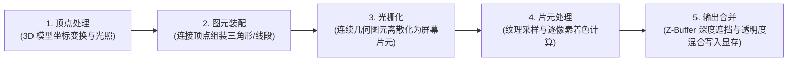
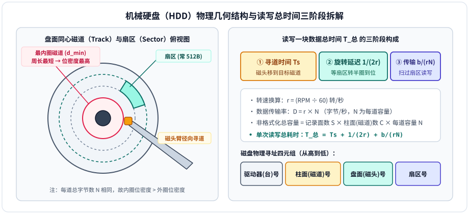

# 第7章：外围设备

!!! note "参考讲义"
    课堂配套课件下载：[第7章 外围设备 PPT](https://github.com/xurry-ace/mynotes/releases/download/pdf-assets/co-ch7-peripherals.pdf)

外围设备（**Peripheral Equipment**，简称外设）是计算机系统与外部世界进行信息交互和持久化存储的重要组成部分。本章系统梳理**输入设备、输出设备（显示系统与打印机）以及外存储器（机械硬盘 HDD、固态硬盘 SSD、光盘与新型存储）**的核心原理与考研计算方法。

---

## 7.1 外围设备概述

### 7.1.1 作用与分类全景

如果说 CPU 和主存构成了计算机的“中枢主机”，那么外围设备就是连接现实物理世界的桥梁。

> **人体功能类比（仅帮助理解）**：把计算机想象成一个人——**CPU** 是负责思考计算的大脑，**内存**是临时的短期工作记忆；而外围设备中的**输入设备**相当于眼睛和耳朵（感官采集），**输出设备**相当于嘴巴和手势（表达呈现），**外存储器**则是随身携带、断电也不丢字的笔记本（长期档案库）。

-   **⌨️ 1. 输入设备（Input）**

    ---

    将外部物理世界的信息（按键动作、位移、光影、声波）转换为计算机可识别处理的**二进制数字信号**。

    - **常见代表**：键盘、鼠标、触摸屏、扫描仪、数码相机、麦克风。

-   **🖥️ 2. 输出设备（Output）**

    ---

    将计算机处理后的二进制结果还原为人类感官可感知的形式（视觉图像、纸质文字、立体声波、三维实体）。

    - **常见代表**：显示器（配合显卡）、打印机、扬声器/耳机、投影仪、3D 打印机。

-   **💾 3. 外存储器（External Storage）**

    ---

    又称辅助存储器，用于**断电非易失、大容量永久保存**程序与数据（408 统考本章最核心的定量计算对象）。

    - **常见代表**：机械硬盘（HDD）、固态硬盘（SSD）、光盘（CD/DVD/蓝光）、磁带、U 盘与存储卡。

### 7.1.2 外围设备的四大演进趋势

1. **智能化**：设备内置专用微控制器（MCU/ASIC），独立承担图像处理、色彩管理、磨损均衡等繁重工作，大幅减轻主机 CPU 负担。
2. **高速化**：外部传输接口从早期低速串口/并口跨越到 **USB4、Thunderbolt（雷电）、PCIe/NVMe** 等数十 $\text{Gbps}$ 级高速串行通道。
3. **小型化与便携化**：随移动计算普及，闪存盘、无线键鼠、超薄便携 SSD 成为主流。
4. **多功能整合**：单一设备融合多类职责（如集打印、复印、扫描于一体的办公多功能一体机，或触控显示一体屏）。

---

## 7.2 输入设备原理与对比

### 7.2.1 键盘与鼠标

-   **⌨️ 键盘（Keyboard）：行列扫描矩阵**

    ---

    - **核心原理**：内部铺设由行线（如 X 轴）与列线（如 Y 轴）正交组成的**二维矩阵电路**。按下某键即接通对应交叉点 `(行号, 列号)`，键盘控制器扫描定位、消抖后查表生成扫描码/字符编码发往主机。
    - **常见接口**：早期 `PS/2`（不支持热插拔，已少见） $\rightarrow$ 现代标准 **`USB`**（支持热插拔）与 **`蓝牙`** 无线连接。
    - **三类按键结构**：
      - **机械键盘**：每键独立机械微动开关，寿命长、段落手感鲜明；
      - **薄膜键盘**：按压三层导电薄膜接触导通，成本极低、轻薄静音但手感偏软；
      - **静电容键盘**：利用按压引起的电容容量变化无触点触发，寿命极长、手感顺滑。

-   **🖱️ 鼠标（Mouse）：位移传感检测**

    ---

    - **两代工作原理**：
      - **早期机械鼠标**：底部橡胶滚球带动正交双轴光栅编码盘旋转，靠脉冲计数与相位测算水平/垂直位移；
      - **现代光电 / 激光鼠标**：底部 LED 或高精度激光照射桌面，高速微距 CMOS 传感器连续抓拍表面纹理反射光变化（数字图像相关算法）解算移动方向与距离。
    - **三大性能指标**：
      - **分辨率（`DPI`）**：鼠标每移动 1 英寸屏幕光标跨越的像素点数，越高定位越细腻；
      - **回报率 / 采样率（`Hz`）**：每秒向主机上报坐标的次数（如 $125\text{Hz} \sim 1000\text{Hz}+$）；
      - **加速度**：物理移动速度与光标移动倍率的关系。
    - **常见接口**：`USB` 有线 / 2.4G 接收器、`蓝牙`（早期 `PS/2` 已淘汰）。

---

### 7.2.2 触摸屏：四类触控技术对比

现代触摸屏将输入与显示合二为一，普遍支持**多点触控（Multi-touch）**与手势识别（双指缩放、旋转、滑动）。四类主流实现原理对比如下：

| 触摸屏类型 | 物理结构与位置检测原理 | 核心优势 | 局限与典型应用 |
| :---: | :--- | :--- | :--- |
| **电阻式** | 双层透明导电薄膜夹微小绝缘点；按压使两层物理接触导通，靠分压比测算触点坐标 | 成本低；**不挑触控物**（戴普通手套、指甲、塑料笔尖均可点按） | 透光率较低、表面偏软易划伤，一般仅支持单点；常见于工业控制屏、早期工控 POS 机 |
| **电容式** | 利用**人体静电场**与屏幕表面透明电极（ITO）形成耦合电容，手指触碰吸走微量电流改变局部电容，控制器解算多指坐标 | **透光率极高、玻璃耐刮擦、原生支持丝滑多点触控** | **必须使用导体触发**（普通棉手套或绝缘笔尖无效）；统治现代智能手机与平板电脑 |
| **红外式** | 屏幕四周边框密集排列红外发射管与接收管构成不可见光网；手指遮挡X/Y方向光束即定位 | 不依赖贴膜、寿命长、**极易做成超大尺寸** | 边框较厚，强环境光或灰尘遮挡易受干扰；常见于大尺寸教学交互白板、自助查询机 |
| **表面声波** | 玻璃四角发射超声波沿表面传播，手指触碰吸收部分声波能量，按衰减时刻推算位置 | 透光性与定位精度极佳 | 怕表面水滴、油污与灰尘吸收声波导致误判，成本较高 |

---

### 7.2.3 图像与音频采集设备

-   **📄 扫描仪（Scanner）**

    ---

    - **工作链路**：内置线光源照射纸质文档 $\rightarrow$ 反射光经光学透镜聚焦至 **CCD（电荷耦合器件）** 或 **CIS（接触式图像传感器）** 实现光电转换 $\rightarrow$ 经 **A/D（模数转换）** 生成数字位图。
    - **关键指标**：**光学分辨率**（如 $300\text{ dpi}$、$600\text{ dpi}$）、**色彩深度**（如 24 位真彩色、48 位专业色深）、**扫描速度**（页/分）。

-   **📷 数码相机（Digital Camera）**

    ---

    - **核心原理**：镜头将光学画面投射到 **CMOS** 或 **CCD** 图像传感器阵列，直接数字化为图像文件。
    - **四大核心参数**：**像素总数**、**传感器靶面尺寸**（“底大一级压死人”，越大信噪比与画质越好）、**ISO 感光度**（对弱光敏感度）、**光学变焦倍数**（改变镜头物理焦距，无损画质）。

-   **🎙️ 麦克风（Microphone）**

    ---

    - **工作链路**：空气声波推动振膜振动 $\rightarrow$ 换能器转为微弱模拟电信号 $\rightarrow$ 声卡放大并经 **A/D 采样量化**变为数字音频流。
    - **三大类型**：**动圈式**（结构坚固耐用、适合舞台人声）、**电容式**（灵敏度极高、频响宽，录音棚首选）、**驻极体**（微型低成本，广泛嵌入手机与笔记本）。

---

## 7.3 输出设备：显示系统与打印技术

### 7.3.1 显示器四代演进与核心指标

显示系统由**显示适配器（显卡）**与**显示器**共同构成。四代显示面板发光原理对比如下：

| 显示技术 | 发光与成像物理机制 | 突出优点 | 主要短板 |
| :---: | :--- | :--- | :--- |
| **CRT（阴极射线管）** | 尾部**电子枪**发射高速电子束，在偏转线圈控制下按行**逐点顺序扫描**轰击涂有 **R/G/B 三色荧光粉**的荧光屏发光（好比画笔每秒在纸上重画几十遍整幅画） | 色彩还原自然、无固定物理分辨率限制、响应极快 | 体积厚重如电视箱、功耗高、存在几何失真与轻微闪烁，早已淘汰 |
| **LCD（传统液晶）** | 液晶本身**不发光**——底层 CCFL 冷阴极灯管提供恒定背光，电场精确控制每个子像素**液晶分子扭转角度**充当“光阀门”，配合前层 RGB 彩色滤光片调出亮度与色彩 | 平板轻薄、无辐射、无几何失真 | 黑色漏光（对比度受限）、低温响应变慢、早期 CCFL 灯管较耗电 |
| **LED 背光液晶** | 成像层**本质仍是 LCD 液晶光阀**，但将背光源升级为 **LED（发光二极管）阵列**（进阶如 Mini-LED 分区控光） | 比传统 CCFL 更轻薄省电、寿命长、亮度高、色域更广 | 液晶偏转物理极限仍在，暗场光晕难以彻底根除 |
| **OLED（有机发光二极管）** | 采用有机电致发光材料，通电后**每个红绿蓝像素独立自发光，彻底取消背光层**！ | **极致纤薄（可弯曲折叠）、纯黑完全不发光（近乎无限对比度）、微秒级响应、超大可视角** | 长期固定显示高亮度静态图标存在有机材料不均匀老化（“烧屏”）风险，成本较高 |

!!! info "显示器六大核心指标与显存（刷新存储器）必考公式"
    - **六大常用指标**：
      1. **分辨率**：水平像素数 $\times$ 垂直像素数（如 $1920 \times 1080$、$3840 \times 2160$ 即 4K）；
      2. **像素间距（点距）**：相邻同色像素中心距离（越小画面越细腻）；
      3. **刷新率（帧频 $f$）**：屏幕每秒重绘更新画面的次数（如 $60\text{Hz}$、$144\text{Hz}$）；
      4. **响应时间**：像素灰阶/颜色切换耗时（以 $\text{ms}$ 计，越小高速运动画面越少拖影）；
      5. **对比度**：最亮白场与最暗黑场亮度之比；
      6. **色域**：能覆盖呈现的色彩空间比例（如 sRGB、DCI-P3）。
    - **刷新存储器（VRAM 显存）容量与带宽公式**（课后题高频考点）：设分辨率为 $M \times N$，颜色深度为 $k\text{ bit}$（每像素占 $\frac{k}{8}\text{ B}$），刷新帧频为 $f\text{ Hz}$，则：
      $$\text{单帧最低显存容量 } C = M \times N \times \frac{k}{8}\text{ (Byte)}, \qquad \text{刷新显存带宽 } B = C \times f\text{ (Byte/s)}$$

---

### 7.3.2 显卡（显示适配器）与 GPU 渲染流水线

- **显卡四大硬件组成**：**GPU（图形处理器，拥有成千上万流处理器并行算力）** $+$ **高速独立显存（VRAM）** $+$ **输出接口（HDMI / DisplayPort）** $+$ **RAMDAC（数模转换器，仅早期 VGA 等模拟信号接口需要，纯数字接口直出）**。
- **三类产品形态**：**集成显卡 / 核显**（集成于 CPU 芯片内、共享系统主存，低功耗省成本）、**独立显卡**（自带高带宽 GDDR 显存，游戏与 AI 算力主力）、**专业工作站显卡**（针对 CAD/3D 建模工业软件专项驱动与精度认证）。
- **现代 GPU 五阶段可编程图形渲染流水线**：

---

### 7.3.3 打印机与其他输出设备

| 打印机类型 | 物理成像原理 | 核心优势 | 主要短板与典型场景 |
| :---: | :--- | :--- | :--- |
| **针式打印机** | 电磁驱动金属打印针直接**击打色带**，在纸面压印出字符点阵（击打式） | 耗材极便宜，**唯一能依靠物理击打力一次打印多层无碳复写纸** | 噪音极大、分辨率低、打印慢；专用于银行柜台单据、多层增值税发票 |
| **喷墨打印机** | 微喷嘴将液态墨水微滴精确喷射附着于纸面（非击打式） | **彩色照片层次细腻还原好**、机身购置便宜、安静 | 原装墨盒单页成本偏高、喷头长期不用易干涸堵塞、大批量速度较慢；适合家庭与图文彩照 |
| **激光打印机** | 激光束扫描感光硒鼓形成**静电潜像** $\rightarrow$ 吸附干碳粉 $\rightarrow$ 转印到纸上 $\rightarrow$ **高温高压定影**（非击打式） | **打印速度极快（PPM 高）、文字边缘锐利如印刷、单页碳粉成本低** | 购机成本较高、体积较大，顶级相纸色彩表现略逊专业多色喷墨；企业办公绝对主力 |

- **打印机四项核心指标**：**打印分辨率**（`dpi`，每英寸点数，如 $600/1200\text{ dpi}$）、**打印速度**（`PPM`，Pages Per Minute 每分钟页数）、**月打印负荷**、**内置打印缓存容量**。
- **其他常见输出设备**：
  - **🔊 扬声器与耳机**：数字音频经 **`DAC`（数模转换器）** 转为模拟波形 $\rightarrow$ **功率放大器**驱动音圈振膜推动空气发声。
  - **📽️ 投影仪**：主流技术含 **LCD**（液晶透射光阀）、**DLP**（TI 数字微镜芯片高速翻转反射）、**LCOS**（硅基反射式液晶，高分辨率高对比度）。
  - **🧊 3D 打印机（增材制造）**：逐层堆叠成型，主流工艺有 **FDM**（热熔挤出塑料丝）、**SLA**（紫外激光固化液态光敏树脂，高精度）、**SLS**（高能激光烧结尼龙/金属粉末）。

---

## 7.4 外存储器：磁盘、固态盘与光磁存储（核心考点）

### 7.4.1 机械硬盘存储器（HDD）原理与几何定量关系

机械硬盘（Hard Disk Drive）利用涂覆磁性材料的铝合金/玻璃盘片高速旋转，依靠南北极两种剩磁极化方向记录二进制 `0` 和 `1`（写操作靠磁头线圈通电流产生磁场改写盘面极化方向；读操作靠磁头切割盘面磁力线感应电信号）。

> **黑胶唱片机类比（仅帮助理解）**：盘片好比旋转的黑胶唱片，磁臂上的磁头好比唱针。但关键区别在于：黑胶唱片的音轨是从外向内一圈连着一圈的**单条螺旋线**，而硬盘盘面划分的是一圈圈彼此独立的**同心圆磁道（Track）**，每条磁道又等分为若干个固定大小的**扇区（Sector，传统每扇区 $512\text{B}$，现代高级格式化多为 $4\text{KB}$）**，且磁头在读写时悬浮在高速气流垫上绝不接触盘面！

-   **📐 HDD 四大定量计算铁律（必背）**

    ---

    1. **非格式化/格式化容量**：总容量 $= S \times C \times N$（即记录面数 $S \times$ 每面磁道数 $C \times$ 每道字节数 $N$）。
    2. **最内圈决定最高位密度**：若各磁道记录字节数 $N$ 相等（等容量磁道），**直径最小的最内圈磁道周长 $\pi d_{\min}$ 最短，位密度最大**（$D_b = \dfrac{N}{\pi d_{\min}}$），因此磁盘总容量受限于最内圈的最大物理位密度！
    3. **内部持续传输率**：转速 $r\text{ (r/s)}$ 下每转一圈读完一整条磁道，$D_r = r \times N\text{ (B/s)}$（注意把题目给的 $\text{r/min}$ 除以 $60$ 换算成 $\text{r/s}$！）。
    4. **单次块读写总时间**：$T_{\text{总}} = T_s + \dfrac{1}{2r} + \dfrac{b}{rN}$（依次为平均寻道 $T_s$ $+$ 平均旋转等待 $\frac{1}{2r}$ $+$ 数据传送 $\frac{b}{rN}$）。

-   **🔌 HDD 性能参数与四类接口**

    ---

    - **常见转速**：笔记本节能盘 $5400\text{ RPM}$、桌面主流盘 $7200\text{ RPM}$、企业高速盘 $10000 / 15000\text{ RPM}$（板载 $64 \sim 256\text{ MB}$ DRAM 缓存加速）。
    - **接口演进**：
      - `IDE (PATA)`：早期宽排线并行接口，已淘汰；
      - **`SATA`**：串行点对点接口（SATA 3.0 带宽 $6\text{Gbps}$），个人电脑机械盘标配；
      - **`SAS`**：串行连接 SCSI，双端口高可靠企业级服务器接口；
      - **`USB`**：移动硬盘外置桥接接口。

---

### 7.4.2 固态硬盘（SSD）与 NAND Flash 技术

固态硬盘（Solid State Drive）彻底摒弃了旋转盘片与机械摆臂，由 **主控芯片（相当于片上小 CPU）$+$ NAND Flash 闪存颗粒 $+$ 缓存芯片（DRAM 或 HMB）** 组成，纯粹依靠**浮栅晶体管（Floating-Gate MOS）或电荷陷阱层**捕获电子数量所引起的阈值电压偏移来表示数据。

#### 1. NAND Flash 四代存储密度对比

每个闪存单元（Cell）塞进的比特数越多，单位容量成本越低，但需要区分的电压台阶呈指数（$2^k$）暴增，导致速度变慢、可擦写寿命（P/E Cycles）急剧缩短：

| 颗粒类型 | 每单元存储位数 | 需区分的电压状态数 | 读写速度 | 擦写寿命（P/E 量级） | 单位成本与典型定位 |
| :---: | :---: | :---: | :---: | :---: | :--- |
| **SLC** | **1 bit** | $2^1 = 2$ 种 | **最快** | 最高（约数万～十万次） | 最昂贵；航天军工、高端企业级缓存 |
| **MLC** | **2 bits** | $2^2 = 4$ 种 | 快 | 较高（约数千～一万次） | 较高；早期中高端消费盘、工业存储 |
| **TLC** | **3 bits** | $2^3 = 8$ 种 | 中等（常配模拟 SLC 缓存） | 中等（约 $1000 \sim 3000$ 次） | **性价比甜点，当今主流消费级与数据中心绝对主力** |
| **QLC** | **4 bits** | $2^4 = 16$ 种 | 缓外写入较慢 | 较低（约数百～一千次） | **每 GB 成本最低**；适合大容量冷读少写仓库盘 |

#### 2. SSD 三大底层寿命与性能保障机制

!!! tip "为什么闪存有写入寿命且不能直接“原地覆盖写”？"
    NAND Flash 的物理特性决定了它**按页（Page，如 $4\sim 16\text{KB}$）读写，但必须按块（Block，含数十至数百页）整块先擦除再写入**，且每次高压隧穿擦写都会对绝缘氧化层造成不可逆的微损伤。为此主控芯片必须配合操作系统引入三大机制：

    1. **磨损均衡（Wear Leveling）**：主控通过 FTL（闪存转换层）动态映射逻辑块与物理块，将写入操作均匀摊平到全盘所有闪存块上，严防少数热块被提前写穿报废。
    2. **垃圾回收（Garbage Collection, GC）**：在空闲后台把含有零散有效页的旧块中有效数据搬移合并到新块，再将旧块整块擦除回收备用。
    3. **`TRIM` 指令**：操作系统删除文件时只改目录表并不清零扇区；开启 `TRIM` 后 OS 会主动通知 SSD 主控“哪些逻辑页已经作废”，方便主控在 GC 时直接跳过搬运无效数据，大幅减少**写放大**并维持长期写入不掉速。

#### 3. 机械硬盘（HDD） vs 固态硬盘（SSD）全景对比

| 对比维度 | 机械硬盘（HDD） | 固态硬盘（SSD） |
| :---: | :--- | :--- |
| **记录介质与结构** | 磁性旋转盘片 $+$ 精密机械移动磁头 | 纯电子 **NAND Flash** 闪存芯片（无任何机械运动部件） |
| **持续读写带宽** | 约 $100 \sim 250\text{ MB/s}$ | SATA SSD 约 $550\text{ MB/s}$；**PCIe 4.0/5.0 NVMe 高达 $5 \sim 14\text{ GB/s}$**（快数十倍） |
| **随机寻址延迟** | **毫秒级（$5 \sim 15\text{ ms}$）**，受物理寻道与旋转拖累 | **微秒级（$< 0.1\text{ ms}$）**，零寻道时间，4K 随机 IOPS 高出百倍以上 |
| **噪音 / 功耗 / 抗震** | 有马达寻道声、功耗较高、**工作时极怕跌落震动划伤盘片** | **完全静音**、休眠功耗极低、**抗冲击抗震性极强** |
| **单位容量价格** | **每 TB 成本极低**（$10\text{TB}+$ 海量仓库盘首选） | 每 TB 价格仍高于大容量 HDD |
| **写入寿命与数据恢复** | 磁介质理论上可无限次覆写；故障盘开盘仍有机会抢救磁面数据 | 闪存块有 P/E 擦写上限；主控或颗粒击穿及 `TRIM` 清空后**数据几乎无法恢复** |

---

### 7.4.3 光盘、磁带、混合存储与新型非易失存储

#### 1. 三代光盘规格演进（激光波长越短 → 光斑越小 → 容量越大）

| 光盘代际 | 激光波长与光色 | 典型单盘容量 | 按读写特性的三类盘片介质原理 |
| :---: | :---: | :---: | :--- |
| **CD** | $780\text{ nm}$（红外激光） | 约 **$700\text{ MB}$** | • **只读型（`CD-ROM / DVD-ROM`）**：工厂母盘压制物理**凹坑（Pit）与平坦岸（Land）**，靠反射激光强弱干涉差异读 `0/1`； • **一次刻录型（`CD-R / DVD-R`）**：涂覆**有机染料层**，高能激光烧灼产生不可逆光学变化（写一次读多次）； • **可重写型（`CD-RW / DVD-RW`）**：采用**相变合金材料**，靠不同功率激光加热在晶态与非晶态间可逆转换反复擦写 |
| **DVD** | $650\text{ nm}$（红色激光） | 单面单层 **$4.7\text{ GB}$** / 双层 **$8.5\text{ GB}$** | （光驱演进：只读光驱 $\rightarrow$ 可读 DVD 并刻 CD 的**康宝 COMBO** $\rightarrow$ DVD 刻录机 $\rightarrow$ 蓝光刻录光驱） |
| **蓝光（Blu-ray）** | $405\text{ nm}$（蓝紫激光） | **$25\text{ GB} \sim 128\text{ GB}$** | 高清影视母带发行与长周期离线归档 |

#### 2. 其他辅助存储与前沿非易失性内存（NVM）

-   **⚡ 混合硬盘（SSHD）与缓存加速**

    ---

    - **混合硬盘（SSHD）**：在同一盘体内集成小容量 NAND 闪存缓存与大容量机械盘片，自动将高频访问热数据驻留闪存，兼顾启动加载速度与大容量低成本。
    - **傲腾缓存加速**：如早期 Intel Optane Memory 利用超低延迟 `3D XPoint` 介质充当 HDD/慢速盘的高速前端缓存。

-   **🎞️ 磁带存储器与闪存便携介质**

    ---

    - **磁带（Magnetic Tape）**：单盒容量高达数十 $\text{TB}$、**每 GB 成本全存储体系最低、离线保存寿命长达 30 年以上**、抗电磁干扰可靠；但只能顺序卷带，随机定位极慢——专用于超算、银行与影视行业的**海量“冷数据”灾备归档**。
    - **存储卡与 U 盘**：便携即插即用的 NAND 闪存介质，包括手机/无人机常用的 **Micro SD（TF）卡**、相机主流 **SD 卡**（及早期 CF 卡）和 USB 接口闪存盘（U 盘）。

-   **🔬 新型存储级内存（SCM / NVM）**

    ---

    致力于填补高速易失 DRAM 与慢速非易失 NAND Flash 之间的性能鸿沟：

    - **`3D XPoint`**：Intel 与美光研发的相变交叉点阵列技术（曾推出 Optane 持久内存），按字节寻址、延迟接近 DRAM 且断电不丢数据。
    - **`MRAM`（磁阻随机存取存储器）**：利用磁性隧道结自旋方向存数据，非易失、读写极快、擦写寿命近乎无限。
    - **`ReRAM`（阻变存储器）**：通过电场可逆改变金属氧化物介质电阻高低态存储 `0/1`，结构极简、功耗极低。

---

## 本章小结

- **输入与输出设备**完成了物理信号（按键、位移、光电、声波）与计算机内部二进制编码之间的双向转换：电容屏统治移动多点触控，OLED 凭借像素自发光代表现代显示方向，GPU 通过五级可编程流水线驱动实时三维渲染，激光与喷墨打印机分庭抗礼服务办公与彩色影像。
- **外存储器**在容量、成本与速度之间分级互补：**机械硬盘（HDD）**围绕“寻道 $+$ 旋转半圈等待 $+$ 磁道旋转传输”三阶段公式进行定量分析，最内圈决定最高位密度；**固态硬盘（SSD）**依托 NAND Flash（SLC/MLC/TLC/QLC）和主控的磨损均衡、GC 与 `TRIM` 机制实现微秒级随机读写；磁带则稳守超大规模冷数据归档底座。

---

## 作业题

### 作业 P254-5：磁盘读写一块信息总时间公式推导

!!! question "题目"
    试推导磁盘存储器读写一块信息所需总时间的公式。

查看答案与解析

**解析：**

要理解机械磁盘读写一个数据块的总时间 $T_{\text{总}}$，可以将整个访问过程拆解为三个阶段：

**1\. 平均寻道时间（Seek Time）：$T_s$**

- **含义**：当磁头需要读写数据时，首先必须移动到数据所在的磁道（Track）上。
- **推导**：取决于机械手臂移动的速度，通常由硬件性能决定，直接设为已知量 $T_s$。

**2\. 平均等待时间（Rotational Delay）：$\dfrac{1}{2r}$**

- **含义**：磁头到达正确磁道后，等待磁盘旋转把目标扇区（Sector）送到磁头下方的时间。
- **推导**：设磁盘转速为 $r\text{ 转/秒}$，则转一圈所需时间为 $\frac{1}{r}\text{ 秒}$。最理想情况下等待时间为 $0$，最坏情况下需等一整圈 $\frac{1}{r}$，通常取其平均值（即转半圈的时间）：

$$
\text{平均等待时间} = \frac{1}{2} \times \frac{1}{r} = \frac{1}{2r}
$$

**3\. 数据传送时间（Transfer Time）：$\dfrac{b}{rN}$**

- **含义**：磁头对准扇区起点后，边旋转边读写 $b$ 个字节数据所需的时间。
- **推导**：设每个磁道信息量为 $N\text{ 个字节}$，磁盘转一圈（$\frac{1}{r}\text{ 秒}$）可读完整个磁道，因此数据传输率 $D = \frac{N}{1/r} = rN\text{ 字节/秒}$。传送 $b$ 个字节所需时间为：

$$
\text{数据传送时间} = \frac{\text{数据大小}}{\text{传输率}} = \frac{b}{rN}
$$

!!! success "结论答案"
    将三个阶段的时间相加，即得读写一块信息所需的总时间公式：

    $$
    T_{\text{总}} = \underbrace{T_s}_{\text{平均找道时间}} + \underbrace{\frac{1}{2r}}_{\text{平均等待时间}} + \underbrace{\frac{b}{rN}}_{\text{数据传送时间}}\quad (\text{秒})
    $$

### 作业 P254-7：磁盘存储器容量、位密度、传输率与地址格式

!!! question "题目"
    某磁盘存储器转速为 $3000\text{ r/min}$，共有 4 个记录面，每道记录信息为 $12288\text{ B}$，最小磁道直径为 $230\text{ mm}$，共有 275 道。问：  
    1\. 磁盘存储器的存储容量是多少？  
    2\. 最高位密度是多少？  
    3\. 磁盘数据传输率是多少？  
    4\. 平均等待时间是多少？  
    5\. 给出一个磁盘地址格式方案。

查看答案与解析

**解析：**

!!! info "补充知识：磁盘物理寻址的四字段格式"
    主机向磁盘控制器发送寻址信息时，磁盘地址一般由 **驱动器号（台号）$D$**、**圆柱面（磁道）号 $T$**、**盘面（磁头）号 $n$**、**扇区号 $m$** 四部分组成。例如：系统有 4 个驱动器（2 位）、每个磁盘 256 个圆柱面（8 位）、16 个盘面（4 位）、每面 16 个扇区（4 位），则扇区地址共需 $2 + 8 + 4 + 4 = 18$ 位二进制代码。

**已知条件整理：**

- 转速：$r = 3000\text{ r/min} = \frac{3000}{60}\text{ r/s} = 50\text{ r/s}$
- 记录面数（磁头数）：$S = 4$
- 每道记录信息量：$N = 12288\text{ B} = 12\text{ KB}$
- 最小磁道直径：$d_{\text{min}} = 230\text{ mm}$
- 磁道数（柱面数）：$C = 275$

**1\. 磁盘存储器的存储容量**

磁盘非格式化总容量等于“记录面数 $\times$ 每面磁道数 $\times$ 每道信息量”：

$$
\text{存储容量} = S \times C \times N = 4 \times 275 \times 12288\text{ B} = 13,516,800\text{ B} = 13200\text{ KB} = \frac{13200}{1024}\text{ MB} \approx 12.89\text{ MB}
$$

**2\. 最高位密度与最低位密度**

位密度是指磁道单位长度上记录的二进制信息量（此处统一按字节/毫米 $\text{B/mm}$ 计算）。所有磁道记录的信息量相同（均为 $12288\text{ B}$），因此最内圈（直径最小）周长最短，对应**最高位密度**；最外圈（直径最大）周长最长，对应**最低位密度**。

- **最高位密度（最内圈）**：最小磁道周长 $L_{\text{min}} = \pi d_{\text{min}} = 230\pi\text{ mm}$，故：

$$
\text{最高位密度} = \frac{N}{\pi d_{\text{min}}} = \frac{12288}{230\pi} \approx 17.01\text{ B/mm}\quad (\text{或 } 136.05\text{ bit/mm})
$$

- **最低位密度（最外圈，补充拓展）**：若按教材常见道密度 $D_t = 40\text{ 道/mm}$ 估算，单侧磁道宽度为 $\frac{275}{40} = 6.875\text{ mm}$，最大磁道直径 $d_{\text{max}} = 230 + 2 \times 6.875 = 243.75\text{ mm}$，则最低位密度为 $\frac{12288}{243.75\pi} \approx 16.05\text{ B/mm}$。

**3\. 磁盘数据传输率**

数据传输率等于“磁盘转速（转/秒）$\times$ 每道记录的信息量”：

$$
\text{数据传输率} = r \times N = 50\text{ r/s} \times 12288\text{ B} = 614,400\text{ B/s} = \frac{614,400}{1024}\text{ KB/s} = 600\text{ KB/s}
$$

**4\. 平均等待时间**

平均等待时间取磁盘旋转半圈所需的时间：

$$
\text{平均等待时间} = \frac{1}{2r} = \frac{1}{2 \times 50\text{ r/s}} = 0.01\text{ s} = 10\text{ ms}
$$

**5\. 磁盘地址格式方案**

- **台号（2 位）**：可寻址 $2^2 = 4$ 台独立的磁盘驱动器。
- **柱面（磁道）号（9 位）**：因为 $2^8 = 256 < 275 \le 2^9 = 512$，需 9 位（实际使用 $0 \sim 274$）。
- **盘面（磁头）号（2 位）**：共 4 个记录面，$2^2 = 4$，需 2 位（编号 $0 \sim 3$）。
- **扇区号（5 位）**：若按标准每扇区 $512\text{ B}$ 划分，每道有 $\frac{12288}{512} = 24$ 个扇区；因为 $2^4 = 16 < 24 \le 2^5 = 32$，需 5 位（实际使用 $0 \sim 23$）。

| 字段名称 | 台号 | 柱面（磁道）号 | 盘面号 | 扇区号 |
| :---: | :---: | :---: | :---: | :---: |
| **位区间** | 第 17 ~ 16 位 | 第 15 ~ 7 位 | 第 6 ~ 5 位 | 第 4 ~ 0 位 |
| **位数** | 2 位 | 9 位 | 2 位 | 5 位 |
| **寻址范围** | `0 ~ 3` | `0 ~ 274`（最大 511） | `0 ~ 3` | `0 ~ 23`（最大 31） |

!!! success "最终答案汇总"
    1\. 存储容量为 **$13,516,800\text{ B}$（约 $12.89\text{ MB}$）**；  
    2\. 最高位密度约为 **$17.01\text{ B/mm}$**；  
    3\. 数据传输率为 **$600\text{ KB/s}$（或 $614,400\text{ B/s}$）**；  
    4\. 平均等待时间为 **$10\text{ ms}$**；  
    5\. 地址格式共 18 位（若不计台号则为 16 位）：台号 2 位、柱面号 9 位、盘面号 2 位、扇区号 5 位。

### 作业 P255-14：刷新存储器（显存）容量与带宽计算

!!! question "题目"
    刷新存储器的重要性能指标是它的带宽。若显示工作方式采用分辨率为 $1024\text{ 像素} \times 768\text{ 像素}$，颜色深度为 24 位，帧频（刷新速率）为 $72\text{ Hz}$，求：  
    1\. 刷新存储器的存储容量是多少？  
    2\. 刷新存储器的带宽是多少？

查看答案与解析

**解析：**

**1\. 刷新存储器的存储容量**

存储容量由单帧屏幕的总像素点数和每个像素的颜色深度（位数）决定：

- **总像素数**：$1024 \times 768 = 786,432$ 像素
- **每像素位数**：$24\text{ bit} = 3\text{ B}$
- **单帧存储容量**：

$$
\text{存储容量} = 1024 \times 768 \times 3\text{ B} = 2,359,296\text{ B} = \frac{2,359,296}{1024 \times 1024}\text{ MB} = 2.25\text{ MB}
$$

**2\. 刷新存储器的带宽**

带宽是指每秒钟需要刷新读取的数据量，等于“单帧容量 $\times$ 帧频（刷新速率）”：

$$
\text{带宽} = 2.25\text{ MB} \times 72\text{ Hz} = 162\text{ MB/s}\quad (\text{或按十进制字节率 } 2.359296 \times 10^6\text{ B} \times 72 \approx 169.87 \times 10^6\text{ B/s})
$$

!!! success "最终答案"
    1\. 刷新存储器的存储容量是 **$2.25\text{ MB}$（或 $2,359,296\text{ B}$）**；  
    2\. 刷新存储器的带宽是 **$162\text{ MB/s}$**。

## 课后自测思考题

???+ question "复习自检清单（共 10 题，学完本章试着口述作答并勾选）"
    - [ ] **1. 外围设备作用**：外围设备在计算机系统中承担什么角色？如果没有外围设备，计算机能否独立完成完整的实际工作？
    - [ ] **2. 触摸屏原理**：电阻式触摸屏和电容式触摸屏在检测原理上有何本质区别？各有什么优缺点？
    - [ ] **3. 显示器原理**：比较 CRT 显示器、LCD 显示器和 OLED 显示器的成像发光机制差异及各自优缺点。
    - [ ] **4. SSD vs HDD**：固态硬盘相比机械硬盘有哪些核心优势？为什么如今在大容量冷存储领域 SSD 仍未完全取代机械硬盘？
    - [ ] **5. 硬盘性能口算**：某硬盘转速为 $7200\text{ RPM}$（即 $120\text{ r/s}$），平均寻道时间为 $8\text{ ms}$，请计算其平均访问定位时间（提示：旋转半圈延迟 $= \frac{1}{2 \times 120} \approx 4.17\text{ ms}$，合计约 $12.17\text{ ms}$）。
    - [ ] **6. 显卡与 GPU**：什么是 GPU？它与通用 CPU 的设计目标有何区别？为什么三维图形渲染需要专门的可编程流水线 GPU？
    - [ ] **7. 闪存写入寿命**：为什么 NAND Flash 有擦写次数限制？主控的磨损均衡与 OS 的 `TRIM` 指令对普通用户日常使用有何意义？
    - [ ] **8. 打印机选型**：为家庭冲印彩色照片、为企业办公室大批量打印黑白公文、为柜台打印多层复写票据分别应选哪种打印机？为什么？
    - [ ] **9. 存储层次定位**：梳理计算机存储体系中 DRAM 主存、SSD、HDD、磁带各自的速度量级、单位成本定位与典型适用场景。
    - [ ] **10. 未来存储演进**：展望未来 10 年存储技术的发展方向（如 QLC/PLC 3D NAND 与 SCM 持久内存），机械硬盘会在哪些场景长期存续？
