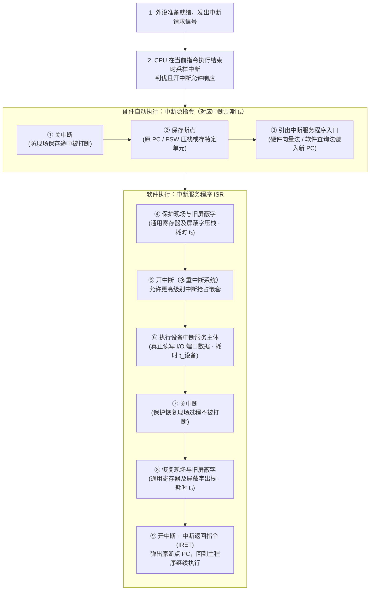
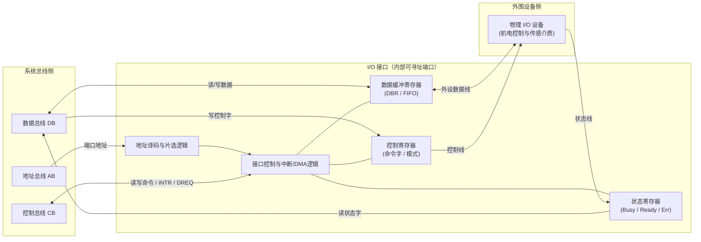
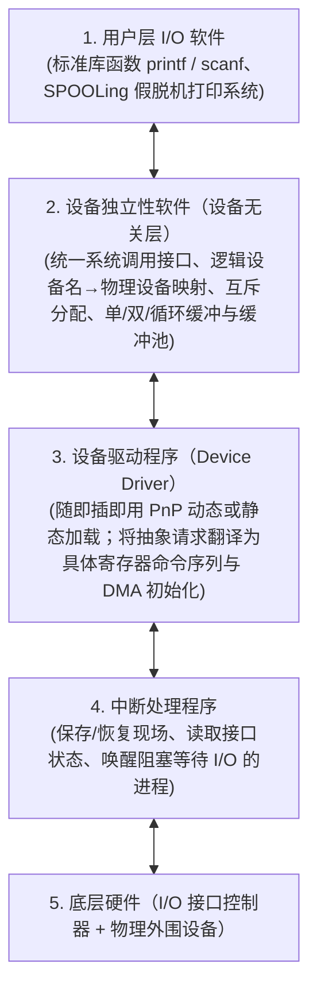
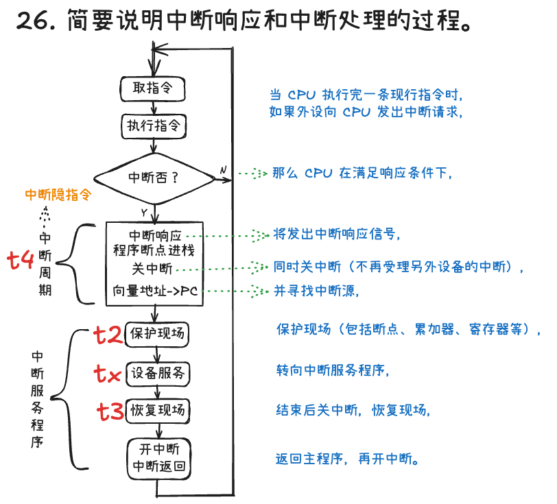

# 第8章：输入输出系统

!!! note "参考讲义"
    课堂配套课件下载：[第8章 输入输出系统 PPT](https://github.com/xurry-ace/mynotes/releases/download/pdf-assets/co-ch8-io.pdf)

输入输出系统（**I/O System**）负责协调超高速 CPU/主存与种类繁杂的低速外围设备之间可靠、高效地交换信息。本章围绕**四大 I/O 控制方式（程序查询、程序中断、DMA、通道）、I/O 接口内部结构与端口编址、I/O 软件分层以及系统性能瓶颈优化**四大主线展开，是 408 统考综合大题的常客。

---

## 8.1 I/O 系统概述与“I/O 墙”瓶颈

### 8.1.1 I/O 系统的三大组成部分

<div class="grid cards" markdown>

-   **🖨️ 1. I/O 设备（外部物理端）**

    ---

    泛指第 7 章介绍的各类输入设备（键鼠、扫描仪）、输出设备（显示器、打印机）及外存（HDD、SSD），负责信息采集、结果呈现与大容量持久化存储。

-   **🔌 2. I/O 接口（硬件控制器 / 适配器）**

    ---

    介于系统总线与外设电缆之间的专用硬件电路。

    > **翻译官类比（仅帮助理解）**：CPU 讲的是高速统一的二进制总线语言，外设讲的是五花八门的模拟/机电/串行语言，**I/O 接口就是实时双向翻译加缓冲驿站**——负责速度匹配、串并格式与电平转换、地址译码和状态汇报。

-   **💿 3. I/O 软件（管理与驱动层）**

    ---

    驻留在操作系统内核与运行时库中的控制程序（包括中断处理程序、设备驱动程序、与设备无关的管理及缓冲软件），向上层应用屏蔽繁琐的底层硬件寄存器细节。

</div>

### 8.1.2 I/O 设备的四大显著矛盾与 Amdahl 定律警示

1. **速度鸿沟悬殊**：CPU 时钟在 $\text{GHz}$（亚纳秒）级，DRAM 主存在数十纳秒级，而机械磁盘等外设在**毫秒（$\text{ms}$）级**——读一个扇区的 $10\text{ ms}$ 内，CPU 足以执行数千万条指令！
2. **数据格式各异**：键盘发扫描码、显卡吃像素矩阵、声卡要脉冲编码流，必须经接口标准化转换。
3. **控制种类繁杂**：单台计算机同时挂载数十种工作原理、位宽与速率截然不同的外设。
4. **物理可靠性较低**：外设往往含机械运动部件或暴露于外部环境，掉线、校验错、缺纸等异常频发。

!!! warning "“内存墙 / I/O 墙”与 Amdahl 定律的铁律"
    I/O 系统通常是制约整机实际体验的头号短板。根据第 1 章的 **Amdahl 定律**，哪怕把 CPU 算力提升到无穷快，只要任务中有相当比例的时间卡在磁盘读写或网络等待上，整机加速比就会被慢速 I/O 死死封顶！因此，**如何把 CPU 从漫长的 I/O 等待中解放出来**，正是下面四种控制方式一路演进的原动力。

---

## 8.2 四种 I/O 控制方式（408 核心必考）

为了解决“高速 CPU 怎样跟慢速外设打交道最划算”的问题，计算机体系结构演化出了四代控制方式：

!!! tip "四代 I/O 控制方式的直观生活类比（仅帮助理解，不可替代硬件机制）"
    - **① 程序直接控制（轮询）**：你去银行办业务却没有叫号机，只能站在窗口**每隔 5 秒问柜员一句“轮到我了吗？”**——期间你什么别的事也干不了（CPU $100\%$ 死等空转）。
    - **② 程序中断方式**：装上了手机来电提醒——你专心写代码，**只有快递员到楼下打响电话（中断请求）时才暂停工作下楼取件**，取完回来接着写（CPU 与外设并行，按字/字节通知）。
    - **③ DMA（直接内存访问）**：要搬一整屋子书，每搬一本书都打电话叫你下楼（按字节中断）还是会把你累趴下；于是你**雇了专业搬家公司（DMA 控制器）**，只交代一句“把书房 50 箱书搬到新家客厅”，搬家公司自己一趟趟直接往返主存，**整车全部搬完后再打一个电话让你验收**！
    - **④ 通道方式**：你配了一位**全能行政秘书（I/O 通道处理器）**，直接丢给秘书一份写满多步复杂流程的任务清单（通道程序），秘书自己统筹联系多家物流、核对清点，全部办妥后只向你汇报最终结果。

---

### 先看数据通路：通知 CPU 与搬运数据是两件事 { #io-path-map }

以**设备向主存输入数据**为例。中断解决“何时通知 CPU”；DMA 进一步改变“数据怎样到主存”。下面只画经典教材模型，不表示所有现代 I/O 实现的全部细节。

=== "程序中断：CPU 搬数"

    ```mermaid
    flowchart TD
        A[设备准备数据] -->|发出中断请求| B[CPU 执行中断服务程序]
        B --> C[CPU 读取接口数据寄存器]
        C --> D[CPU 把数据写入主存]
        D --> E[恢复并继续原程序]
    ```

    就绪前 CPU 可以执行其他任务；响应后，数据经 CPU 寄存器进入主存。它减少忙等，但没有把搬运工作交给 DMA 控制器。

=== "DMA：控制器组织直传"

    ```mermaid
    flowchart TD
        A[CPU 配置地址、长度、方向] --> B[DMA 控制器组织总线传送]
        B --> C[设备数据直接写入主存]
        C --> D{块传送完成吗}
        D -->|否| B
        D -->|是| E[通知 CPU 做完成处理]
    ```

    数据不必逐字经 CPU 寄存器中转，但 CPU 仍负责启动、完成处理等工作；DMA 与 CPU 还可能争用访存资源。**“不逐字搬运”不等于“CPU 完全不参与”或“从不暂停访存”。**

### 8.2.1 程序直接控制方式（Programmed I/O）

最原始的控制方式，完全由用户/内核程序中的指令显式驱动数据传输，细分为两类：

- **无条件传送**：假定外设每时每刻都处于就绪状态（如拨码开关、数码管、LED 指示灯），CPU 直接读写数据端口即可。
- **程序查询（Polling / 条件传送）**：CPU 在循环里反复读取接口的**状态寄存器**，死盯“就绪位（Ready）”，直到外设备妥一个字才读写数据寄存器：

```text
poll_loop:
    读取键盘接口 [状态寄存器]
    测试 Ready 标志位是否为 1（有按键数据？）
    若 Ready == 0  -->  跳回 poll_loop 继续原地轮询（CPU 忙等空转！）
    若 Ready == 1  -->  读取 [数据寄存器] 取走字符，结束本次 I/O
```

- **评价**：硬件极其简单、零额外控制器成本；但 **CPU 与外设彻底串行绑定，轮询忙等把宝贵算力浪费在无用功上**，仅适合单片机控制简单低速传感器或系统刚上电的自检阶段。

---

### 8.2.2 程序中断方式（Interrupt-Driven I/O · 对应教材图 8-1）

#### 1. 核心机制与中断响应时机

外设受命启动后自己慢慢准备数据，CPU 掉头去执行其他用户主程序；一旦外设准备就绪（或发生故障），立刻拉高**中断请求线（INTR）**主动呼叫 CPU。

> **关键细节**：为保证主程序指令执行的原子性，CPU **一律在当前指令执行周期的最后一个时钟拍结束时**统一采样检查中断请求线！若存在未屏蔽请求且当前处于开中断（`IF = 1`）状态，CPU 下一个周期便转入**中断响应周期**。

#### 2. 一次完整中断响应与服务全流程（复原图 8-1 · 硬件隐指令 vs 软件 ISR）

考研真题极爱追问“哪几步由硬件自动完成、哪几步由中断服务程序软件完成”——看清下面这张流程全图即可一锤定音：



#### 3. 多重中断嵌套与两类优先级

- **单重中断 vs 多重中断（中断嵌套）**：单重中断在整个 ISR 执行完返回前一直保持关中断，谁也不能打断；**多重中断**在保护完现场和屏蔽字后**提前“开中断”**，允许级别更高的紧急中断打断当前低优先级 ISR 优先执行。
- **硬件响应优先级 vs 软件处理优先级**（作业 `P290-8` 核心理论）：
  - **响应优先级**：由硬件排队器线路固定决定，解决“**同一时刻多个外设同时发请求，CPU 先受理谁**”；
  - **处理优先级**：通过各中断服务程序在开头动态改写**中断屏蔽字寄存器（Mask）**来设定，解决“**我已经进来了，允许谁中途插队打断我（`0` 允许 / `1` 屏蔽）**”——无需改动一根硬件连线即可灵活重排嵌套次序！
- **评价**：实现了 CPU 与外设并行工作、实时响应好，至今仍是**键盘、鼠标及各类控制事件通知**的基石；但每传一个字/字节都要走一遍“中断请求 $\rightarrow$ 保护现场 $\rightarrow$ 恢复现场”，用于高速磁盘块读写时开销依然不可接受。

---

### 8.2.3 DMA 方式（Direct Memory Access，直接存储器访问）

#### 1. DMA 控制器的七步批量直传流程

在主存与高速外设之间架设专用的 **DMA 控制器（DMAC，具备主设备能力）**，绕开 CPU 直接开辟“外设 $\leftrightarrow$ 主存”数据高速路：

1. **CPU 预处理（启动初始化）**：CPU 执行几条指令向 DMAC 写入**主存起始地址（AR）、传送字数计数器（WC）、设备地址及读写方向**，随后转身继续执行其他程序；
2. **外设发 DMA 请求**：外设准备好一个字/字节到接口缓冲后，向 DMAC 发 `DREQ`；
3. **DMAC 申请总线**：DMAC 向 CPU 发出总线保持/周期挪用请求（`HOLD` / `BR`）；
4. **CPU 让出总线控制权**：CPU 在当前**总线周期（存取周期）结束即可响应**（注意：**比中断响应更快！无需等整条指令执行完**），回送 `HLDA` / `BG` 释放三态总线；
5. **硬件直传一拍数据**：DMAC 接管地址、数据与读写控制线，驱动数据在主存与外设间直接完成一次读写；
6. **内部寄存器自动更新**：DMAC 硬件自动将**主存地址寄存器 $+1$、字计数器 $-1$**；若计数器未归零则释放总线，回第 2 步继续传下一个字；
7. **后处理（块结束中断）**：当一整块数据全部传完（计数器溢出归零），DMAC 向 CPU 发**一次“DMA 结束中断”**，CPU 仅在此刻短暂介入做校验收尾。

#### 2. DMA 与 CPU 共享访存总线的三种传送方式

当 DMAC 与 CPU 同时需要访问主存时，按总线让渡粒度分为三种策略：

| DMA 访存方式 | 核心机制 | 优点 | 缺点与适用场景 |
| :---: | :--- | :--- | :--- |
| **1. 停止 CPU 访存（独占突发式）** | 一旦开始传数据块，DMAC **一口气独占主存总线直到整块传完**，期间 CPU 涉及访存的操作被迫挂起（仅能靠片内 Cache 跑少量指令） | 控制简单，适合超高速成批紧迫数据块 | 整块传输期间 CPU 较长时间拿不到内存，局部闲置 |
| **2. 周期挪用（Cycle Stealing，最常考）** | 外设每凑齐一个字，DMAC 才临时**“借用 / 窃取”一个主存存取周期**传完即还；可能遇到三种情形：<br>• CPU 此时本就不访存（零冲突）<br>• CPU 正在访存（DMAC 等当前存取周期结束再挪用）<br>• **双方同拍请求访存 $\rightarrow$ DMAC 优先权高于 CPU！**（因高速外设不及时取走数据会发生数据丢失覆盖） | **兼顾 CPU 高效执行与 I/O 及时响应**，是最经典的折中方案 | 每传一字都要申请/归还一次总线周期 |
| **3. DMA 与 CPU 交替访存** | 主存工作速度远快于 CPU 时，将一个 CPU 周期硬性等分为 $C_1$（专供 DMAC 访存）和 $C_2$（专供 CPU 访存）两个分时槽 | **完全无需申请/建立/归还总线握手，零冲突零等待，速率最高** | 硬件时序逻辑最复杂，要求主存周期明显短于 CPU 周期 |

---

### 8.2.4 通道方式与四种控制方式终极对比

**I/O 通道（Channel）**是一台精简的**专用 I/O 处理器**，拥有专属于自己的**通道指令集**。CPU 只需在主存里准备好由多条通道指令（指明读/写命令、主存首址、字节计数、下一条特征位）串成的**通道程序**，发一条“启动 I/O”指令告知通道即可撒手不管；通道自行从主存逐条取通道指令控制多台控制器与海量外设（完成后发一次通道中断）。

- **三类通道结构**：**字节多路通道**（分时交叉连接大量低速字符设备）、**选择通道**（一段时间内独占服务一台高速磁盘直到传完）、**数组多路通道**（按数据块分时交叉服务多台高速设备，兼顾高带宽与高并发，大型主机主力）。
- **DMA vs 通道核心分野**：DMA 靠固定硬件计数器只能执行**单一设备、单一连续主存块**的死板搬运；而通道靠执行主存中的**通道程序**，能独立管理**多台不同外设、离散主存区域及复杂条件跳转分支**。

#### 四种 I/O 控制方式全景对比表（408 高频简答与选择核对表）

| 对比维度 | 程序查询（轮询） | 程序中断 | DMA 方式 | 通道方式 |
| :---: | :--- | :--- | :--- | :--- |
| **数据传送通路** | 外设 $\leftrightarrow$ **CPU** $\leftrightarrow$ 主存 | 外设 $\leftrightarrow$ **CPU** $\leftrightarrow$ 主存 | 外设 $\leftrightarrow$ **主存（绕开 CPU）** | 外设 $\leftrightarrow$ **主存（绕开 CPU）** |
| **单次干预粒度** | 按 **字 / 字节** 死盯 | 按 **字 / 字节** 发中断 | 按 **单个连续数据块** | 按 **通道程序（多块 / 多设备组）** |
| **CPU 介入时机** | **全程 $100\%$ 忙等参与** | 每传完 **1 个字/字节** 进一次 ISR 搬数 | 仅在数据块传输**开始（预处理）和结束（后处理中断）**时参与 | 仅在整套 I/O 任务**启动通道与最终完成中断**时参与 |
| **CPU 与外设并行度** | **完全串行（无并行）** | 并行（按字打断） | **高度并行**（仅挪用少量总线周期） | **最高度并行**（大型机级彻底解耦） |
| **异常事件处理能力** | 程序自行判断 | **能直接执行软件处理复杂故障异常** | 仅负责纯数据搬运，遇故障仍需发**中断**请 CPU 处理 | 可由通道程序自检并上报状态字 |
| **硬件成本与适用场景** | 最低；极简低速开关/传感器 | 中等；键鼠、串口及全系统异常通知 | 较高；**现代 PC 磁盘（NVMe/SATA）、高速网卡主力** | 最高；IBM 大型主机与超算海量存储系统 |

---

## 8.3 I/O 接口结构与端口编址

### 8.3.1 I/O 接口的六大职责与内部通用结构

1. **设备寻址选择**：地址译码器比对地址总线信号，确认 CPU 当前点名的是不是本接口内部端口。
2. **数据缓冲匹配**：内置数据缓冲寄存器（DBR）或小型 FIFO 队列，削平高速总线与慢速外设的速度落差。
3. **信号与格式转换**：完成**并行 $\leftrightarrow$ 串行**转换、TTL/CMOS 与外部差分电平转换及 $8\text{ bit} \leftrightarrow 32/64\text{ bit}$ 位宽拼拆。
4. **设备状态监视**：通过**状态寄存器**记录 `Busy`（忙）、`Ready`（就绪）、`Error`（故障）标志供 CPU 读取。
5. **控制命令锁存与定时**：通过**控制寄存器**接收 CPU 下发的工作模式字并向外设发出启动/复位定时脉冲。
6. **中断与 DMA 握手逻辑**：管理中断允许/屏蔽触发器，向 CPU/DMAC 递交请求信号。



> **易混术语辨析**：接口内部那几个能被 CPU 用地址直接点名读写的寄存器（数据口、状态口、控制口）称为 **I/O 端口（Port）**；而把若干个 I/O 端口加上地址译码、控制逻辑封装在一起的整块硬件电路才叫 **I/O 接口（Interface）**！

---

### 8.3.2 I/O 端口的两种编址方式对比（高频考点）

CPU 究竟把接口里的“端口寄存器”当成普通内存单元看，还是单独拎出来编号？

| 对比维度 | 统一编址（存储器映射 I/O，MMIO） | 独立编址（专设 I/O 映射，Port-Mapped I/O） |
| :---: | :--- | :--- |
| **地址空间划分** | 将 I/O 端口与主存单元**混编在同一个物理地址空间**中（划出一段特定内存地址区间分给外设寄存器） | I/O 端口拥有**完全独立于主存之外的专属 I/O 地址空间**（需单独的控制线如 $\text{M}/\overline{\text{IO}}$ 区分当前地址是找内存还是找外设） |
| **访问所用指令** | **无需专用 I/O 指令**——直接复用全部访存指令（如 `LW` / `SW`、`MOV`） | **必须使用专门的 I/O 指令**（如 x86 经典的 `IN` / `OUT` 指令） |
| **核心优势** | 指令类型与寻址方式极其丰富灵活，可直接对端口做算术逻辑操作，软硬件译码统一简洁 | **不挤占宝贵的主存地址空间**；I/O 端口地址位数短，地址译码更快；汇编代码中 `IN/OUT` 一眼就能识别出外设操作 |
| **主要短板** | 占用一部分主存物理地址空间（注意 I/O 映射区必须设为**不可被 Cache 缓存**，否则读不到最新实时外设状态！） | 专用 I/O 指令功能单一、寻址模式少，CPU 控制引脚更复杂 |
| **典型架构代表** | **MIPS、RISC-V、ARM** 等几乎所有 RISC 架构（以及现代 x86 访问 PCIe 高速显存/网卡 BAR 空间也大量混用 MMIO） | 传统 **x86 架构**（拥有独立的 16 位 $64\text{K}$ I/O 端口号空间） |

---

### 8.3.3 常见典型物理 I/O 接口速览

- **并行接口 vs 串行接口**：早期打印机 LPT 并口与 IDE 排线一次并传多位但抗干扰差、线缆短；现代 **RS-232 调试串口、SATA、USB、PCIe** 全面转向高速串行传输。
- **主流高速外设与存储接口**：**SATA**（点对点串行连接硬盘）、**SCSI / SAS**（企业级高可靠多设备服务器存储接口）、**USB**（通用热插拔即插即用外设中枢）、**Thunderbolt（雷电接口）**（单口融合 PCIe 数据通道与 DisplayPort 视频流，带宽高达 $40\text{Gbps}+$）。

---

## 8.4 I/O 软件五层体系结构

操作系统通过自顶向下严格分层的软件栈，把冰冷复杂的硬件端口包装成程序员一行 `read()` / `printf()` 就能轻松调用的抽象服务：



- **为什么必须强调“设备无关性（Device Independence）”？** 应用程序只需操作逻辑设备名或文件描述符（如 `/dev/lp0` 或标准输出流），操作系统在底层悄悄完成物理绑定——即便把惠普激光打印机换成佳能网络打印机，只需更换底层**设备驱动程序**，上层所有业务软件一行代码都不用改！

---

## 8.5 I/O 系统性能评估、优化与全栈延迟图景

### 8.5.1 三大指标、四类优化与基准测试工具

<div class="grid cards" markdown>

-   **📊 I/O 三大核心度量指标**

    ---

    1. **吞吐量（Throughput / 带宽 / IOPS）**：单位时间内完成的字节数（$\text{MB/s, GB/s}$）或随机读写次数（IOPS）。
    2. **响应时间（Response Time / 延迟）**：从应用发出请求到拿到数据的端到端耗时（含**队列排队等待 $+$ 控制器寻址 $+$ 实际传输**）。
    3. **利用率（Utilization）**：设备或通道处于繁忙工作状态的时间占比（注意排队论规律：利用率逼近 $100\%$ 时排队等待延迟会呈指数级飙升！）。

-   **🚀 软硬件协同优化与测试工具**

    ---

    - **四大优化利器**：
      1. **多级缓存（Page Cache / 磁盘 DRAM 缓存）**：吸收重复读并合并零碎写；
      2. **顺序预读（Read-ahead / Prefetching）**：利用空间局部性提前把后续扇区拉入内存；
      3. **异步非阻塞 I/O（Async I/O, 如 `io_uring`）**：发起请求后线程不挂起，可并发重叠计算与多路 I/O；
      4. **应用层批处理**：用缓冲流攒够一整块再刷盘，避免频繁单字节系统调用。
    - **主流基准测试（Benchmarking）工具**：Linux 服务器压测神器 **`fio`**、Windows 经典 **`IOmeter`** 与日常测盘工具 **`CrystalDiskMark`**、文件系统基准 **`IOzone`**。

</div>

### 8.5.2 计算机全栈存储与 I/O 访问延迟数量级（建立系统直觉）

理解为什么需要 Cache、DMA 和中断，最好的方式就是对各层硬件的真实物理延迟建立数量级直觉：

| 层次部件 | 典型访问延迟量级 | 典型容量规模 | 若把 `L1 Cache` 比作 **1 秒钟**（直观体感缩放） |
| :---: | :---: | :---: | :--- |
| **L1 Cache** | $\sim 0.5 \sim 1\text{ ns}$（亚纳秒） | 数十 $\text{KB}$ | **$1\text{ 秒}$**（伸手拿桌上的水杯） |
| **L2 / L3 Cache** | $\sim 3 \sim 15\text{ ns}$ | 数 $\text{MB} \sim$ 数十 $\text{MB}$ | **$5 \sim 20\text{ 秒}$**（起身去书架拿书） |
| **DRAM 主存** | $\sim 50 \sim 100\text{ ns}$ | 数十 $\text{GB} \sim$ 数百 $\text{GB}$ | **约 $1.5\text{ 分钟}$**（下楼去便利店） |
| **NVMe / SATA SSD** | $\sim 10 \sim 150\ \mu\text{s}$（微秒级） | 数百 $\text{GB} \sim$ 数 $\text{TB}$ | **约 $4\text{ 小时} \sim 2\text{ 天}$**（跨省快递） |
| **机械硬盘（HDD）** | $\sim 5 \sim 12\text{ ms}$（毫秒级） | 数 $\text{TB} \sim 20\text{TB}+$ | ==**整整 $3 \sim 6\text{ 个月}$！**==（跨洋海运货轮） |

---

## 本章小结

- **I/O 控制方式的四级跃迁**本质上是“用专用硬件复杂度换取 CPU 解放度”的过程：**程序查询**让 CPU 原地空转；**程序中断**利用“硬件隐指令（关中断·存断点·引入口）$+$ 软件 ISR（存现场·开中断服务·关中断复现场·返回）”实现按字异步响应与多重嵌套；**DMA** 借用总线周期在主存与高速外设间直接成块搬运；**通道**则以独立 I/O 处理器形态登峰造极。
- **I/O 接口与软件栈**共同构筑了软硬件解耦桥梁：内部由数据、状态、控制三类端口寄存器与译码控制电路构成，支持**统一编址（MMIO）**与**独立编址（`IN/OUT`）**两种寻址哲学；外部由五层 I/O 软件（用户层 $\rightarrow$ 设备无关层 $\rightarrow$ 驱动程序 $\rightarrow$ 中断处理 $\rightarrow$ 硬件）屏蔽物理差异并结合缓存、预读与异步机制榨干存储带宽。

---

## 作业题

<div class="co-question" markdown="1">

### 作业 P290-7：多设备系统中断饱和时间计算

!!! question "题目"
    在图 8.12 中，假定 CPU 取指并执行一条指令的时间为 $t_1$，保护现场需 $t_2$，恢复现场需 $t_3$，中断周期需 $t_4$，每个设备的设备服务时间为 $t_{\text{A}}, t_{\text{B}}, \cdots, t_{\text{G}}$。试计算只有设备 A，D，G 时的系统中断饱和时间。

<details class="co-answer" markdown="1">
<summary>查看答案与解析</summary>

**解析：**

**中断饱和时间**的本质是指：**CPU 完全被中断服务程序以及中断开销所占满，没有任何空闲时间去执行主程序（即不能取指并执行主程序指令）的状态**。

**1\. 单个设备的中断总开销**



当一个设备发出中断请求并被响应后，CPU 为了处理这个中断，需要付出以下 4 项时间代价：

1. **中断周期时间 $t_4$**：硬件响应中断、暂停当前程序、压入 PC 和 PSW 等。
2. **保护现场时间 $t_2$**：软件（中断服务程序开头）保存通用寄存器的值。
3. **设备服务时间 $t_{\text{设备}}$**：CPU 真正为该设备执行 I/O 操作或处理数据的时间（如 $t_{\text{A}}, t_{\text{D}}, t_{\text{G}}$）。
4. **恢复现场时间 $t_3$**：软件（中断服务程序结尾）恢复通用寄存器的值。

因此，对于任意设备 $X$，CPU 处理它的一次中断所花费的**总时间**为：

$$
T_X = t_4 + t_2 + t_X + t_3
$$

**2\. 系统中断饱和时间的物理含义**

在多设备中断系统中，饱和状态意味着：在某一段时间 $T_{\text{饱和}}$ 内，设备 A、D、G **各自恰好发出并完成了一次中断处理**，且这三个中断开销加起来**刚好把 CPU 的时间全部占满**，留给主程序取指执行的时间（$t_1$）变成了 $0$。

**3\. 公式推导与合并同类项**

将设备 A、D、G 的中断处理总时间相加，即可得到系统中断饱和时间：

$$
\begin{aligned}
T_{\text{饱和}} &= T_{\text{A}} + T_{\text{D}} + T_{\text{G}} \\
&= (t_4 + t_2 + t_{\text{A}} + t_3) + (t_4 + t_2 + t_{\text{D}} + t_3) + (t_4 + t_2 + t_{\text{G}} + t_3) \\
&= 3(t_2 + t_3 + t_4) + t_{\text{A}} + t_{\text{D}} + t_{\text{G}}
\end{aligned}
$$

!!! success "最终答案"
    只有设备 A、D、G 时的系统中断饱和时间为 **$3(t_2 + t_3 + t_4) + t_{\text{A}} + t_{\text{D}} + t_{\text{G}}$**。

</details>

</div>

<div class="co-question" markdown="1">

### 作业 P290-8：五级中断屏蔽字设置与响应处理次序

!!! question "题目"
    设某机有 5 级中断：$L_0, L_1, L_2, L_3, L_4$，其中断响应优先次序为：$L_0$ 最高，$L_1$ 次之，$L_4$ 最低。现在要求将中断处理次序改为 $L_1 \rightarrow L_3 \rightarrow L_0 \rightarrow L_4 \rightarrow L_2$，试问：  
    1\. 下表中各级中断处理程序的各中断级屏蔽值如何设置（每级对应一位，该位为“0”表示允许中断，该位为“1”表示中断屏蔽）？  
    2\. 若这 5 级中断同时都发出中断请求，按更改后的次序画出进入各级中断处理程序的过程示意图。

| 中断处理程序 | $L_0$ 级 | $L_1$ 级 | $L_2$ 级 | $L_3$ 级 | $L_4$ 级 |
| :---: | :---: | :---: | :---: | :---: | :---: |
| $L_0$ 中断处理程序 | | | | | |
| $L_1$ 中断处理程序 | | | | | |
| $L_2$ 中断处理程序 | | | | | |
| $L_3$ 中断处理程序 | | | | | |
| $L_4$ 中断处理程序 | | | | | |

!!! warning "内容待补充"
    这一节还没有整理完，后续继续补充。

</div>

## 课后自测思考题

???+ question "复习自检清单（共 10 题，学完本章试着口述作答并勾选）"
    - [ ] **1. I/O 系统组成**：I/O 系统由哪三大部分组成？I/O 接口在其中承担什么桥梁职责？
    - [ ] **2. 控制方式横评**：从数据通路、CPU 介入频率与适用设备三个维度，对比程序查询、中断、DMA 和通道方式。
    - [ ] **3. 中断全流程**：复述一次多重中断从外设请求到 `IRET` 返回的完整步骤，区分哪些是硬件“中断隐指令”做的、哪些是软件 ISR 做的。
    - [ ] **4. DMA 核心机制**：DMA 控制器如何绕开 CPU 直传主存？“周期挪用”时若 CPU 与 DMA 同拍争用主存，谁优先？为什么？
    - [ ] **5. 端口编址对比**：统一编址（MMIO）与独立编址（`IN/OUT`）有何本质区别？各自优缺点与代表指令集是什么？
    - [ ] **6. 控制方式选型**：为键盘、鼠标、NVMe 固态硬盘和万兆网卡分别挑选最匹配的 I/O 控制方式并说明理由。
    - [ ] **7. 磁盘 I/O 耗时口算**：某硬盘平均寻道时间 $8\text{ ms}$，平均旋转延迟 $3\text{ ms}$，读取 $4\text{KB}$ 数据传输时间 $0.1\text{ ms}$，求单次随机读取 $4\text{KB}$ 总耗时（核对：$8 + 3 + 0.1 = 11.1\text{ ms}$——可见机械盘超过 $99\%$ 时间花在寻道与旋转定位上！）。
    - [ ] **8. 软硬件性能优化**：从硬件架构和操作系统/应用软件两个层面，列举至少四项提升 I/O 吞吐或降低延迟的技术。
    - [ ] **9. 驱动与设备无关性**：设备驱动程序在五层 I/O 软件栈中起什么作用？操作系统引入“设备无关性”有什么工程价值？
    - [ ] **10. 前沿 I/O 趋势**：思考 PCIe 5.0 NVMe、NVMe over Fabrics（NVMe-oF）与持久内存（PMEM）等高速技术为何促使内核从传统中断转向轮询/异步 `io_uring`？
